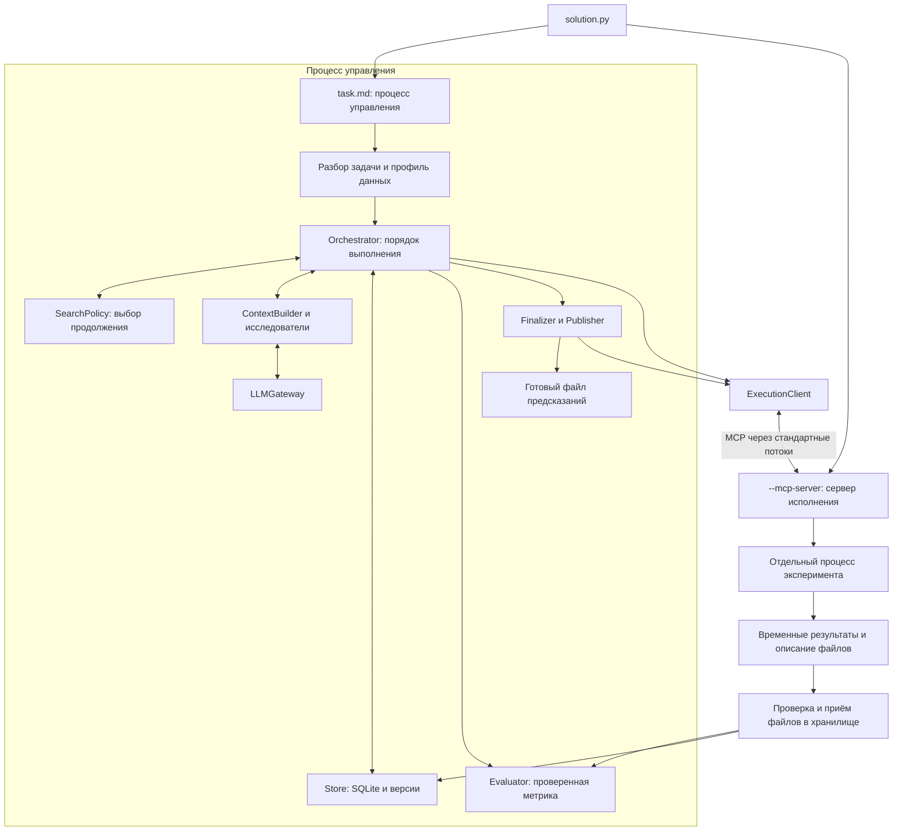
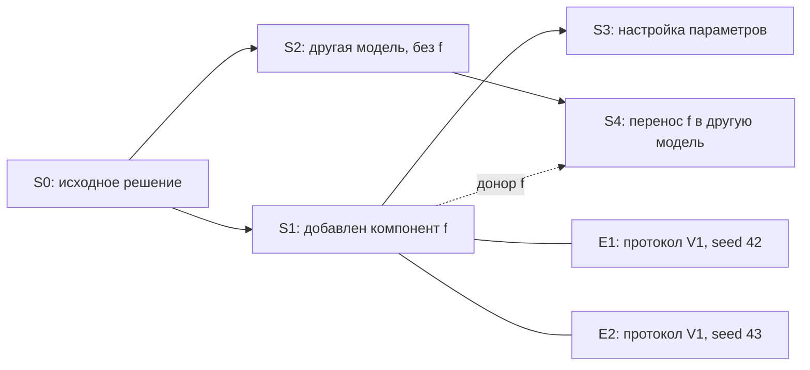

# Архитектура исследовательского AutoML-агента

Версия 0.2 · 21 октября 2026 года · проект для реализации командой.

Это архитектурное предложение, а не реализованный или проверенный на данных агент. Оно объединяет условие организаторов, их пример запуска, две схемы команды и присланные контракты C00–C24. Новые проектные решения явно отделены от требований платформы. Исходный HTML команды не изменён.

## 1. Основное решение

Одна программа внутри контейнера платформы. В ней есть управляющий процесс, локальный сервер исполнения и отдельные процессы экспериментов. Память исследования хранится в SQLite и файловом хранилище. Все изменения кода образуют граф неизменяемых версий решений.

Управляющая часть определяет порядок действий обычным кодом. Языковая модель разбирает условие, предлагает гипотезы и пишет модули кандидатов. Обучение, оценка, выбор продолжения и выпуск ответа выполняются через проверяемые контракты.

Первый прототип: регрессия с RMSE и многоклассовая классификация с Macro F1; два исследователя с разными контекстами и одно одновременно обучаемое решение. Те же интерфейсы предусматривают увеличение числа исследователей и очередь нескольких обучений. Добавление агентов не требует превращать программу в набор сетевых служб.

## 2. Требования и проектные настройки

### Подтверждено материалами организаторов

- Python 3.12; ZIP с `solution.py` в корне; модули разрешено размещать рядом.
- На одну задачу: до трёх часов, 8 CPU и 32 GB памяти. Каждая задача запускается отдельно; её история и результаты не передаются в следующий запуск.
- Условие передаётся путём к Markdown-файлу. Относительные пути разрешаются от его каталога.
- Используются предоставленная языковая модель и переменные `OPENAI_API_KEY`, `OPENAI_MODEL`, `OPENAI_BASE_URL` из примера запуска.
- Пакеты для обучения ограничены списком организаторов. Установка из интернета во время решения не предусматривается.
- Итоговый ответ — файл предсказаний. Его точный путь и формат должны определяться материалами конкретной задачи.

### Выбираем для первой реализации

- Один управляющий процесс, один сервер исполнения, максимум один процесс обучения одновременно.
- SQLite, файловые объекты с SHA-256, Pydantic для контрактов, прямой клиент предоставленной языковой модели.
- Начальные способы решения: простая постоянная модель, CatBoost для регрессии и классификации, затем линейная модель как отдельное направление.
- Одна фиксированная проверочная выборка для исследовательского поиска. Временное или групповое разделение имеет приоритет, если оно следует из задачи. Случайное разделение — только при отсутствии таких ограничений.
- Агент пишет `candidate.py` с ограниченным интерфейсом; он не управляет загрузкой исходных файлов, разбиениями, записью метрик или публикацией ответа.
- Нет обязательных HTTP-служб, отдельной графовой базы, внешнего сервера журналирования или вложенного Docker.

## 3. Процессы и их полномочия



### Процесс управления

Владеет исходным условием, исходными таблицами, ответами проверочной части, ключом доступа к языковой модели, журналом и окончательным выходным файлом. Только он меняет SQLite. Вызовы к исследователям могут быть асинхронными задачами внутри этого же процесса.

`Orchestrator` — цикл исполнения и переходы состояний. `SearchPolicy` — отдельная заменяемая стратегия выбора. `BudgetManager` — учёт времени, памяти, вычислительных потоков и вызовов модели. Эти обязанности не объединяются в один большой запрос к языковой модели.

### Сервер исполнения

Запускается тем же `solution.py --mcp-server`, как в присланном примере. Не получает ключ языковой модели и не меняет журнал. Проверяет утверждённые задания, запускает процессы экспериментов, следит за ними, сообщает события и подтверждает остановку.

Минимальные транспортные операции: `start_job`, `poll_events(after_sequence)`, `cancel_job`. `start_job` быстро возвращает идентификатор. Управляющий процесс получает события ограниченными по времени вызовами `poll_events`; каждое событие обрабатывается по смыслу C15. Прямой обратный вызов Python из серверного процесса в объект управляющего процесса не предполагается.

`MCP` здесь — способ связи процессов. Он не выбирает модели и не управляет поиском.

### Процесс эксперимента

Создаётся на одно задание. Использует тот же интерпретатор через `sys.executable`, отдельный рабочий каталог и выделенные ограничения. Получает утверждённый набор файлов и параметры. Обучает модель, получает предсказания и пишет временные результаты. После завершения его переменные не используются следующей попыткой; перенос возможен только через явно сохранённые файлы.

Сериализованная модель загружается только внутри процессов исполнения. Управляющий процесс и оценщик читают предсказания и описания файлов, а не исполняемые Python-объекты из модели.

## 4. Части программы и направления зависимости

```text
solution.py                  выбор одного из двух режимов
automl/
  domain/
    contracts.py             типы сообщений и их версии
    entities.py              задача, решение, ветвь, эксперимент, оценка
    ports.py                 интерфейсы хранилища, исполнения, часов, модели
    errors.py                коды ошибок
  application/
    runtime.py               жизненный цикл одного запуска
    orchestrator.py          цикл исследования и обработка событий
    search_policy.py         продолжить, ответвиться, вернуться, завершить
    budget.py                ограничения и запас на завершение
    finalizer.py             подготовка готового ответа
  research/
    task_interpreter.py      смысл условия → черновик TaskSpec
    context.py               ограниченный контекст конкретного поручения
    researcher.py            гипотеза и модуль кандидата
    llm_gateway.py           единый выход к предоставленной модели
    catalog.py               способы решения и доступные действия
    prompts/                 инструкции исследовательских ролей
  ml/
    task_reader.py           чтение условия и разрешение путей
    profile.py               технический профиль данных
    task_registry.py         проверка TaskSpec и выбор обработчика задачи
    validation.py            создание неизменяемых протоколов проверки
    evaluation.py            проверка предсказаний и метрика
    output.py                проверка формата и публикация файла
    adapters/                типы задач и метрики
    recipes/                 способы подготовки данных и обучения
  infrastructure/
    store.py                 единственный доступ к SQLite
    migrations/              версии структуры базы
    artifacts.py             неизменяемые файлы и контрольные суммы
    execution_client.py      управляющая сторона связи с исполнителем
    clock.py                 монотонное время и наблюдаемое время UTC
  execution/
    mcp_server.py            транспортные операции сервера
    supervisor.py            процессы, наблюдение, остановка
    worker.py                доверенный каркас fit/predict
    recipe_runtime.py        разрешённые способы вызова моделей
config/
  defaults.yaml              настройки первого прототипа
  recipes.yaml               версии способов решения и точки изменения
dev/
  Dockerfile                 воспроизведение среды при разработке
  requirements.txt           полученный список организаторов
```

Это логические границы; при реализации небольшие соседние файлы можно объединять. Они не являются отдельными службами.

Направление зависимости: предметные типы не импортируют OpenAI, MCP, SQLite или конкретные библиотеки обучения. Прикладной слой работает через интерфейсы. Конкретные реализации подключаются один раз при старте программы. Добавление другого способа хранения, транспорта или алгоритма поиска не меняет контракты задачи и решения.

## 5. Что именно хранится в графе

### Четыре разных уровня

1. **SolutionVersion** — неизменяемый код, параметры, состав компонентов и версия интерфейса кандидата. Это основной узел графа.
2. **Experiment** — запрос на проверку конкретного решения: данные, протокол, начальное значение генератора случайных чисел, объём проверки и условия исполнения.
3. **Attempt / Job** — физическая попытка исполнить этот эксперимент. Сбой и повтор не создают новую версию решения.
4. **Evaluation** — вычисленная оценщиком метрика конкретных предсказаний. Неизменяема после записи.

В исходных C09–C12 термин `experiment` включает сразу несколько этих уровней. Существующий `experiment_id` сохраняем для проверочного эксперимента, добавляем отдельный `solution_id` для узла графа.



Сплошная стрелка означает основного родителя; пунктирная — донора компонента. Связи направлены от существующих версий к новым; циклы не допускаются. Проверки связаны с версиями отдельно и не изображают происхождение кода.

### Ветвь

`Branch` содержит `branch_id`, `base_solution_id`, `active_solution_id`, `best_evaluation_id`, цель исследования, ограничения и состояние. Она не принадлежит навсегда одному агенту. Любой исследователь может получить поручение продолжить её с конкретной версии.

Откат означает создание нового продолжения от выбранного предка. Старые вершины, оценки, потраченное время и опубликованный ответ сохраняются. У ветви «без f» хранится машинно проверяемое ограничение на идентификатор компонента. Распознавание произвольного переписанного аналога f в первый прототип не входит.

### Три указателя вместо одного «лучшего»

- `active_solution_id`: откуда сейчас строится продолжение.
- `best_evaluated_experiment_id`: лучшее сопоставимо оценённое решение за весь запуск.
- `published_champion_experiment_id`: решение, для которого уже записан проверенный файл ответа.

Эти указатели могут различаться. Неудачная текущая ветвь не ухудшает опубликованный ответ. Снимок состояния команды хранит соответствие исследователей, ветвей и исходных версий до общего решения о переносе компонента.

### Компоненты и перенос

`Component` — явно выделенная часть решения: код преобразования, правило отбора признаков или способ задания весов классов. Карточка содержит идентификатор, версию, необходимые входы, зависимости, исходное решение и проверяемые ограничения применимости.

`ComponentTrial` связывает компонент, версию до изменения, версию после изменения и две сопоставимые оценки. Улучшение признаётся наблюдением в данном конвейере. Для переноса в другой конвейер создаётся отдельная проверка. Статус «полезен везде» не вводится.

## 6. Контракт кода, который пишет агент

Предлагаемый интерфейс кандидата версии 1.1:

```python
def make_pipeline(task_view: dict, params: dict, runtime: dict):
    """Вернуть объект с fit(X, y), predict(X), при необходимости predict_proba(X)."""
```

`task_view` содержит тип задачи, схему признаков, категории и требования к предсказанию. В него не входят ключ доступа, пути к журналу, исходная таблица с ответами проверки или путь итогового файла.

`params` — раскрытые параметры модели и обработки данных. `runtime` — выданные исполнителем число потоков, начальное значение генератора случайных чисел и ограничения. Эти поля агент не может переопределять через обычные параметры.

Доверенный каркас `worker.py` загружает разрешённые входы, создаёт объект через `make_pipeline`, вызывает обучение и получение предсказаний, затем записывает файлы. Способ решения задаёт разрешённые дополнительные аргументы обучения и правила сохранения модели.

В первом прототипе допускается сгенерированный Python внутри этого интерфейса. Агент может менять признаки и алгоритм, но не заменять `worker.py`, оценщик или правила публикации. Проверка синтаксиса выполняется без запуска; проверка импорта и пробное обучение — в отдельном процессе.

Для устранения двух источников правды исполняемым определением решения считаются код и переданный ему нормализованный `params`. Описания `model` и `feature_steps` — части этого же набора параметров и происхождения, а не второй независимо применяемый конвейер. Исполнитель сохраняет фактический класс модели, разрешённые параметры и версии библиотек в отчёт обучения.

Текст условия и ячейки таблиц рассматриваются как входные данные. Они не могут менять внутренние правила доступа, разрешать новые команды или переопределять оценщик.

### Ранняя остановка обучения

Ответы внешней проверочной части не передаются модулю кандидата. Если модели нужна ранняя остановка, способ решения выделяет дополнительную внутреннюю часть только из доступного ей обучающего поднабора. Найденное число итераций и другие производные параметры сохраняются как `ResolvedTrainingSpec`.

При обучении на всех данных финализатор использует этот зафиксированный план. Он не требует ответов тестовой выборки и не меняет параметры после оценки без записи происхождения.

### Граница изоляции

Разделение данных выше — обязательный контракт. Оно предотвращает штатную передачу ответов проверки в обучение. Сам по себе процесс Python с тем же пользователем не запрещает читать другие доступные файлы. Поэтому первая версия не заявляет жёсткую изоляцию произвольного недоверенного кода.

Интерфейс `ExecutionSandbox` предусматривает усиление: отдельный пользователь, ограничения файлов и системные ограничения ресурсов, если среда платформы это позволяет. Каркас, оценщик и прикладной цикл при этом не меняются. Возможности платформы необходимо выяснить до выбора конкретного механизма.

## 7. Данные, проверка и метрики

Разбор условия состоит из двух частей. `TaskInterpreter` создаёт черновик из текста и словаря данных. `TaskRegistry` проверяет его по реальным столбцам, образцу ответа и доступным обработчикам. Если все обязательные поля однозначно извлекаются обычным кодом, допустим черновик без обращения к языковой модели. Противоречивый целевой столбец, неизвестная метрика или неразрешённый путь дают явную ошибку; молчаливой подмены нет.

`TaskAdapter` определяет тип целевой переменной и форму предсказаний. `MetricAdapter` содержит реализацию метрики, направление улучшения, требования к предсказаниям, параметры и допуск для определения плато. `Recipe` задаёт построение, обучение и сохранение модели. Это три независимых реестра расширения.

В первом прототипе регистрируются RMSE и Macro F1. Формат классов сохраняется по данным, а не принудительно приводится к строкам. Порядок классов фиксируется один раз. Для Macro F1 фиксируется полный допустимый набор классов и правило обработки отсутствующих предсказаний класса.

Строкам назначается внутренний `row_key`, независимый от пользовательского идентификатора. Предсказания проверки содержат `row_key`; оценщик сопоставляет их с ожидаемыми строками и отклоняет пропуски, лишние строки, повторы или неверную форму. Итоговый файл содержит только колонки, требуемые условием.

Для первой версии доля проверки по умолчанию составляет 20%; в классификации используется сохранение пропорций классов там, где это допустимо. Временные, групповые зависимости, дубли и редкие классы проверяются до выбора разбиения. Невозможное разделение не исправляется молча случайным способом.

В `ValidationSpec` сохраняются фактические ключи строк, тип разбиения, параметры, метрика, версия оценщика и назначение протокола. Смена протокола создаёт новый идентификатор и требует повторной проверки основных кандидатов.

Сопоставимость задаётся ключом:

```text
dataset_fingerprint + task_spec_version + validation_id
+ metric_implementation_version + metric_parameters + prediction_kind + fidelity
```

`fidelity` различает предварительную проверку на ограниченном объёме и полную проверку. Слово `full` в существующих контрактах означает полный утверждённый протокол, а не обучение на всём исходном train. Последнее — отдельная операция финализации.

Повторное использование одной проверочной части может привести к подгонке поиска. Возможное расширение — заранее выделенный контрольный протокол для однократного сравнения финалистов без возврата его результатов в поиск. Первый прототип использует один исследовательский протокол; наличие этой границы не считается устранением подгонки.

## 8. Хранилище и журнал действий

### Таблицы SQLite

| Таблица | Основные записи |
|---|---|
| runs | задача, состояния, ограничения, версия конфигурации |
| tasks / validation_protocols | утверждённые условия, метрики, разбиения |
| solutions / solution_edges | код и параметры версий; основной родитель и доноры |
| branches / assignments | цели ветвей, ограничения, поручения исследователям |
| components / component_trials | версии компонентов и подтверждения переноса |
| experiments / attempts / jobs | логические проверки, физические попытки, процессы |
| evaluations | проверенные значения метрик и диагностика |
| artifacts | вид, размер, контрольная сумма и относительный путь файла |
| events / decisions | события исполнения и обоснованные решения стратегии |
| snapshots | согласованные снимки графа и состояния команды |
| publications | подготовка и фиксация готового файла |
| llm_calls | запрос, результат, расход, причина вызова; без ключей |

Таблицы заполняются по мере появления соответствующей возможности. Их не нужно обслуживать отдельными службами. Основная история хранится обычными связанными записями; полный повтор работы программы только из журнала событий не требуется.

Один писатель, короткие транзакции, внешние ключи, миграции структуры базы. Обучение и ожидание модели никогда не выполняются внутри открытой транзакции. Для локальной файловой системы можно включить WAL; он не превращает SQLite в базу с несколькими одновременно пишущими процессами.

### Файлы одного запуска

```text
work/<run_id>/
  journal.sqlite
  objects/<sha256>/...                неизменяемые файлы
  prepared_data/<validation_id>/...   подготовленные входы и ключи строк
  jobs/<job_id>/attempt-<n>/           только текущие временные файлы
  execution-events.jsonl              события сервера исполнения
  logs/                              технические журналы
```

Исходные таблицы остаются входами задачи и регистрируются с контрольными суммами; их не обязательно копировать целиком в `objects`.

### Приём результата

1. Процесс эксперимента пишет файлы в свой каталог и завершает их запись.
2. Сервер сообщает относительные пути, виды файлов и заявленные контрольные суммы.
3. Управляющий процесс проверяет принадлежность путей каталогу задания, наличие, размеры и фактические контрольные суммы. Принимает файлы в неизменяемое хранилище.
4. После этого транзакция журнала фиксирует ссылки и событие.

Оборванный приём может оставить неиспользуемый файловый объект, но не должен создавать запись об успешной оценке с отсутствующими файлами. Позже такие объекты можно удалить отдельной обслуживающей операцией.

### Три разных вида идентичности

`solution_hash` вычисляется по коду, раскрытым параметрам, версиям способов решения и интерфейса кандидата. Из него исключаются текст гипотезы, имя исследователя и пути.

`experiment_fingerprint` включает `solution_hash`, данные, протокол, начальное значение генератора случайных чисел, объём проверки и влияющие на вычисления условия среды. Поэтому один код с разными значениями генератора — одна версия решения и разные эксперименты.

`attempt_no` различает повторы физического исполнения после сбоя. Точный повтор не запускается без причины; новая попытка разрешается после подтверждения остановки предыдущей. Одинаковое начальное значение генератора само по себе не объявляется гарантией побитового совпадения.

## 9. Стратегия поиска и сборка контекста

`SearchPolicy` получает согласованный снимок графа и остаток ресурсов. Возвращает структурированное действие: `CONTINUE`, `FORK`, `BACKTRACK`, `TRANSFER_COMPONENT` или `FINALIZE`. Действие и использованные факты сохраняются в `decisions`.

Первая стратегия намеренно простая и воспроизводимая:

1. Получить технически корректный ранний ответ постоянной моделью.
2. Построить сильное стартовое решение CatBoost через тот же путь проверки.
3. Продолжать лучшую ветвь, выдавая конкретное поручение: параметры, предобработка, новые признаки или веса классов.
4. После трёх различных успешно проверенных изменений без существенного прироста искать ближайшего предка с допустимым непроверенным направлением.
5. Создать от него альтернативную ветвь. Если подходящего направления нет, выбрать другой стартовый способ решения.
6. Завершить поиск при достижении запаса времени, исчерпании бюджета модели или отсутствии допустимых продолжений.

Допуск существенного улучшения относится к определению плато. Выбор лучшего кандидата выполняется отдельно по основной метрике; небольшой действительный прирост не теряется только из-за допуска плато. Ошибки исполнения учитываются как исправления кода, а не как успешные отрицательные проверки гипотезы.

Каталог действий хранит, что именно уже проверялось: смена семейства модели, обработка пропусков, отбор признаков, новый компонент, веса классов и настройка параметров. «Непроверенный путь» определяется относительно этого каталога и ограничений ветви, а не обещает перебрать все возможные программы.

Двум исследователям диспетчер выдаёт разные поручения и атомарно резервирует одинаковые эксперименты. Один продолжает сильное решение, другой проверяет альтернативу; роли можно менять между раундами. Это два контекста одной предоставленной языковой модели, а не два постоянно работающих процесса. Число одновременных обращений к API настраивается отдельно; для начала допустим последовательный доступ. Обучения допускаются только при наличии ресурсов независимо от количества готовых предложений.

`ContextBuilder` собирает: утверждённую задачу и метрику; текущую версию кода; профиль данных; ограничения ветви; последние релевантные проверки; лучшие сопоставимые альтернативы; карточки компонентов; остаток времени; конкретное поручение. Полные CSV и весь журнал в запрос не передаются.

Каждый контекст привязан к `snapshot_id`, `store_revision`, `branch_id`, `solution_id` и `validation_id`. При ответе исследователя управляющая часть проверяет актуальность этих ссылок. Изменение только указателя на лучшее решение не делает автоматически неверной независимую альтернативу; решение о её запуске принимает текущая стратегия.

Ошибки синтаксиса и исполнения возвращаются с ограниченным фрагментом журнала. Разрешены до двух попыток исправления; они тоже расходуют время и запросы. После этого версия остаётся в истории, а поиск переключается.

## 10. Ресурсы и состояния

Время измеряется от самого начала входного файла через монотонные часы, до тяжёлых импортов. Настенные часы используются только для подписей в журнале. Конечный срок не переносится при откате или повторном запуске задания.

Первоначальные настройки: один процесс обучения, до 6 вычислительных потоков и мягкий порог 20 GiB на его дерево процессов. Для служебных частей оставляются 2 CPU и до 8 GiB; остаток фактически доступной памяти остаётся свободным запасом. Выделение проверяется по реальным ограничениям контейнера: обозначение 32 GB в условии не приравнивается автоматически к 32 GiB. Это распределение команды, не лимиты платформы для каждого процесса.

Для двух одновременных обучений настройки меняются на два задания по 3 потока и 10 GiB. Правила аренды из C13 сохраняются. Истечение срока аренды не разрешает выдать те же ресурсы новому процессу до подтверждения остановки старого.

Ограничение потоков задаётся библиотекам и окружению. Память наблюдается для всего дерева процессов. Опрос потребления — мягкая мера, способная заметить превышение с задержкой; жёсткое ограничение зависит от доступных системных средств контейнера.

Стартовая временная политика: стремиться получить ранний ответ в первые минуты; прекращать исследовательские запуски не позже 130-й минуты; завершить программу к 175-й минуте, сохраняя пять минут до предельных трёх часов. Запас на финализацию пересчитывается по наблюдаемым длительностям и может остановить поиск раньше. Если новый вариант не помещается, используется уже готовый ответ.

Перед запуском проверяется:

```text
оценённая длительность задания + запас на финализацию
+ остановка процессов + проверка и запись файла < оставшееся время
```

Бюджет запросов модели задаётся отдельно. Локальный учёт не может гарантировать соблюдение общего дневного бюджета команды, если тот же ключ одновременно используют другие машины. Стоимость в рублях не выводится из числа запросов без известных тарифов.

Состояния запуска:

```text
INITIALIZING → PREPARING → BASELINE → SEARCHING → FINALIZING
             → COMPLETED / DEGRADED / FAILED
```

`DEGRADED` означает, что поиск завершился с ограничениями или ошибкой, но корректный готовый ответ существует. `FAILED` — корректного файла нет.

Состояния попытки исполнения: `QUEUED → STARTING → RUNNING → SUCCEEDED / FAILED / TIMED_OUT / CANCELLED`. Успешное обучение ещё не означает успешную оценку. Завершённые состояния не откатываются поздним сообщением.

Дубликат события сначала распознаётся по `event_id` и подтверждается без повторного изменения. Затем для нового события проверяется актуальность попытки и номера разрешения. Это исключает повторную публикацию и возврат ресурсов из-за повторной доставки.

## 11. Ранний ответ и окончательное обучение

`Finalizer` получает ссылки на проверенный эксперимент и оценку. `Publisher` — единственная часть, меняющая итоговый путь. В первой версии они работают в процессе управления и используют один механизм записи журнала.

Постоянная стартовая модель проходит общую проверку, затем быстро обучается на всех данных и формирует первый готовый файл. Она нужна для работоспособности, а не для утверждения о хорошем качестве. Это не внешний исходный результат организаторов.

После появления сильного решения финализатор готовит новый полный ответ при наличии бюджета. Одновременно активна одна финализация. Если за это время появились ещё более сильные кандидаты, в очереди сохраняется актуальный лучший; не запускается полное переобучение каждой промежуточной версии.

Перед заменой файла проверяются точный порядок колонок, количество и порядок строк, идентификаторы, типы, отсутствие недопустимых значений, классы или вероятности. Корректность формата не выдаётся за измерение качества на скрытом тесте.

Публикация: сравнить сопоставимые оценки и текущую версию опубликованного результата; записать намерение публикации; создать и проверить временный файл в каталоге окончательного ответа; завершить его запись; заменить итоговый путь; зафиксировать контрольную сумму и новую версию публикации. При восстановлении сверить существующий файл с журналом намерений.

SQLite и файловая система не являются одной общей транзакцией. Поэтому восстановление по контрольной сумме — часть протокола, а не обещание одной атомарной операции на два хранилища.

В финальной фазе сравниваются все сопоставимые валидные решения, включая предков и остановленные ветви. Ансамбль допускается только как отдельная версия с проверкой на том же протоколе и известной стоимостью получения итогового ответа. В обязательный первый прототип он не входит.

## 12. Как используются присланные C00–C24

| Этап | Контракты | Кто выполняет |
|---|---|---|
| Старт | C00 | входной файл и Runtime |
| Задача | C01–C04 | чтение, толкование, профиль, проверка TaskSpec |
| Правила исследования | C05–C06 | протокол проверки, каталог способов и действий |
| Поручение | C07–C10 | снимок, контекст, исследователь, предоставленная модель |
| Кандидат | C11–C12 | приём кода, регистрация версии, резервирование эксперимента |
| Исполнение | C13–C15 | выделение ресурсов, запуск, события выполнения |
| Оценка | C16–C17 | независимая метрика и выбор лучшего оценённого кандидата |
| Готовый ответ | C18–C21 | финализация, полное обучение, проверка, публикация |
| Остановка | C22–C24 | запрет нового поиска, завершение, остановка процессов |

Имена `POST /v1/...` в исходном файле трактуются как обозначения операций. Отдельный HTTP-сервер не создаётся. Вызовы внутри управляющего процесса — типизированные функции; процессы обмениваются сериализуемыми сообщениями.

C23 завершает локальный процесс после проверки готового файла и остановки заданий. Никакого дополнительного запроса «отправить ответ на платформу» архитектура не предполагает.

### Предлагаемые изменения к контрактам

Это предложение новой версии реестра 0.2.0 и схем сообщений 1.1. Исходный файл остаётся версией 0.1.0. Из-за `additionalProperties: false` нельзя добавить эти поля в работающий обмен, не обновив соответствующие схемы и проверки.

| Место | Изменение | Зачем |
|---|---|---|
| Общие типы | Добавить SolutionVersion, Branch, Assignment, Component, ProducedFile, ResolvedTrainingSpec | Формализовать граф и переход между исполнением и хранением |
| C07 | Передавать branch_id; возвращать ограниченный снимок ветви и доступные альтернативы | Контекст конкретной ветви вместо только общего списка лучших |
| C08–C09 | Добавить branch_id, base_solution_id, snapshot_revision, restrictions | Связать поручение с точной версией и местными запретами |
| C09 / ExperimentPlan | Разделить основной родительский solution_id и доноров; связать план с solution_id | Не смешивать версии кода и проверки с разными seed |
| C11 | Интерфейс make_pipeline(task_view, params, runtime); версия интерфейса | Явно передавать разрешённые данные и параметры исполнения |
| C12 | Регистрировать решение по solution_hash и эксперимент по отдельному fingerprint | Повторная проверка не создаёт новую вершину решения |
| C14 / C19 | Передавать полный утверждённый RunBundle с разрешёнными файлами и параметрами | Сервер не должен читать SQLite или угадывать параметры по идентификатору |
| C15 | На транспортной границе — produced_files и training_summary; artifact_id присваивает приёмщик | Согласовать единственного писателя с файлами, созданными другим процессом |
| C19 | Явная ссылка на ResolvedTrainingSpec | Устранить неоднозначность ранней остановки и параметров полного обучения |
| TaskSpec | Сохранять тип меток; список возможностей задаётся реестром обработчиков | Не терять числовые классы и возможность новых типов задач |

`RunBundle` содержит `job_id`, назначение запуска, версию интерфейса, ссылки на код и параметры с контрольными суммами, входы по ролям, описание выходов и разрешение ресурсов. Скрытые ответы проверки в него не входят.

Дополнительные операции поиска:

| ID | Операция | Основной результат |
|---|---|---|
| C25 | graph.create_branch(base_solution_id, restrictions, reason) | Неизменяемое основание ветви и её начальное состояние |
| C26 | graph.snapshot(branch_id, revision, limits) | Согласованный снимок для контекста и стратегии |
| C27 | search.decide(snapshot_id, budget) | CONTINUE / FORK / BACKTRACK / TRANSFER_COMPONENT / FINALIZE |
| C28 | components.schedule_transfer(component_id, evidence_ids, target_branches) | Снимок до переноса и отдельные проверочные поручения |

C26 — специализированное чтение графа под существующим фасадом C07. C27 вызывается управляющим кодом, не внешним клиентом. C25 и C28 меняют состояние только через Store. У всех операций сохраняются общая оболочка сообщения, проверка версий, защита от повторного применения и нормализованные ошибки.

В присланном HTML все 50 примеров запросов и ответов проверены по вложенным JSON Schema: нарушений структуры не обнаружено. Это проверка примеров, а не доказательство выполнения правил между операциями. Новый реестр 1.1 в этом документе описан как проект; его полные JSON Schema ещё не реализованы.

## 13. Размещение, Docker и зависимости

Контейнер предоставляет платформа. Наш архив содержит код, инструкции исследовательским ролям, каталог способов решения и конфигурацию. Исходные данные, Markdown задачи, виртуальное окружение разработчика и результаты прежних задач в архив решения не включаются.

Входной файл определяет собственный каталог для импортов и ресурсов программы, а `task_root` — отдельно по аргументу задачи. Эти пути не считаются совпадающими. Рабочее пространство запуска выбирается в доступном для записи каталоге. Окончательный файл размещается по утверждённому OutputSpec.

При разработке `dev/Dockerfile` собирает проверяемое приближение к среде платформы: Python 3.12 и полученные версии библиотек. Пакеты устанавливаются при сборке, а не при запуске агента. Перенос локальной `.venv` в контейнер не используется. Без предоставленного образа организаторов нельзя утверждать полное совпадение среды.

При старте выполняется короткая проверка импортов и версий действительно используемых библиотек. Лишние библиотеки из большого списка не импортируются заранее. `LangChain` и `LangGraph` не являются обязательными зависимостями архитектуры: прикладной цикл и граф решений представлены собственными предметными объектами.

В примере организаторов импортируется пакет `mcp`, но в приложенном requirements он напрямую не указан. До проверки на платформе требуется выяснить, установлен ли он в образе и какая версия предоставляется. Решение не должно пытаться скачивать его во время проверки.

## 14. Разделение работы команды и порядок реализации

### Участник A — выполнение и интеграция

Входной файл, Runtime, Orchestrator, SearchPolicy, SQLite, процессы, очередь, ограничения ресурсов, MCP-связь, события и восстановление. Отвечает за C00, C07, C12–C15, C17, C19, C22–C28 и общие типы совместно с командой.

### Участник B — условие, контекст и исследователь

Толкование задачи, инструкции, сборка контекста, каталог доступных действий, предоставленная языковая модель, подготовка гипотез и кода. Отвечает за C01–C02, C06, C08–C10 и содержимое исследовательских поручений.

### Участник C — данные, обучение и ответ

Профиль, обработчики задач и метрик, способы обучения, интерфейс кандидата, протоколы проверки, независимая оценка, приём файлов, проверка и публикация ответа. Отвечает за C03–C05, C11, C16, C18, C20–C21. Файловый приёмник реализуется здесь, но запись его метаданных выполняется через Store участника A.

### Последовательность сборки

1. **Сквозной запуск без языковой модели.** TaskSpec из тестовой заготовки, постоянная модель, общий протокол, отдельный процесс, метрика, обучение на всех данных, корректный выходной файл. Работают C00–C05 и C12–C24.
2. **Исследовательский цикл.** Разбор реального Markdown, CatBoost, вызов предоставленной модели, сгенерированный модуль, новая версия решения, независимая оценка, сохранение лучшего.
3. **Настоящий обход графа.** Два исследователя с разными поручениями, очередь одного обучения, обнаружение плато, ответвление от предка, ветвь с ограничением, сохранение прежнего лучшего ответа.
4. **Развитие.** Перенос компонента с парными проверками, увеличение числа исследователей, несколько одновременных обучений после измерения ресурсов, проверяемые ансамбли.

Этапы 1–3 образуют первый рабочий прототип. Число исследователей, смена стратегии обхода и дополнительные способы обучения расширяются через уже предусмотренные интерфейсы.

### Проверки готовности

- Один и тот же архив решает обе публичные задачи без ручного изменения названий целевой переменной, колонок и метрики.
- Результат появляется рано и остаётся корректным после ошибки модели, сбоя обучения и остановки более позднего эксперимента.
- Точная копия предложения не вызывает два обучения; повторное событие не меняет состояние второй раз.
- Старая попытка после повторного запуска не может записать новую оценку или освободить ресурсы текущей попытки.
- Разные протоколы проверки не участвуют в одном прямом сравнении.
- Возврат к предку создаёт новое продолжение, сохраняет прежние оценки и не изменяет лучший готовый файл.
- Более слабая поздняя финализация не заменяет сильный опубликованный результат.
- При смене протокола основные претенденты переоцениваются, а произвольное число из текста агента не становится метрикой.
- Перед штатным завершением нет действующих обучающих процессов; итоговый файл соответствует записи публикации.

## 15. Что требует внешней проверки до отправки

1. Реальный `task.md`: точное имя и расположение выходного файла, используемые относительные пути и обязательные переменные окружения.
2. Образ платформы: наличие и версия `mcp`, доступный для записи каталог, пользователь процесса и возможность ограничивать доступ исполняемого кода к файлам.
3. Разрешённый маршрут к предоставленной языковой модели при общем запрете интернета; пределы запросов и допустимые параметры совместимого API.

Эти неизвестные не меняют разделение частей программы. Они определяют конкретную настройку адаптеров запуска и проверки среды. Архитектурный проект не выдаёт их за уже подтверждённые свойства платформы.

## Источники

- Условие «Альфа Хак_AutoML», страницы 6–10 и приложения на страницах 16–19.
- Присланные организаторами пример запуска и список библиотек.
- Две схемы команды и `automl-architecture.html` с реестром C00–C24, версия 0.1.0.
- [Python 3.12: управление дочерними процессами](https://docs.python.org/3.12/library/subprocess.html) — запуск, окружение и ожидание процессов.
- [SQLite: режим WAL](https://www.sqlite.org/wal.html) — свойства локального журнала и ограничение на одновременную запись.
- [Python 3.12: виртуальные окружения](https://docs.python.org/3.12/library/venv.html) — окружение создаётся в целевой среде и обычно не переносится копированием.
