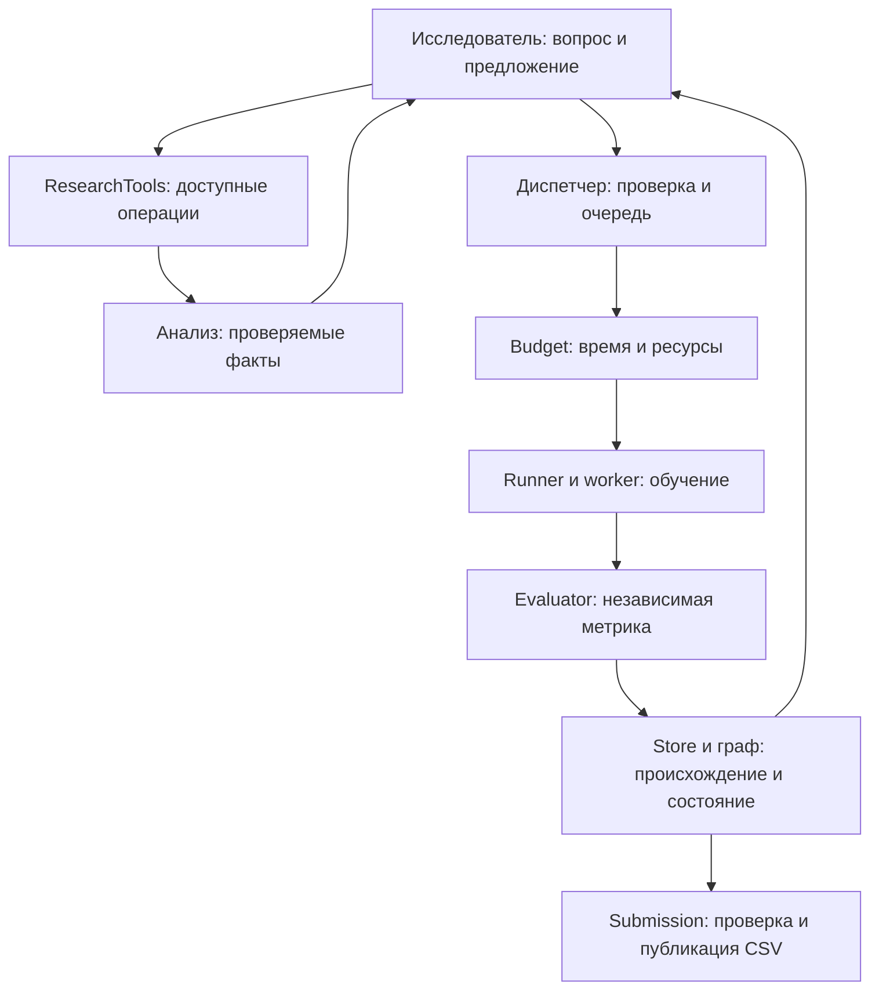

# Ревизия архитектуры: решения, данные и полномочия

Этот документ объясняет причины архитектурных изменений. Практическое руководство
по работе с системой находится в [PROJECT_GUIDE.md](PROJECT_GUIDE.md).

## Что именно сравнивалось

За исходную основную ветку принят `63fd5aa`. Перед началом правок также проверена
существующая работа `406ee5d` — `Add adaptive research actions, analysis and custom
pipelines`. Она продолжает `63fd5aa`, поэтому использована как часть решения, а не
переписана заново. Ниже отдельно отмечены ограничения основной ветки, уже сделанные
исправления `406ee5d` и дополнительные исправления этой ревизии.

Отчёт опирается на исполняемый код. Старые изображения и описания сами по себе не
считались доказательством поведения. Ссылки ведут на действующие модули; поведение
исходной основной ветки можно сравнить в [снимке `63fd5aa`](https://github.com/ExpertDaniil/stepan/tree/63fd5aa).

При последующем согласовании также включены изменения команды `adc9a88`–`a7c8bdf` из
`feat/open-research-loop`. В итоговом `adaptive` клиентские ограничения входного контекста
отключены, а последний ход диалога выделен под явное решение. Нормализация повторных запросов
и строгий разбор ответа находятся в [protocol.py](../agent/llm/protocol.py). Необязательные
`research_notes` сохраняют выраженные вопросы и отложенные варианты; диспетчер строит
[проекцию памяти](../agent/research_memory.py) из неизменяемых решений и проверенных оценок
без новой таблицы и отдельного координатора. Свободные слова модели не закрывают идеи и
не устанавливают запреты семейств. Текстовая библиотека [KNOWLEDGE.md](KNOWLEDGE.md) дополняет
локальные оригинальные тетради, а не заменяет их. Ниже сохраняется разбор причин исходного
состояния; итоговое поведение и ограничения описаны в [руководстве](PROJECT_GUIDE.md).

## Результат проверки предположения

Проблема чрезмерного предварительного ограничения исследования существовала, но
не сводилась к классу `Orchestrator`. В основной ветке ограничения складывались из
отбора рецептов в `Catalog` и `ContextBuilder`, подсказок с обязательным числом
изменений, автоматической политики переноса признаков и фиксации переключателей
на завершающей стадии. Сам `Orchestrator` при этом не выбирал целевой столбец и
способ проверки: это делал `TaskInterpreter` через языковую модель до поиска.

Ветка `406ee5d` уже устранила значительную часть ограничений: ввела явные действия
исследователя, собственные обучаемые конвейеры и дополнительный анализ. Поэтому
утверждать, что актуальная система всегда даёт модели только готовый рецепт,
было бы неверно. Однако её анализ всё ещё зависел от одной постоянной выборки,
подготовка задачи не позволяла восстановить полную схему, а права исполнения и
инструменты имели несколько неправильных границ. Именно эти места исправляет
настоящая ревизия.

## Кто принимает решения: весь путь задачи

Под «протоколом проверки» здесь понимаются замороженные обучающие и проверочные
строки, метрика и правило разделения. Под «версией» — зафиксированный код,
параметры и происхождение решения; обучение этой версии создаёт измеренный опыт.

| Переход | Владелец решения и основания | Полномочия и ограничения | Код |
|---|---|---|---|
| Условие → входные файлы | Читатель условия ищет файлы текущей задачи | Разрешает пути; не выбирает модель и не читает соседние задачи ради дополнительных данных | [tools/files.py](../tools/files.py) |
| Файлы → технические факты | Средство профилирования читает схему, типы и пропуски | Полный профиль сохраняется отдельно; краткий ответ ограничен по размеру | [tools/data.py](../tools/data.py) |
| Условие и схема → смысл задачи | `TaskInterpreter` запрашивает у модели целевой столбец, тип задачи, метрику и формат ответа | Это семантическое предложение, а не вычисленная оценка качества; доступен запрос страниц полной схемы без значений строк | [agent/task_interpreter.py](../agent/task_interpreter.py), [SchemaInspection](../agent/research_tools.py) |
| Предложение → проверенная спецификация | `resolve_spec` сверяет существование столбцов, метрику, классы и выходную схему | Отклоняет технические противоречия; не доказывает правильность понимания естественного языка | [agent/task.py](../agent/task.py) |
| Задача → протокол проверки | Модель предлагает разделение; `Evaluator` создаёт строки и идентификатор протокола | Разделение создаётся до исследования. Проверочные ответы исследователям не выдаются | [agent/evaluation.py](../agent/evaluation.py) |
| Готовая спецификация → первый ответ | Контроллер запускает стандартную базовую модель и полное итоговое обучение | Первый CSV должен пройти проверку выходного формата и публикацию; предположение не подменяет готовый файл | [agent/orchestrator.py](../agent/orchestrator.py), [agent/graph/controller.py](../agent/graph/controller.py) |
| Состояние → поручение и контекст | Граф фиксирует собственную базу исследователя, родителей, разрешённую историю и бюджет | Определяет происхождение и видимость; в `adaptive` подсказка направления не ограничивает семейство или число совместных изменений | [agent/graph/context.py](../agent/graph/context.py), [agent/context.py](../agent/context.py) |
| Неизвестный факт → проверяемая сводка | Исследователь вызывает `analyze_data` | Ограниченные запросы к обучающей части и признакам теста; без произвольного доступа к файлам, SQL и проверочным ответам | [tools/analysis.py](../tools/analysis.py), [agent/research_tools.py](../agent/research_tools.py) |
| Факты → предложение | Исследователь выбирает рецепт, собственный конвейер, ограниченную настройку или завершение | Ссылается на доступные измеренные результаты и отчёты; не поставляет авторитетную метрику | [agent/researcher.py](../agent/researcher.py), [agent/research_actions.py](../agent/research_actions.py) |
| Предложение → зарегистрированный опыт | Диспетчер проверяет схему, источник кода, ограничения ветви и повтор конфигурации | Создаёт происхождение версии; отказ или ошибка не превращаются в успешное измерение | [GraphService.submit_proposal](../agent/graph/service.py), [agent/graph/constructor.py](../agent/graph/constructor.py), [agent/store.py](../agent/store.py) |
| Зарегистрированный опыт → процесс | `Budget` допускает работу по прогнозу, `Runner` проверяет выданное разрешение на ресурсы и запускает процесс | Процесс получает конкретные потоки, память и срок; исследователь не может расширить разрешение в JSON | [agent/budget.py](../agent/budget.py), [agent/runner.py](../agent/runner.py) |
| Код → предсказания | `worker` строит и обучает переданный конвейер | Преобразования обучаются на обучающей части; процесс не объявляет собственный результат лучшим | [agent/worker.py](../agent/worker.py), [agent/ml.py](../agent/ml.py) |
| Предсказания → оценка | Независимый `Evaluator` читает истинные проверочные ответы и вычисляет метрику | Проверяет строки, форму, конечность значений и сопоставимость протокола | [agent/evaluation.py](../agent/evaluation.py) |
| Оценка → история и собственная база | `Store` и граф фиксируют результат и обновляют допустимую базу | Лучшее определяется сопоставимыми измерениями; неуспешные опыты остаются в истории | [agent/store.py](../agent/store.py), [GraphService.commit_evaluation](../agent/graph/service.py) |
| История → продолжение поиска | Языковая модель выбирает исследовательское действие; политика управляет фазой и намеренными ветвями | В `adaptive` обычный успех преобразования не делает его обязательным для всех потомков | [agent/search_policy.py](../agent/search_policy.py), [agent/graph/refinement.py](../agent/graph/refinement.py) |
| Лучшее измеренное решение → CSV | Контроллер организует полное обучение; `Submission` проверяет и публикует кандидат | Прежний проверенный CSV сохраняется до готовности и проверки лучшего | [agent/orchestrator.py](../agent/orchestrator.py), [agent/submission.py](../agent/submission.py) |

## Подтверждённые причины и внесённые исправления

### 1. Стратегия поиска была распределена между несколькими обязательными фильтрами

В `63fd5aa` [`Catalog.assignment_recipes`](../agent/catalog.py) оставлял для
доработки семейство собственной базы, а [`ContextBuilder.build_graph`](../agent/context.py)
для альтернативного направления сокращал меню до одного наименее наблюдавшегося
рецепта. Текст поручения дополнительно требовал менять не более двух параметров.
Политика [SearchPolicy](../agent/search_policy.py) могла превращать подтверждённый
перенос признака в дерево принятия/отклонения с обязательными ограничениями.
Это были реальные ограничения доступного пространства, даже если сам контроллер
не анализировал распределения данных.

**Последствие:** исследователь не мог свободно предложить совместное изменение
модели, признаков и обработки, а эмпирически удачное преобразование становилось
обязательным вне первоначальной проверки.

**Исправление уже в `406ee5d`:** режим `adaptive` даёт `ResearchAction-v1` с
действиями `catalog`, `pipeline`, `tune`, `stop`. Подсказки доработки и исследования
альтернатив не сужают каталог. Совместные изменения разрешены. Автоматическое
разветвление по эмпирическому признаку отключено в этом режиме; намеренно созданная
контролируемая ветвь по-прежнему проверяет свои явные условия. Каталожный и прежний
кодовый режимы сохранены для совместимости, поэтому старые ветви кода существуют
осознанно. См. [правила действий](../agent/research_actions.py),
[контекст](../agent/context.py), [политику](../agent/search_policy.py).

### 2. Дополнительный анализ всё ещё воспроизводил одну первоначальную картину

В `406ee5d` конструктор [AnalysisService](../tools/analysis.py) один раз оставлял
случайные 20 000 строк. Все последующие запросы изучали только их. Защищённая
сводка показывала первые 128 столбцов; запрос полного перечня отсутствовал.

**Последствие:** редкая группа, выпавшая из первоначальной выборки, оставалась
недоступной для перепроверки. Название столбца за пределами сводки исследователь
должен был знать заранее. Повторный вызов инструмента не устранял этот предел.

**Исправление этой ревизии:** страницы `kind="schema"` раскрывают полную схему.
Запросы читают только выбранные столбцы порциями, исключают проверочные строки,
применяют точный фильтр по признаку и лишь затем выбирают до 20 000 строк.
`matched_fit_rows` и `matched_test_rows` показывают число совпадений до выборки;
`analyzed_rows` и `analyzed_test_rows` — объём реально изученных данных.
Редкую категорию можно проверить самостоятельным запросом, не передавая модели
целую таблицу. Запросы ограничены временем и объёмом ответа; новая схема
согласована с [контрактом](../contracts/contracts.schema.json) и
[инструкцией исследователя](../prompts/researcher-adaptive.md).

Отдельно исправлены ошибки того же средства: булевы значения больше не передаются
в числовой расчёт квантилей; несовместимое сравнение выдаёт предметную ошибку;
история и сохранённые ответы возвращаются копиями. Проверка JSON использует
существующий валидатор контрактов вместо второго набора правил типов.

### 3. Подготовка задачи не могла восстановить отброшенную схему

Даже после появления анализа `TaskInterpreter` получал только сокращённый ответ
профилирования. Средство анализа создавалось позже — после выбора целевого
столбца и протокола. Прочитать недостающую часть схемы на стадии первоначального
понимания было невозможно.

**Исправление:** [SchemaInspection](../agent/research_tools.py) читает полный
сохранённый профиль и выдаёт страницы имён, типов и долей пропусков. Он
подключается в [runtime.bootstrap](../agent/runtime.py) до C02/C05. Строки и
целевые значения при этом не выдаются. Первоначальный выбор остаётся предложением
модели, а техническую непротиворечивость проверяют `resolve_spec` и `Evaluator`.

### 4. Правило проверки было заморожено, но его мотив не доходил до исследователя

Идентификатор и хеш протокола передавались в контекст, а правило, причина и
размеры частей оставались внутри оценщика. Это затрудняло содержательную оценку
предположения, например о переносе модели на будущие периоды.

**Исправление:** публичный
[`Evaluator.describe_protocol`](../agent/evaluation.py) отдаёт копию предложения,
причину, размеры и хеш. [ContextBuilder](../agent/context.py) включает её в
контекст. Индексы и проверочные ответы через этот метод не раскрываются.
Произвольная смена разделения посреди поиска не добавлялась: оценки другого
протокола нельзя молча сравнивать с уже измеренными.

### 5. Сборка средств исследования и расчёт сроков зависели от чужого представления

В `406ee5d` `Orchestrator` создавал сервис анализа и записывал его в атрибут
`researcher.gateway.analysis`. Сам Gateway знал предметные инструменты и их
обработчики. Для расчёта фазового срока он восстанавливал план из компактной
записи результата и имени рецепта. Собственное решение `python-pipeline-v1`
не является именем рецепта в статическом `recipes/catalog.json`, поэтому этот
путь не мог корректно восстановить его стоимость.

**Исправление:** [runtime](../agent/runtime.py) собирает сервисы и явно подключает
их через [ResearchTools](../agent/research_tools.py). [Gateway](../agent/llm/gateway.py)
отвечает за API, повтор запроса, проверку формы и доставку вызовов инструментов,
не выбирая собственный способ анализа таблиц. Диспетчер передаёт фактический
`response_cost_plan` измеренной базы. [`Budget.response_deadline`](../agent/budget.py)
применяет прогноз и запас; Gateway больше не ищет рецепт по сокращённой записи.
Это устраняет зависимость временного допуска от представления API-ответа и
отдельную ошибку с собственным идентификатором конвейера.

### 6. Ошибка получения предложения смешивалась с добровольным завершением

В [research_batch](../agent/graph/controller.py) после исключения создавалось
внутреннее предложение `stop`. В режиме `adaptive` оно обрабатывалось как
осознанное решение исследователя и прекращало работу вместо допустимой замены.

**Исправление:** отказ исследователя и ошибка доставки различаются. Настоящий
`stop` соблюдается; исключение оставляет запись об ошибке и допускает проверенный
каталожный запасной путь при наличии времени. Ошибка не превращается в измеренную
метрику или в выдуманное объяснение модели.

### 7. Разрешение на ресурсы проверялось не полностью

`Runner._start` проверял идентификатор разрешения и защитный номер поколения,
но не сверял владельца, фазу и переданные лимиты с сохранённым разрешением.
Это нарушение границы между допуском работы и её запуском, даже если обычный
контроллер передавал правильный объект.

**Исправление:** [Runner](../agent/runner.py) до запуска сверяет владельца,
`train`/`refit`, процессоры, память и срок, затем использует копию выданного
разрешения. Проверки не перекладываются на сформированный исследователем JSON.

### 8. Пользовательский код мог исполняться после завершения ограниченного участка

В `406ee5d` сохранение модели через `joblib` вызывалось после выключения
ограничителя ввода-вывода. Это сохранение может вызвать определённые самим
конвейером `__reduce__`/`__getstate__`. Аналогично отложенное преобразование
элементов предсказания могло исполнять их методы во время доверенной записи CSV.
Конструктору также передавался изменяемый общий объект спецификации задачи.

**Исправление:** [worker](../agent/worker.py) преобразует предсказания в простые
числа или строки внутри ограниченного участка, передаёт копию спецификации и
не сохраняет сериализованную модель для генерируемого кода. Исходник, параметры,
протокол и результаты остаются для восстановления и повторного обучения.
Стандартные каталожные модели сохраняются по прежним ограничениям размера.

### 9. Граница ввода-вывода зависела от имени потока и расположения Python

В [PipelineGuard](../tools/runtime_guard.py) привилегия служебного наблюдателя
определялась строкой `worker-watchdog`, которую может присвоить себе другой поток.
При этом каталог библиотек виртуального окружения не всегда находился под
`sys.base_prefix`, что приводило к отказам разрешённых импортов.

**Исправление:** разрешение привязано к конкретному доверенному объекту потока.
Пути `purelib`/`platlib` определяются до включения ограничителя. Произвольные
элементы `sys.path` не объявляются доверенными.

### 10. Ошибка запуска окончательного обучения оставляла неиспользованное разрешение

После получения ресурсов неудачный запуск процесса итогового обучения мог
оставить разрешение занятым до последующей общей уборки. Это отдельная ошибка
жизненного цикла, а не исследовательской стратегии.

**Исправление:** [Orchestrator._finalize_best](../agent/orchestrator.py) освобождает
разрешение, если процесс вообще не был зарегистрирован. Уже зарегистрированную
работу останавливает обычная процедура уборки. Опубликованный CSV не заменяется
неполным кандидатом.

### 11. Завершающая фаза незаметно сохраняла прежний запрет смены подхода

В `406ee5d` контекст `adaptive` разрешал пересматривать модель и признаки,
а `LocalSearch.refining` снимал прежнюю фиксацию переключателей. Однако
[`GraphService.submit_proposal`](../agent/graph/service.py) независимо от режима
отклонял смену семейства и эмпирических признаков после G15. Обещание контекста
расходилось с реальным допуском. Это подтверждённый случай обязательного
центрального выбора направления, сохранившийся после расширения исследователя.

**Исправление:** прежняя фиксация семейства и переключателей применяется только
к совместимым режимам `catalog`/`code`. В `adaptive` измеренное лучшее решение
задаёт исходную базу, но не запрет изменения конвейера. При этом явно созданные
условия контролируемой ветви по-прежнему проверяются через I01. Общий бюджет,
происхождение, независимая метрика и требования к коду не ослабляются.

## Итоговые границы ответственности

Минимальное исправление не создаёт дополнительного универсального оркестратора
или новой системы гипотез. Сохраняются имеющиеся контракты, процессы и граф.

Стрелки обозначают передачу запроса или результата. Исследователь выбирает смысл
опыта; анализ поставляет факты; допуск не вычисляет качество. Оценщик проверяет
предсказания независимо от описания гипотезы. Граф фиксирует результат и
происхождение, а публикация заменяет итоговый файл только после проверки.

Сборка зависимостей находится в `runtime`, а не внутри API-транспорта. Остаются
внутренние зависимости графа от диспетчера и SQLite; они не объявляются полностью
устранёнными. Эта ревизия исправляет подтверждённые нарушения границ, а не
переименовывает старые модули в новую иерархию.

## Какие ограничения обязательны, а какие выбраны реализацией

| Ограничение | Основание и текущая реализация |
|---|---|
| Данные только текущей задачи, без загрузки внешних моделей и установки пакетов во время запуска | Условия поставки и воспроизводимости; [поиск входов](../tools/files.py), [проверка кода](../tools/code.py), [официальные зависимости](../requirements.organizers.txt) |
| Полное время не больше трёх часов | Жёсткая верхняя граница `TIME_BUDGET_SECONDS`; [Config](../agent/config.py), [Budget](../agent/budget.py) |
| Общие пределы процессоров и памяти | Учёт ресурсов и ограничения процессов; распределение не более трёх потоков на одно обучение — конкретная политика текущего каркаса, а не исследовательский вывод; [Budget](../agent/budget.py), [Runner](../agent/runner.py), [worker](../agent/worker.py) |
| Независимая метрика на одинаковом разделении | Необходимость сопоставимости оценок; [Evaluator](../agent/evaluation.py), [comparable](../agent/store.py) |
| Плоская поставка с читаемыми модулями и точным requirements.txt | Платформенная поставка; [package_solution.py](../scripts/package_solution.py), [AGENTS.md](../AGENTS.md) |
| Предварительно заданные семейства и диапазоны | Возможности каталога, не предел допустимого исследования; собственный конвейер доступен в `adaptive` |
| Одна первоначальная выборка, первые 128 известных столбцов | Случайные прежние ограничения доступа; устранены страницами схемы и запросом фильтра перед выборкой |
| Автоматическая серия после любого предложения | Прежняя политика; в `adaptive` серия настройки требует явного `tune` с осями, числом запусков и временем |
| Остановка после 12 обучений | Устаревший параметр совместимости, не условие остановки; [Config](../agent/config.py), [контроллер](../agent/graph/controller.py) |
| Разделение времени на поиск и доводку | Настраиваемая политика проекта, а не доказанная оптимальная пропорция; [RefinementPolicy](../agent/graph/refinement.py) |
| 20 000 анализируемых строк, 12 столбцов и 120 секунд на запрос | Ресурсная ёмкость средства анализа, не статистическая гарантия; [AnalysisService](../tools/analysis.py) |

Оценка длительности по истории семейства, влияние параметров на стоимость и запас
на окончательное обучение сохранены в [DurationModel](../agent/duration.py) и
[Budget](../agent/budget.py). Серия по-прежнему представляет несколько связанных
запусков. Ошибка прогноза не даёт права превысить общий срок работы процесса.

## Проверяемое поведение и пределы вывода

Проверки этого этапа находятся в следующих файлах; итоговые результаты полного
запуска проверок фиксируются отдельно при завершении работы:

- [test_analysis_access.py](../tests/test_analysis_access.py): редкая группа после
  фильтра, отсутствие проверочных ответов, страницы схемы, ограниченная выборка,
  независимые копии, одновременные запросы, завершение чтения по времени.
- [test_architecture_flow.py](../tests/test_architecture_flow.py): полная схема без
  значений строк, публичное описание протокола, путь от дополнительного факта до
  настоящего обучения и публикации на искусственной задаче.
- [test_execution_boundaries.py](../tests/test_execution_boundaries.py): границы
  разрешения на ресурсы, преобразование предсказаний, изменяемая спецификация,
  сериализация пользовательской модели, права потока, отказ запуска итогового
  обучения и сохранность ранее опубликованного ответа.
- [test_adaptive_research.py](../tests/test_adaptive_research.py): действия
  исследователя, собственные классификатор и регрессор, граф и восстановление.
- [test_adaptive_refinement.py](../tests/test_adaptive_refinement.py): изменение
  семейства и эмпирических признаков после G15 в `adaptive`, прежние отказы в
  каталожном режиме и сохранение явно заданных условий контролируемой ветви.
- [scripts/check.py](../scripts/check.py): общая проверка проекта, контрактов,
  процессов и платформенной поставки.

Ответы API в искусственных сценариях имитируются; обучение, метрика и CSV
выполняются настоящим кодом. Эти проверки подтверждают устройство и обработку
ошибок, но не улучшение метрики соревнования и не качество решений живой модели.

## Оставшиеся ограничения и долг

1. **Семантика первоначального выбора не доказана.** Доступ к полной схеме
   помогает модели проверить названия, но не доказывает правильность прочтения
   условия или выбора временного/группового разделения. Публичная причина теперь
   видна. Смена протокола с отдельной историей сопоставимости не реализована.
2. **Повторное использование одной проверочной части.** Независимый расчёт
   метрики не устраняет риск подгонки исследования под многократные оценки.
   Отдельное скрытое контрольное разделение и сравнение политик поиска требуют
   самостоятельного экспериментального исследования.
3. **Ограничения Python не являются изоляцией операционной системы.** Проверка
   синтаксиса и контроль ввода-вывода закрывают перечисленные пути, но не доказывают
   безопасность произвольного Python и всех расширений на машинном коде.
   Загрузка некоторых штатных библиотек собственным конвейером может быть
   отклонена ограничителем. Сохранение сериализованной пользовательской модели
   отключено; доступно восстановление из закреплённого кода и параметров.
4. **Чтение анализа прерывается между порциями.** Это не жёсткое прерывание
   отдельного чтения CSV или расчёта сводки. Ограничено число удерживаемых строк,
   но очень большие отдельные ячейки всё равно влияют на память. Полный профиль
   на подготовительной стадии также читает таблицы целиком.
5. **Прогноз времени приблизителен.** История семейства и параметры лучше
   постоянного лимита числа запусков, но не гарантируют точную длительность
   нового собственного конвейера или другого набора данных.
6. **Граф остаётся крупной внутренней подсистемой.** Идентичность версий,
   поручения, ограничения и запись событий пересекаются в сервисах графа.
   Перестройка всей структуры без конкретного нарушения поведения в этот этап
   не включена. Подтверждённые результаты и недавние исправления происхождения
   сохраняются.
7. **Дополнительные направления самостоятельны.** Полнота исходных тетрадей
   Kaggle/MLE-bench, полезность новых форм представления графа и удобство обычного
   вывода не считаются завершёнными только благодаря архитектурной ревизии.
