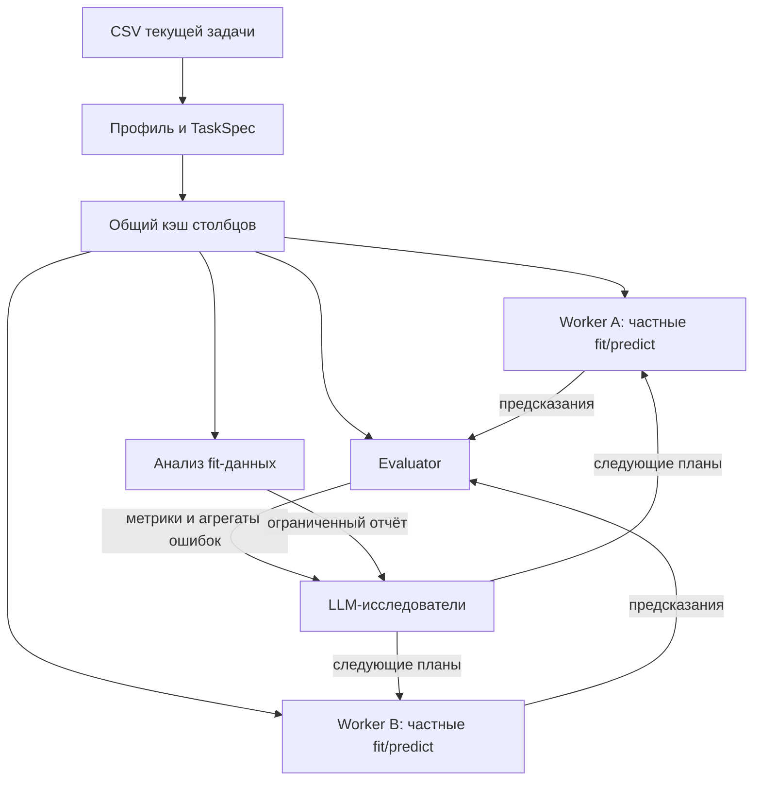

# Передача входных данных — 23 октября 2026

Продолжение `feat/final-data-research` после `a2588d4`.
Ускорение включено автоматически, переменные окружения менять не требуется.

## Что тормозило

Полные таблицы уже не передавались в LLM/JSON: API получает ограниченные сводки,
планы и ссылки на артефакты. Основная повторная работа находилась в локальном data
plane: каждый train заново разбирал весь CSV, создавал полный train с target, затем
ещё несколько копий fit/validation. Evaluator после каждого эксперимента снова
разбирал train. Анализ потоково читал выбранные столбцы CSV для каждого нового
запроса. Refit и проверка output читали весь test дополнительно ради ID.
C03 также одновременно удерживал train и test, хотя использовал только сводки.

## Реализация

`agent/data_transport.py` создаёт кэш в `runs/<run_id>/data-cache/` из уже
зарегистрированных входов. Числа хранятся с исходным dtype в `.npy`, строковые и
nullable boolean значения — как обратимый словарь JSON и массив индексов.
Пустая ячейка остаётся пропуском, буквальные NA/NULL — значениями. Это транспортное
кодирование: модель получает исходные строки, а не общие для fit/holdout коды,
частоты или статистики. Классификационная цель читается как текст отдельно от
обычного dtype inference; `001` остаётся `001`.

1. C03 собирает исходный профиль и освобождает каждый frame до следующего файла.
2. C04 делает один типизированный parse каждого train/test и создаёт кэш. Первичный
   parse профиля C03 остаётся отдельным: тип цели ещё выбирается из условия.
3. Runner передаёт в worker JSON только path/hash manifests, пути split и код.
   Независимые процессы читают общие файлы через read-only memory mapping.
4. Worker материализует только нужные столбцы и строки X/y. Модель получает частные
   pandas/NumPy данные; backing storage с validation labels отсутствует. Полный
   train и открытые memory maps не остаются в стеке вызова candidate.
5. Evaluator и final confirmation используют тот же проверенный источник.
   Confirmation читает только target и свои строки. Полные данные evaluator не
   сохраняются в резидентном кэше между оценками.
6. `analyze_data` читает выбранные столбцы из кэша chunks по 4096; fit-фильтр,
   фильтрация редкой группы до выборки, лимит 20 000 строк и проверка времени
   сохранены. Самостоятельный AnalysisService без подготовленного кэша сохраняет
   потоковый CSV reader.
7. Финальный output и его проверка читают из исходного test только ID как текст.
   Случай без ID использует число строк. Так сохраняются ведущие нули и порядок.

Кэш логически неизменяемый: atomic rename завершённого каталога предшествует выдаче
ссылки. SHA-256 проверяет manifest и выбранные массивы до их использования;
allow_pickle=False запрещает загрузку Python objects. Изменившийся вход/кэш даёт
явную ошибку вместо смены данных посреди исследования. Формат, TaskSpec, pipeline
и runtime (включая транспорт/CSV reader) входят в frozen execution для refit.

C00–C24 не изменены. `input_tables` — optional поле внутреннего worker job;
старые jobs и реконструкция без кэша продолжают работать через CSV.



На схеме стрелка от кэша означает чтение по ссылке. В API уходят ограниченные
отчёты; обучающие процессы получают pandas inputs после выбора своих строк.

## Ограничения и выбор формата

Кэш ограничен 512 MiB суммарно на запуск и 128 столбцами на таблицу, чтобы оставить
file descriptors процессам обучения. Построение проверяет свободное место и
кооперативный бюджет 15 секунд между столбцами; отдельный CSV parse/запись не
прерываются посередине. При нехватке allowance/диска, ошибке записи или необычном
смешанном object dtype сохраняется CSV путь с `data.cache_bypassed`.
Промежуточный `.building-*` удаляется. За пределами allowance поддержка задачи
сохраняется; ускорение для неё не обещается.

Кэш добавляет ограниченное место на диске к исходным CSV и остаётся частью
диагностического run до его удаления. Автоматического использования старых runs
и переноса данных между задачами нет. Числовые mmap страницы может разделять ОС,
но приватные данные модели и её предобработка по-прежнему требуют RAM. Полного
zero-copy fit и уменьшения общего RAM в фиксированное число раз не заявляется.

| Рассмотренный подход | Решение для текущего процесса |
|---|---|
| CSV или JSON таблицы на каждое испытание | Повторный parsing/объектная сериализация не нужны для неизменяемых входов |
| Pickle/joblib DataFrame | Удобен, но новый путь загрузки pickle для входов не требуется; `.npy` + JSON сохраняет явную проверяемую схему |
| Arrow IPC/Feather | Подходящий стандарт обмена, PyArrow разрешён организаторами; в текущей проверочной среде отсутствует. Выбран уже доступный NumPy, без новой установки и зависимости |
| SharedMemory/Ray/Redis | Дополнительный lifecycle/shared-memory pool или сервис не нужен двум локальным worker; file-backed mmap переживает worker crash и не требует resource tracker для общего сегмента |

## Первичные источники и применение

- [NumPy 1.26: numpy.load](https://numpy.org/doc/1.26/reference/generated/numpy.load.html):
  read-only mmap для выборочного доступа и allow_pickle=False. Используется API
  версии, совместимой с официальным numpy==1.26.4.
- [NumPy 1.26: indexing](https://numpy.org/doc/1.26/user/basics.indexing.html#advanced-indexing):
  выбор целочисленным массивом возвращает копию. Дополнительно материализуем обычный
  ndarray, чтобы candidate не получил memmap/backing storage с посторонними строками.
- [joblib: NumPy memmap example](https://joblib.readthedocs.io/en/stable/auto_examples/parallel_memmap.html):
  предварительно сохранённый массив позволяет убрать повторные затраты передачи
  между процессами. Применён принцип, без изменения нашего процессного supervisor.
- [pandas 2.2: read_csv](https://pandas.pydata.org/pandas-docs/version/2.2/reference/api/pandas.read_csv.html):
  usecols уменьшает parsing/RAM; dtype=str сохраняет буквальный вид ID, chunksize
  даёт bounded CSV путь. Используется для ID и совместимого fallback.
- [Moritz et al., Ray, OSDI 2018, §4.2.3](https://www.usenix.org/system/files/osdi18-moritz.pdf):
  локальный общий object store, неизменяемость и разделение данных между tasks.
  Отсюда взят архитектурный принцип «ссылка на неизменяемые данные вместо повторной
  сериализации»; наша реализация односерверная, с отдельными копиями для candidate.

Это обоснование проектного решения, а не перенос цифр ускорения из источников.

## Проверки

Замер финального кода: 100 000 строк, 40 числовых и 6 строковых признаков,
ID/target, три пары партий с двумя свежими worker в каждой. Порядок CSV/cache
чередовался; фоновый общий test suite перед замером был завершён. OS page cache
не сбрасывался ни для одного метода. Импорты исключены из времени; проверки
SHA-256, decoding и приватные split-копии включены.

| Подготовка входов одного worker, медиана 6 измерений | CSV | Кэш |
|---|---:|---:|
| Время | 0,782 с | 0,146 с |
| Peak RSS адресного пространства до fit | 198,14 MiB | 119,95 MiB |
| Полные CSV parsing за 6 worker | 6 | 0 |

Ускорение подготовки — **5,36×**, peak RSS этой стадии меньше на **39,46%**.
Однократное построение кэша заняло **0,935 с**, его размер **36 012 967 байт**;
исходный CSV — **84 447 890 байт**. Это дополнительный кэш, исходник не удаляется.
Hash полных модельных входов совпал во всех 12 измерениях. В Linux RSS берётся
из VmHWM: ru_maxrss может наследовать больший pre-exec high-water mark родителя.
Результаты этой синтетики не устанавливают ускорение всего поиска или общий RAM
после feature engineering/fit. Для коротких/единичных запусков подготовка кэша
может не окупиться.

Воспроизводимые команды:

```bash
python3 -m unittest tests.test_data_transport tests.test_prediction_contracts tests.test_analysis_access tests.test_final_data_research -q
python3 scripts/benchmark_data_transport.py --rows 100000 --numeric 40 --repeats 3 --workers 2
python3 scripts/demo_data_research.py --directory /tmp/stepan-transport-demo --kind both
python3 scripts/check.py --jobs 3
python3 scripts/package_solution.py
```

Финальный общий прогон: **354 теста за 456,467 с, 342 passed**. Оставшиеся 12
уникальных сценариев требуют отсутствующую Optuna: 10 прямых ошибок загрузки и
две зависимые интеграции (одна с двумя subtests). Это прежнее ограничение среды;
пакеты не устанавливались, тесты не пропускались и оптимизатор не подменялся.
Новых падений не обнаружено. Все **13 новых transport checks** прошли; focused
набор **41/41 за 1,761 с** входит в эту проверку и не прибавляется к её количеству.

Две демонстрации analysis → feature → fit/evaluation → проверенный CSV завершены
для классификации и регрессии: по 48 output rows, три оценки, одно исполненное
feature program и один fit-only анализ, без незавершённых jobs. Их локальные
метрики совпадают с предыдущим вариантом. Отдельный тест исполняет настоящее
обучение и refit через оба reader и проверяет побайтовое совпадение CSV.

Плоский ZIP: **67 корневых файлов, 549 416 байт**; все собственные Python-модули
побайтово совпали, включая новый transport. Официальный requirements не изменён.
SHA-256: `aa4085b4c498c31c41246f97a549a966210936dd09a0702854f6e88c61098fa8`.
Оба изолированных запуска плоской поставки в полном наборе прошли.

Среда проверки: Python 3.12.14, NumPy 2.3.5, pandas 2.2.3, scikit-learn 1.8.0,
joblib 1.5.3; это не официальный pinned-контейнер. Native CatBoost, live API и
соревновательный benchmark не проверялись.

Полные измерения и границы финальной проверки записаны в
`validation-data-transport.json`. Benchmark измеряет только подготовку данных;
фактические feature/pipeline демонстрации используют scripted LLM и настоящее
обучение. Рост соревновательной метрики или качества рассуждений из ускорения
transport не следует.
