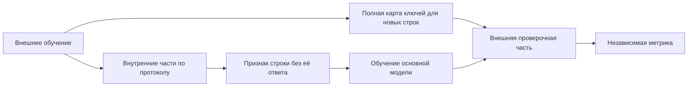

# Доработка после независимого обзора

Этот документ продолжает [первую поставку](DATA-UNDERSTANDING-RELEASE.md).
Её перечень незавершённых работ — исторический срез `de7a28c`, а не описание
текущих возможностей. Результаты ручных опытов из обзора не являются метриками
этой реализации.

## Восстановление условий и проверка качества

Явная метрика распознаётся в обычной строке, Markdown-списке, таблице и заголовке.
`Metric: RMSE` и `**Metric:** RMSE` дают один контракт. Противоречивые метрики
не разрешаются угадыванием. Проверенный аварийный CSV по-прежнему не имеет
выдуманной оценки качества.

Явное требование проверять будущие наблюдения вместе с объявленным временным
столбцом создаёт `temporal_holdout`. Новые объекты и объявленный столбец группы
создают `group_holdout`. Источником служит условие и роли словаря; одно название
столбца или наличие даты не задаёт сценарий. Если сценарий явно указан, но не
разрешён однозначно, недоступность API не заменяет его случайным разбиением:
сохраняется аварийный ответ, запуск отмечает незавершённое понимание условий.

Проверка цитат сохраняется. Она подтверждает источник текста, не истинность
произвольной интерпретации. Одновременное требование новых объектов и будущего
периода нуждается в явно поддержанном составном протоколе; текущая система
не подменяет его одним удобным разбиением.

## Версии и время

Лучший первый результат новой версии меняет приоритет, но не исключает прежнюю
область поиска. Старые измерения и состояние Optuna сохраняются. После начальных
проб очередной пятый выбор возвращается к давно не проверенному претенденту.
Появление новой версии не отменяет уже выполняющееся обучение.

После временной нехватки ресурсов или таймаута начальная версия может вернуться
в очередь с задержкой и повторной проверкой бюджета. Ошибка конкретной программы
и параметров сохраняется; исправление входных параметров допускает новую проверку.
Ожидающая версия не блокирует готовую к запуску.

На трёхчасовом запуске восстановлены обязательные 30 минут работы с данными после
стартовых моделей. Фоновый Optuna теперь также соблюдает этот этап и начинает
предлагать параметры после его окончания. Явный `DATA_RESEARCH_MIN_SECONDS=0`
позволяет отдельно сравнить поведение без этой политики. Общий срок и запас
на окончательное обучение важнее минимального исследовательского этапа.

Половина общего времени диагностики OOF доступна в начале, вторая половина
постепенно открывается по ходу запуска. Это сохраняет возможность исследовать
ошибки позднего лидера при прежнем общем пределе диагностики.

## Финальный выбор и сохранённые ответы

Готовым результатом считается также ранее опубликованный CSV. Для повторного
использования проверяются эксперимент, оценка, исходник, параметры, условия,
протокол, исходные train/test и байты самого ответа. Старые записи публикации
без новой идентичности не получают такого доверия автоматически.

В окончательное сравнение входят два лучших сопоставимых результата, которые
можно сохранить в оставшееся время. Готовому CSV не приписывается стоимость
ещё одного обучения. Текущий победитель не вытесняет более сильного второго
финалиста только из-за своего статуса.

Если окончательная закрытая проверка выбрала прежнюю публикацию, её файл проходит
обычные C20/C21 и атомарно заменяет текущий ответ. C18 явно указывает
`reuse_verified_output`; повторного обучения нет. Повреждённый файл, чужой протокол
или устаревшее разрешение окончательной проверки не дают права на замену.

## Целевые статистики и Macro F1

В программах признаков версии `feature-program-4` доступны `target_mean` и
`target_count`. Прежние операции сохраняют смысл. Пример для искусственной задачи
с известным входным столбцом `category`:

```json
[
  {"op":"target_mean","name":"history","columns":["category"],"alpha":10},
  {"op":"target_count","name":"support","columns":["category"]}
]
```

Ключ можно составить из 1–4 изученных входных столбцов. Это статистическое
отношение строк, не доказанный идентификатор физического объекта. `alpha` управляет
сглаживанием к среднему обучающей части. Для новой строки без известного ключа
возвращается среднее обучающей части и нулевая поддержка. Изменение состава
пакета предсказания не меняет обученное состояние.

Обучающие значения вычисляются перекрёстно: строка кодируется по другой части
обучения. Контроллер передаёт в worker зафиксированный способ проверки; worker
связывает его с собственными операторами до обучения и до создания внутренних
копий моделей. Модель не выбирает себе более удобные фолды.



Стрелки показывают передачу данных. Ответы внешней проверочной части не поступают
ни в вычисление признаков, ни в выбор поправок классификации.

При групповом протоколе исключается целая группа. При временном используются
только более ранние блоки; первый блок без истории получает пропуск и нулевой
счётчик. Внешняя диагностика OOF создаёт оператор заново внутри каждого своего
фолда. Готовая матрица статистик всего train не переносится во внешний фолд.
Если необходимый столбец группы/времени исключён из входа модели, оператор явно
отказывается, вместо скрытого перехода на случайные части.

Текущий собственный оператор целевых средних поддерживает регрессию. Для
классификации произвольные числа вместо названий классов не вводятся.

Для классификации с основной метрикой `f1_macro` собственный исполняемый кандидат
может использовать ту же фабрику:

```python
from agent.feature_engineering import make_feature_pipeline

DEFAULT_PARAMS = {
    'base_recipe_id': 'hist-native-classifier-v1',
    'model_parameters': {'max_iter': 20},
    'feature_program': [],
    'decision_rule': 'macro_f1',
}
SEARCH_SPACE = {}

def make_pipeline(task_spec, params):
    return make_feature_pipeline(task_spec, params)
```

Это рабочий пример интерфейса, не рекомендация 20 итераций для любого соревнования.
Внутренние отложенные прогнозы выбирают ограниченные поправки к логарифмам
вероятностей. Затем основная модель заново обучается на всей доступной обучающей
части. `predict` использует выбранные поправки, `predict_proba` сохраняет исходные
вероятности без заявления об их калибровке. Нехватка примеров редкого класса
отмечается в отчёте и оставляет нулевые поправки.

Метод требует нескольких обучений основной модели. Их фактическое время попадает
в обычную историю длительностей и ресурсный контроль. Объявления, результаты,
внутренние оценки и применённые операции сохраняются в `features.json`;
внутренний F1 не заменяет независимую оценку кандидата. Политика разбиения видна
в `job.json`, её хеш включён в `execution.json`. Новый модуль включается в
плоский платформенный ZIP обычным упаковщиком.

## Результаты проверок

Первые 32 проверки восстановления, очереди, подтверждения, публикации и контрактов
прошли в Ubuntu с закреплёнными основными библиотеками. Полный исходный набор
`de7a28c` проверяется отдельно; полный результат обновлённой версии будет добавлен
после завершения доработок. Внешняя модель и качество соревнования этим не проверены.

18 проверок операторов, прежних программ признаков и контрактов прошли за 0,766 с.
Сквозной сценарий трёх задач прошёл за 24,035 с: настоящий worker, обучение,
независимая оценка, окончательное обучение и проверенный CSV; ответы API явно
имитировались. Это проверка исполнения на искусственных данных, не измерение
выигрыша на соревновании.
