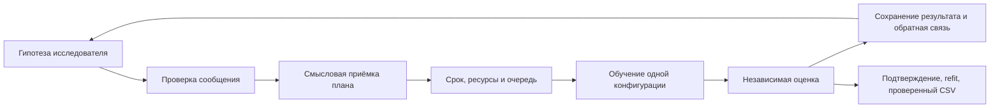

# Архитектура и полезные разрешённые библиотеки

Основа работы — свежая ветка команды `feat/final-data-research`, коммит `a2588d4`,
поверх `feat/open-research-loop`. Из прежней `feat/architecture-guide` не переносился
весь набор изменений: часть её исправлений анализа уже вошла в свежую основу.
Удалённые ветки проверяются перед публикацией; основная ветка не объединяется.
Практическое введение в итоговый проект — [PROJECT_GUIDE.md](PROJECT_GUIDE.md).

## Что показал разбор полного пути

В этой версии нет подтверждения предположению, что все исследователи навсегда
заперты в одной начальной сводке. Это ограничение было существенным для прежних
режимов; адаптивная работа команды уже изменила положение. Вместе с тем управление
исследованием не полностью отдано языковой модели: начальные испытания,
чередование поручений, фоновая подготовка признаков и режим доводки задаются кодом.

| Решение | Фактический владелец и основание | Что исследователь может перепроверить |
|---|---|---|
| Какие файлы относятся к задаче | `tools/files.py`, соседство с `task.md`, безопасное разрешение путей | Получает условие и обнаруженные входы; чужие задачи не являются источником дополнительных данных |
| Тип задачи, цель, метрика, выход | `TaskInterpreter` предлагает, `resolve_spec` проверяет по данным и поддержанным форматам | Может уточнять свойства данных; менять метрику ради лучшего числа не вправе |
| Разделение проверки | `Evaluator.create_protocol` проверяет предложение и фиксирует индексы | Обучение и факты ограничены разрешёнными строками; самовольный новый split не становится сопоставимой оценкой |
| Дополнительные факты | `AnalysisService`, ограниченные запросы и потоковое чтение | Схема по страницам, выбранные распределения/группы, фильтры до выборки, охват отчёта |
| Следующий способ решения | `Researcher`, действия `catalog/pipeline/features/tune/stop` | Готовые модели, собственный код и программы признаков доступны одновременно |
| Что действительно запустить | Диспетчер, Catalog, Constructor, Budget | План должен быть допустимым, происходить от доступных версий и помещаться вместе с refit |
| Значение метрики | `Evaluator`, сохранённые предсказания и закрытые ответы | Получает вычисленный результат и ограниченные диагностики; не назначает себе оценку |
| Состояние и происхождение | `Store`/`GraphService`, единственный поток записи | Получает собственную базу и общий измеренный обзор; донорский приём не равен доказанному эффекту |
| Итоговый ответ | Подтверждение, окончательное обучение, `Submission` | Его гипотеза не может обойти проверку готового CSV |

Исходники: [runtime](../agent/runtime.py), [оркестратор](../agent/orchestrator.py),
[графовый контроллер](../agent/graph/controller.py), [исследователь](../agent/researcher.py),
[анализ](../tools/analysis.py), [оценка](../agent/evaluation.py),
[подтверждение](../agent/confirmation.py), [публикация](../agent/submission.py).

Стрелки обозначают существующие границы. Подключённые библиотеки работают внутри
них: `jsonschema` проверяет формат, новые оцениватели обучают одну конфигурацию,
Optuna предлагает параметры и получает подтверждённое число. Нового владельца
ресурсов, состояния или метрик не появляется.

## Подтверждённые проблемы и изменения

### Самописный интерпретатор JSON Schema

В исходном `Schemas._check` (`agent/contracts.py` на `a2588d4`) поддерживалось
вручную выбранное подмножество стандарта. При наличии `$ref` выполнялся ранний
`return`: соседние ограничения той же схемы не проверялись. Добавление новых
словарных конструкций требовало расширять собственный валидатор одновременно
с контрактами. Это неправильная зависимость протокола от неполной копии стандарта,
а не проблема стратегии оркестратора.

Теперь используется разрешённый `jsonschema==4.23.0`, Draft 2020-12, с локальным
реестром ссылок и кешем разобранного документа. Неизвестные внешние ссылки не
загружаются из сети. Сохранены конечный JSON, различие `bool`/целого, требование
целочисленного токена для `integer`, внешний `CONTRACT_VIOLATION` и ограниченные
сообщения ошибок. Публичные идентификаторы контрактов не менялись.

Это не перенос смысловых проверок в схему: допустимость параметров, родителя,
ресурсов и независимой оценки по-прежнему проверяют владельцы этих решений.
[Регрессионная проверка](../tests/test_library_integration.py) различает два значения,
оба удовлетворяющие `$ref`, но только одно — соседнему ограничению.

### Разрешённые модели были доступны только через произвольный Python

`tools/code.py` уже разрешал импорт `lightgbm` и `xgboost`, но `recipes/catalog.json`
и `build_pipeline` не давали для них собственных рецептов. Исследователь должен
был сам написать адаптацию, параметры и обработку меток. Стандартный путь начальных
испытаний эти семейства не использовал. Доступный пакет и законченная интеграция
были разными вещами.

Добавлены четыре рецепта: `lightgbm-classifier-v1`, `lightgbm-regressor-v1`,
`xgboost-classifier-v1`, `xgboost-regressor-v1`. Все параметры имеют явные домены.
Потоки и CPU заданы контролируемо, seed передаётся из плана. Для XGBoost строковые
метки преобразуются `LabelEncoder`, обученным только по fit-ответам; после
предсказания возвращаются исходные метки и согласованный порядок вероятностей.

Общая подготовка — медианы чисел и порядковые номера категорий, обученные только
на fit. Здесь **не** заявляется использование нативных категорий LightGBM/XGBoost.
Закрытая проверочная часть не передаётся им для ранней остановки. LightGBM
использует CPU-режим `deterministic` с `force_col_wise`; это воспроизводимость
конфигурации в совместимой среде, а не обещание одинаковых битов на всех сборках.

Согласованно изменены [каталог](../recipes/catalog.json), [фабрика](../agent/ml.py),
[начальные испытания](../agent/catalog.py), [прогноз времени](../agent/duration.py),
[описание среды](../agent/graph/constructor.py) и подмножество зависимостей.
История стоимости остаётся отдельной для каждого семейства. Прогноз учитывает
деревья, листья/глубину и параметры выборки; после измерений масштабируется от
наблюдавшегося обучения. Начальная оценка всё ещё эвристическая.

### Защита произвольного кода блокировала штатный C API

Предварительный импорт пакета не устранял все ошибки: прежний `PipelineGuard`
запрещал любое событие `ctypes.*`. У LightGBM выделение буферов и у XGBoost
получение функций уже загруженной библиотеки происходят во время fit. Настоящие
процессы с программой признаков поэтому падали, хотя обычный прямой fit работал.

[Guard](../tools/runtime_guard.py) теперь запоминает точные объекты уже загруженных
`lightgbm.basic._LIB` и `xgboost.core._LIB`. Поиск символов разрешён только в них;
операции с адресами/буферами — из глобальных пространств этих доверенных привязок.
Создание буфера не даёт разрешения на файлы или сеть. `ctypes.dlopen`, неизвестные
библиотеки, произвольный доступ к адресам из сгенерированного модуля, сеть и новые
процессы остаются запрещены. Ошибка теперь содержит имя заблокированного события.
Это прикладное ограничение ввода/вывода, не системная песочница.

### Несовместимость местного демонстратора с расширенным каталогом

Полный набор обнаружил, что `MockTransport` выбирал для неизвестного ему
семейства параметр `max_iter`. Для LightGBM/XGBoost это неверный контракт. Добавлен
явный путь `n_estimators`, как у лесов. Это исправление демонстратора, не изменение
ответов живой модели.

Испытание обрезанного бюджетом тайм-аута также зависело от того, что случайно
выбранная модель окажется медленнее 1,5 секунды. Теперь задержка явно вводится в
тестовый дочерний процесс; сохранение готового ответа и остановка дерева проверяются
независимо от быстродействия CPU. Производственный механизм остановки не ослаблен.

## Что из разрешённого списка имеет смысл использовать

| Библиотека | Решение в этом проходе | Причина |
|---|---|---|
| `jsonschema 4.23.0` | Подключена вместо самописного интерпретатора | Канонический формат уже JSON Schema; нет пользы дублировать его семантику |
| `lightgbm 4.6.0`, `xgboost 2.1.4` | Полные собственные CPU-рецепты | Добавляют реально иные семейства без второго контура управления |
| `optuna 4.2.1` | Сохранена и испытана интеграция команды | `ask/tell` уже соблюдает очередь, происхождение и независимую оценку; повторная интеграция не нужна |
| `scikit-learn 1.5.2` | Сохранены Pipeline, ColumnTransformer, преобразования, метрики и clone | Это уже основа проекта; изменения не обходят обучение преобразований только на fit |
| `threadpoolctl 3.6.0`, `psutil 6.1.1` | Сохранены существующие ограничения и наблюдение процессов | Библиотеки уже заменяют значительную часть ручной работы с потоками/RSS |
| `pydantic` | Не добавлен второй набор моделей сообщений | Потребовалось бы синхронизировать его с существующими JSON Schema и примерами |
| `category-encoders`, `feature-engine` | Не подключены ради замены всего FeatureProgram | Требуется пооперационное совпадение поведения: неизвестные группы, числовые ключи и неизменность статистик между пакетами |
| `imbalanced-learn` | Отложен отдельный опыт, не общая предобработка | Пересэмплирование должно происходить только внутри fit; полезность зависит от дисбаланса и выбранной метрики |
| `polars`, `pyarrow` | Не переписан весь анализ | Потоковое ограниченное чтение уже есть; сначала нужен профиль времени на реальной задаче, затем замена конкретного узкого места |
| `AutoGluon`, `FLAML`, `LightAutoML` | Не запускаются как вложенные автономные поиски | Нужен специальный адаптер учёта внутренних обучений, разделений, потоков и срока; простой `fit` создаст второй распорядитель ресурсов |
| `langgraph`, `langchain` | Не подменяют существующий граф | Новое хранилище переходов/повторов дублировало бы SQLite, разрешения ресурсов и восстановление |
| `tenacity` | Не обёрнут весь API-цикл дополнительными повторами | Повторы уже учитывают квоты, резервы финального запроса и причины остановки; второй слой способен удвоить попытки |

Это приоритеты по фактическим границам проекта, не рейтинг качества библиотек.
Сравнительных измерений всех перечисленных пакетов на данных соревнования нет.

Два небольших собственных адаптера сохранены осознанно. `SequentialTargets`
поддерживает объекты только с `fit/predict`, которым не обязательно доступен
интерфейс `sklearn.clone`; прямая замена на MultiOutputRegressor меняет контракт.
`ShiftedLogTargetModel` вычисляет сдвиг по fit-ответам, поэтому простое
`TransformedTargetRegressor(func=log1p)` меняет поведение при отрицательной цели.
Наличие похожего класса в библиотеке не доказывает взаимозаменяемость.

## Оставшиеся архитектурные вопросы

`Orchestrator.__init__` создаёт сервисы анализа/знаний и присваивает их полям
Gateway и ContextBuilder. Это тесная зависимость сборки объектов. В этом проходе
она не перемещалась в новые файлы ради видимости переработки: проверенного
ограничения самостоятельного анализа из-за неё нет, а полезнее было закрыть
реальные ошибки исполнения. Если появятся разные наборы инструментов, стоит
передавать готовый реестр возможностей при сборке runtime.

`FeatureSearch`, поручения с фокусом признаков и фаза доводки — централизованные
исследовательские эвристики. Они расходуют часть бюджета и могут оказаться
неудачными на конкретной задаче. Это измеряемая гипотеза о политике, а не доказанный
эффект от оркестратора. Переключатели и основания должны сопоставляться с живыми
запусками на одном разделении; синтетические проверки этого не устанавливают.

Граф версий сохраняет полезные измерения и происхождение. Для новых библиотек
менять его таблицы или добавлять сущность «гипотеза» не потребовалось. Основные
гарантии команды — атомарные состояния, собственные базы, контролируемые переносы,
замороженное исполнение и подтверждение — сохранены.

## Проверка и её пределы

Среда: Ubuntu 24.04 в WSL, Python 3.12; отдельное окружение разработки, без
обращения к API. Версии ядра NumPy/SciPy/pandas/scikit-learn и добавленных моделей
соответствуют разрешённым закреплениям. Системная OpenMP подготовлена отдельно
до запуска задач. В местной CPU-проверке XGBoost установлен без необязательного
для этих вычислений NVIDIA NCCL; проверка GPU не проводилась. Полная среда всех
пакетов организаторов здесь не устанавливалась.

Выполнены реальные fit обеих моделей на смешанных признаках с пропусками,
строковыми классами и неизвестной категорией; вероятности и ограничения потоков;
train/refit внутри действующей защиты с программой признаков; отрицательные
проверки защиты; локальные ссылки схем и все существующие примеры контрактов.
Optuna испытана через её настоящую библиотеку, включая передачу подтверждённого
результата и сохранение оценки при ошибке `tell`. Искусственные значения в
проверках оптимизатора не являются измерениями качества ML.

Итог полного набора, сквозного воспроизведения и оформления записывается ниже
после завершения проверок. Обнаруженные ошибки не считаются прошедшими проверками.

## Первичные источники

- [jsonschema 4.23: валидаторы, evolve и TypeChecker](https://python-jsonschema.readthedocs.io/en/v4.23.0/validate/).
- [LightGBM 4.6: параметры CPU и воспроизводимости](https://lightgbm.readthedocs.io/en/v4.6.0/Parameters.html).
- [LightGBM 4.6: интерфейс LGBMClassifier](https://lightgbm.readthedocs.io/en/v4.6.0/pythonapi/lightgbm.LGBMClassifier.html).
- [Исходный sklearn-интерфейс XGBoost 2.1.4](https://github.com/dmlc/xgboost/blob/v2.1.4/python-package/xgboost/sklearn.py).

Разрешённые версии взяты из собственного [списка организаторов](../requirements.organizers.txt).
Документация библиотек проверяет их API; решение о границах интеграции сделано
по исходникам этого проекта.
