# Руководство по AutoML: от условия до проверенного ответа

AutoML получает описание одной задачи и её таблицы, обучает несколько решений, сравнивает их по общей проверке качества и сохраняет готовый ответ. Языковая модель помогает понимать условие и выбирать следующий опыт. Она не назначает себе оценку и не записывает окончательный файл напрямую.

Здесь описаны действующее устройство и практическая работа с проектом. Для первого знакомства достаточно пройти разделы 1–7 и сквозной пример. Разделы о версиях, ошибках и расширении пригодятся при разработке.

## Оглавление

1. [Что поступает в систему и что получается](#1-что-поступает-в-систему-и-что-получается)
2. [Подготовка Ubuntu и запуск](#2-подготовка-ubuntu-и-запуск)
3. [Общая картина и границы ответственности](#3-общая-картина-и-границы-ответственности)
4. [Первые минуты: понимание задачи и первый ответ](#4-первые-минуты-понимание-задачи-и-первый-ответ)
5. [Как исследователь получает факты](#5-как-исследователь-получает-факты)
6. [Один исследовательский опыт](#6-один-исследовательский-опыт)
7. [Проверка качества и сохранение результата](#7-проверка-качества-и-сохранение-результата)
8. [Версии, родители, собственные базы и ветви](#8-версии-родители-собственные-базы-и-ветви)
9. [Время, ресурсы и причины остановки](#9-время-ресурсы-и-причины-остановки)
10. [Что остаётся на диске](#10-что-остаётся-на-диске)
11. [Сквозной пример на искусственной задаче](#11-сквозной-пример-на-искусственной-задаче)
12. [Как разбирать неудачный запуск](#12-как-разбирать-неудачный-запуск)
13. [Как расширять проект](#13-как-расширять-проект)
14. [Проверки и платформенная поставка](#14-проверки-и-платформенная-поставка)
15. [Границы возможностей и карта документации](#15-границы-возможностей-и-карта-документации)

## 1. Что поступает в систему и что получается

Один запуск обрабатывает один файл `task.md`. В нём находится условие: что предсказывать, какую метрику применять и как оформлять ответ. Рядом обычно лежат `train.csv` с известными ответами, `test.csv` без них, необязательный `sample_submission.csv` с форматом результата и `data_dictionary.csv` с описаниями признаков. Признак — входной столбец таблицы; целевой столбец содержит значение, которое нужно научиться предсказывать.

Сейчас поддерживаются табличная регрессия, бинарная и многоклассовая классификация. При регрессии предсказывается число, при классификации — метка класса. Реализованы RMSE, MAE, R², accuracy, macro F1 и weighted F1; допустимость комбинации типа задачи, метрики и формата предсказаний проверяется кодом. Например, таблица вероятностей классов не становится автоматически поддержанной только потому, что условие упоминает классификацию. Неподдерживаемый формат должен дать явную ошибку.

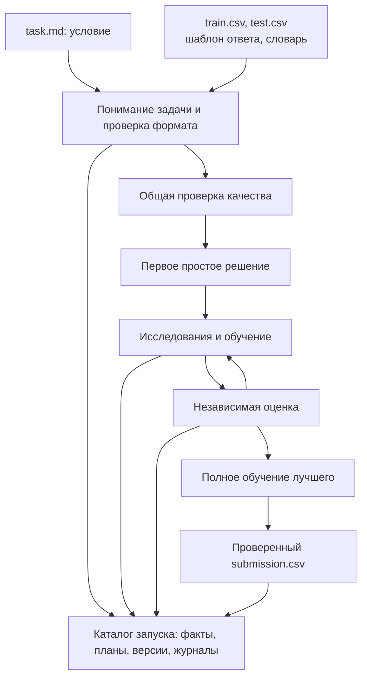

Стрелки показывают передачу входов и результатов. Возврат от оценки к исследованию означает следующий опыт по уже измеренным данным. Условия и проверка качества общие для запуска; исследования не меняют их незаметно после получения неудобной оценки.

Главный внешний результат — CSV по пути из условия. Это обычно `submission.csv` рядом с `task.md`, но код не привязан к такому имени. Каталог `runs/<run_id>/` хранит объяснение того, как получен этот файл. `run_id` — уникальное имя запуска, помогающее отделять разные задачи и повторные попытки.

Имена цели, колонок, классов и метрики берутся из текущей задачи, а не из демонстрации. Запуски не переносят обученные веса и историю между задачами. Платформенная точка входа — [solution.py](../solution.py), разрешение файлов — [tools/files.py](../tools/files.py), проверка спецификации задачи — [agent/task.py](../agent/task.py).

## 2. Подготовка Ubuntu и запуск

### Среда разработки

Нужен Python 3.12. Работать следует из корня клонированного репозитория. Создание окружения и установка библиотек выполняются заранее, до запуска соревнования:

На чистой Ubuntu 24.04 сначала установите сам Python и средство создания окружений:

```bash
sudo apt install python3.12 python3.12-venv
```

Далее создайте отдельное окружение проекта:

```bash
python3.12 -m venv .venv
source .venv/bin/activate
python -m pip install -r requirements.runtime.txt
python scripts/doctor.py
```

`requirements.runtime.txt` — разрешённое подмножество библиотек для местной разработки. `requirements.organizers.txt` — исходный список организаторов; `requirements.txt` должен совпадать с ним побайтно. Во время решения задачи агент не устанавливает дополнительные пакеты.

На Ubuntu проверяются настоящие группы процессов и их остановка. Запуск из Windows полезен для разработки, но сам по себе не подтверждает поведение Linux-процессов. Для такой проверки используйте Ubuntu, WSL2 или контейнер с установленными зависимостями.

### Настройки

Скопируйте [.env.example](../.env.example) в `.env`, заполните `OPENAI_API_KEY` и `OPENAI_BASE_URL`. Ключ и адрес получает команда; не добавляйте этот файл в Git. Для настоящего обращения к модели выполните:

```bash
python solution.py /absolute/path/to/task.md --env-file .env
```

Параметр `--env-file` обязателен, если настройки лежат только в файле. Без него читается окружение процесса. Уже существующая переменная окружения имеет приоритет перед одноимённой строкой `.env`. Подстановка команд и раскрытие `$VARIABLE` внутри файла не выполняются. На платформе переменные API предоставляет сама платформа.

Основные настройки собраны в [agent/config.py](../agent/config.py). Начните со следующих:

| Переменная | Значение по умолчанию | На что влияет |
|---|---:|---|
| `TIME_BUDGET_SECONDS` | `10800` | Всё время запуска, включая подготовку и запись ответа |
| `RESEARCH_MODE` | `adaptive` | Исследовательские действия и доступ к дополнительным фактам |
| `MAX_WORKERS` | `2` | Верхняя граница одновременно работающих заданий |
| `GRAPH_PEERS` | `2` | Число исследователей с отдельными базами |
| `GRAPH_TRAIN_WORKERS` | `1` | Одновременные обучения в графовом цикле |
| `TRAIN_CPU_THREADS` | `3` | Потоки одного обучения |
| `TRAIN_MEMORY_MB` | `10240` | Наблюдаемый предел памяти одного задания |
| `EXPERIMENT_TIMEOUT_SECONDS` | `600` | Верхняя граница длительности обычного опыта |
| `LLM_MAX_CALLS` | `32` | Предел обращений к API за запуск |
| `LLM_MAX_TOTAL_OUTPUT_TOKENS` | `262144` | Общий предел выходных токенов |
| `WORK_DIR` | `./runs` | Родительская папка каталогов запусков |
| `GRAPH_SEARCH_FRACTION` | `0.85` | Доля поискового времени до доводки лучшего |
| `CONSOLE_LOG_FORMAT` | `concise` | Краткие сообщения о фактах и выбранных действиях |

`MAX_RESEARCH_EXPERIMENTS` оставлен для совместимости старых настроек: число обучений не завершает поиск. `RESEARCH_SERIES_SIZE` задаёт размер связанных местных испытаний в режимах, где они разрешены. В `adaptive` исследователь явно выбирает действие `tune` с собственными ограничениями серии; подробности ниже.

### Выбор одной задачи

Проверьте структуру архива, затем запускайте конкретное условие:

```bash
python scripts/list_tasks.py /absolute/path/to/data_for_participants
python solution.py /absolute/path/to/data_for_participants/task-A/task.md --env-file .env
```

`list_tasks.py` перечисляет условия и проверяет расположение файлов, без чтения содержимого CSV и обращения к API. Не смешивайте таблицы разных задач в общей папке. Соседние файлы имеют приоритет, необязательный словарь другой задачи не подхватывается рекурсивно. При неоднозначности система перечисляет кандидатов и прекращает подготовку, чтобы не обучаться на случайно выбранных данных.

### Искусственная задача без API

Для проверки окружения можно создать новые искусственные данные и заменить только ответы языковой модели:

```bash
python scripts/make_demo.py /tmp/stepan-demo --kind regression --rows 120
TIME_BUDGET_SECONDS=45 python solution.py /tmp/stepan-demo/task.md --llm-mode mock
```

`mock` — имитатор API, предназначенный для задач генератора [scripts/make_demo.py](../scripts/make_demo.py). Процессы, обучение, предсказания, метрики и запись CSV остаются настоящими. Автоматического перехода с настоящего API на имитатор при ошибке нет. Выберите пустую папку: генератор отказывается перезаписывать существующую задачу.

## 3. Общая картина и границы ответственности

Сначала полезно разделить исследовательское решение и право его выполнить. Исследователь предлагает, какой опыт полезен и на каких фактах он основан. Управление выполнением проверяет доступное время, ресурсы и жизненный цикл. Проверка качества вычисляет оценку независимо от текста предложения. Хранилище фиксирует то, что действительно произошло.

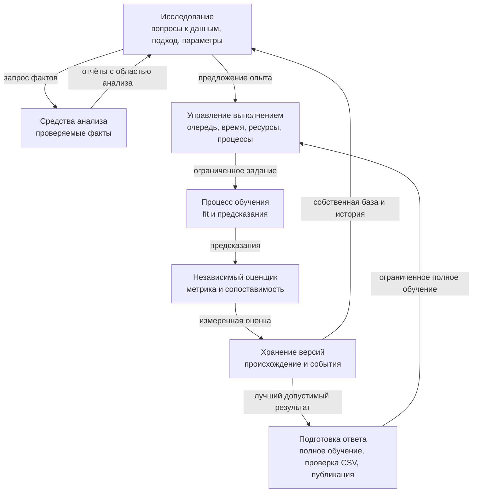

Стрелка от исследователя к управлению — предложение, которое ещё может быть отклонено. Стрелка от оценщика к хранилищу содержит фактическую оценку, а не ожидаемый эффект. Подготовка ответа пользуется теми же ограниченными процессами, но не отдаёт исследователю право менять выходной файл.

| Область | Основной код | Полномочия |
|---|---|---|
| Подготовка запуска | [agent/runtime.py](../agent/runtime.py) | Собрать службы, прочитать конфигурацию, завершить запуск |
| Понимание условия | [agent/task_interpreter.py](../agent/task_interpreter.py), [agent/task.py](../agent/task.py) | Предложить и проверить формальное описание задачи |
| Исследование | [agent/researcher.py](../agent/researcher.py), [agent/context.py](../agent/context.py), [prompts/researcher-adaptive.md](../prompts/researcher-adaptive.md) | Запросить факты, сформулировать действие и проверяемый опыт |
| Анализ данных | [tools/analysis.py](../tools/analysis.py) | Прочитать разрешённые строки и выдать ограниченный отчёт |
| Доступ к инструментам | [agent/research_tools.py](../agent/research_tools.py) | Явно предоставить разрешённые операции текущему диалогу |
| Исполнение | [agent/orchestrator.py](../agent/orchestrator.py), [agent/graph/controller.py](../agent/graph/controller.py), [agent/budget.py](../agent/budget.py) | Допустить опыт, выделить ресурсы, вести очередь, завершить работы |
| Обучение | [agent/runner.py](../agent/runner.py), [agent/worker.py](../agent/worker.py) | Запустить отдельный процесс, обучить, сохранить предсказания |
| Оценка | [agent/evaluation.py](../agent/evaluation.py) | Сформировать разделение строк, вычислить метрики, проверить предсказания |
| Состояние и версии | [agent/store.py](../agent/store.py), [agent/graph/service.py](../agent/graph/service.py) | Транзакционно записать опыт, происхождение и выбор |
| Окончательный ответ | [agent/submission.py](../agent/submission.py) | Проверить CSV и атомарно заменить опубликованный ответ |

Название `Orchestrator` не означает, что в нём находится вся политика. Например, [agent/search_policy.py](../agent/search_policy.py) выбирает переходы исследовательских ветвей, а [agent/context.py](../agent/context.py) определяет видимую историю. Поэтому изменение исследовательских полномочий проверяется по всему пути, а не по одному классу.

Внутренние обращения оформлены как проверяемые сообщения. `C00`–`C24` обозначают общие операции: чтение задачи, предложение, обучение, оценку, публикацию. `G00`–`G15` обозначают операции графа версий; `I00`–`I03` — проверки конструктора, ограничений и происхождения. Это идентификаторы внутренних вызовов Python, отдельный сетевой сервер для них не нужен. [ContractBus](../agent/contracts.py) проверяет JSON по [схеме](../contracts/contracts.schema.json), сохраняет запрос и ответ и связывает их в журнале.

## 4. Первые минуты: понимание задачи и первый ответ

### Условие становится проверяемым описанием

После запуска фиксируются время начала, настройки и отдельный каталог. Чтение условия определяет пути входов. Технический профиль собирает число строк, названия и типы столбцов, пропуски и необязательный словарь. Профиль — описание измеренных свойств таблиц; он не должен подменять содержательное изучение задачи.

Интерпретатор предлагает `TaskSpec`: формальное описание цели, типа задачи, метрики, исключённых столбцов и выходного формата. Затем обычный код проверяет предложение против настоящих входов. Например, неизвестная целевая колонка и неподдерживаемая метрика не принимаются из доверия к ответу модели.

Следующий шаг — протокол проверки качества. Проверочная часть, или `holdout`, — отложенные строки train, которые не используются для обучения данного опыта. Набор индексов и правила оценки сохраняются, получают общий идентификатор `validation_id` и далее используются всеми сопоставимыми опытами.

Короткий профиль не является единственным доступным описанием схемы. Ещё до выбора задачи и проверки интерпретатор может вызвать `inspect_schema` и получить следующую страницу полного сохранённого профиля train или test: имена, технические типы и доли пропусков, без значений строк и меток. Параметры `table`, `offset`, `limit` задают таблицу, начало и размер страницы, не более 64 колонок. Ответ сохраняется в `research/schema-*.json`. Поэтому целевая колонка, оказавшаяся за пределами короткой сводки, не становится невидимой навсегда.

Выбранный протокол остаётся общим и неизменным в пределах запуска. В исследовательском контексте сохраняются его стратегия, параметры, явное основание выбора, размеры частей и хеш; индексы и проверочные ответы туда не передаются. Исследователь видит, на какой проверке основана оценка, и может выразить сомнение в её пригодности. Автоматического пересчёта всех опытов на другом разделении в текущем запуске нет: для другого протокола нужен отдельный запуск или согласованное расширение механизма сравнения. Это осознанная граница сопоставимости, а не утверждение, что первый выбор всегда удачен.

| Стратегия | Что откладывается | Когда это соответствует задаче |
|---|---|---|
| `random_holdout` | Случайные строки | Предполагается одинаковое распределение и независимость строк |
| `stratified_holdout` | Случайные строки с сохранением долей классов | Классификация, если размеры классов позволяют такое разделение |
| `group_holdout` | Целиком группы заданного столбца | Нужно переносить решение на новые группы, а не соседние строки той же группы |
| `temporal_holdout` | Последние целые периоды | Нужно предсказывать следующий период; граница не разрезает одинаковое время |

Оценщик проверяет допустимость выбранного столбца и разделения, а не содержательную истинность предположения об устройстве будущих данных. Например, случайный holdout может быть технически корректен, но плохо соответствовать test из нового года. Поэтому основание выбора сохраняется и остаётся видимым исследователю.

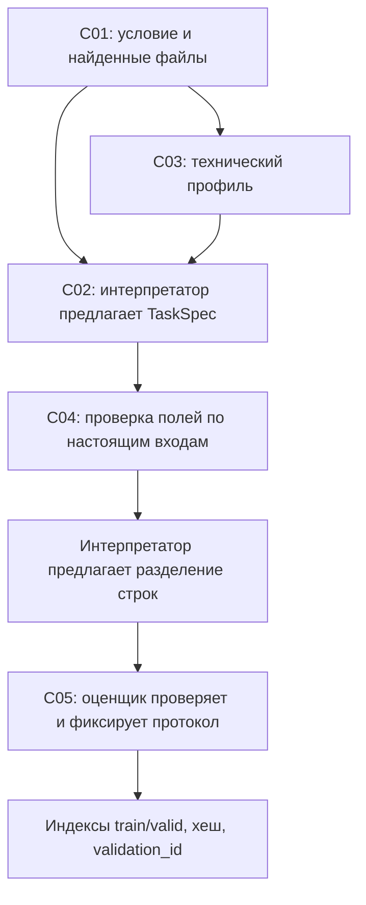

Стрелки показывают порядок подготовки и передачу проверенных результатов следующему этапу. Профиль помогает интерпретатору не угадывать схему, но исследовательские факты позднее могут его дополнить. Изменение протокола создаёт иной `validation_id`: оценки на разных отложенных строках нельзя бесшумно смешивать в одном сравнении.

### Зачем сначала простая модель

Первое решение семейства `dummy` предсказывает простую постоянную величину либо класс. Его польза — быстро проверить весь путь до готового CSV. Оно проходит настоящее обучение, предсказание, независимую оценку, полное обучение на train и проверку выходного формата. Только после публикации этого результата поиск получает надёжную отправную точку.

Если API или обучение ломается до первого проверенного ответа, процесс завершается с ошибкой. Если ошибка случается после публикации, сохранённый результат остаётся доступен, а запуск может завершиться в состоянии `degraded`: файл есть, но часть исследования не удалась. Наличие старого CSV от другого запуска само по себе не считается успехом текущего: проверяется запись публикации и хеш файла.

После первого ответа проходят ограниченные начальные испытания каталога. Они дают измеренные опорные модели, а не заранее доказанную иерархию семейств. Дальше два исследователя работают с собственными измеренными базами.

## 5. Как исследователь получает факты

### Контекст — снимок задачи, базы и доступных наблюдений

Перед обращением к модели собирается контекст: условие, проверенная спецификация, сведения о данных, доступные модели, собственная база исследователя и измеренная история. База — конкретный уже выполненный опыт, от которого исследователь продолжает решение; в контексте есть его фактические параметры и исходный код.

В стандартном `adaptive` локальные `MAX_CONTEXT_TOKENS` и `GRAPH_CONTEXT_BYTES` не обрезают и не отклоняют входной контекст, включая подготовку задачи. В запрос сохраняются условие, измеренная база, история и результаты инструментов. Физическое окно модели и пределы сервиса остаются; отмена местной отсечки их не увеличивает. В `catalog/code` прежние клиентские ограничения и защищённые части контекста сохраняются. Размер технического профиля C03 и отдельного ответа инструмента по-прежнему ограничен: отключение отсечки общего запроса не означает передачу целых таблиц.

Нельзя считать любое поле профиля окончательным исследовательским выводом. Технический тип столбца, доля пропусков, связь с целью и пригодность преобразования — разные виды сведений. Метка «числовой» сама по себе не доказывает, что столбец следует использовать как непрерывную величину.

### Дополнительный анализ по запросу

В `adaptive` исследователь может обратиться к `analyze_data`. Это обычная служба чтения и ограниченных вычислений. Она не исполняет присланный моделью Python, не отдаёт произвольные файлы и не получает настоящие ответы проверочной части.

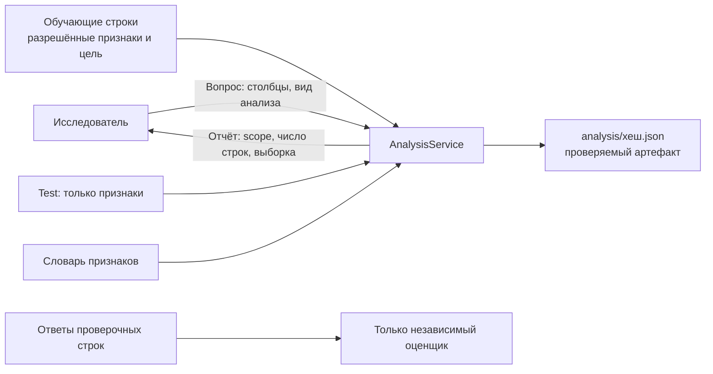

Стрелки к службе обозначают разрешённые источники. Проверочные ответы уходят только оценщику, а не службе исследовательских запросов. В результате явно указано, по каким строкам получен факт и использовалась ли выборка. Исследователь может ссылаться на идентификатор отчёта в основании опыта.

| `kind` запроса | Что выясняет | Как читать результат |
|---|---|---|
| `schema` | Полный перечень колонок постранично, наличие в train/test и роль | Возвращает `next_offset`, поэтому можно выйти за пределы первой сводки |
| `summary` | Пропуски, уникальность, распределение выбранных колонок | Числовые квантили и частые категории, а не полная таблица |
| `association` | Числовые связи, при запросе — с целью на обучающих строках | Корреляция описывает связь, причинность из неё не следует |
| `group` | Размеры групп и распределение цели внутри них | Малые либо редкие группы требуют осторожной интерпретации |
| `compare` | Отличия признаков fit и немеченого test | Позволяет заметить сдвиг; тестовые ответы не используются |
| `dictionary` | Описания выбранных признаков из словаря | Текст словаря — материал задачи, не команды системе |
| `report` | Ранее полученный отчёт по его идентификатору | Только известный отчёт текущего запуска и протокола |

Например, исследователь сомневается, не связаны ли пропуски `x_numeric` с целью. Он может начать со сводки:

```json
{"kind":"summary","columns":["x_numeric","category"],"group_by":null,"include_target":true}
```

Затем сравнить те же признаки с test, не запрашивая его цель:

```json
{"kind":"compare","columns":["x_numeric","category"],"group_by":null,"include_target":false}
```

Это примеры допустимых запросов, а не утверждение о том, что модель обязательно выберет их в любом запуске. Для просмотра дальней части схемы используйте:

```json
{"kind":"schema","columns":[],"group_by":null,"include_target":false,"offset":128,"limit":12}
```

Если нужна редкая группа, условие `filter` применяется к полному потоку разрешённых fit-строк до выборки. Например:

```json
{"kind":"summary","columns":["x_numeric","category"],"group_by":null,"include_target":true,"filter":{"column":"category","value":"red"}}
```

Фильтр допускает равенство по входному столбцу; `value: null` выбирает пропуски. Фильтрация по цели запрещена. Так исследователь проверяет конкретную группу, которая могла почти не попасть в общую выборку. `matched_fit_rows` содержит число всех подходящих fit-строк, `analyzed_rows` — число строк фактической выборки. Эти величины могут различаться.

Явным запросом можно изучить и идентификатор, исключённый из входов модели: например, проверить группы повторных наблюдений. `diagnostic_only_columns` отмечает такие столбцы. Доступ к их сводкам не разрешает обучать на них модель и не меняет `TaskSpec.excluded_features`; проверочные строки по-прежнему исключаются до анализа. В запросе без списка столбцов выбираются обычные признаки модели.

Сервис читает только выбранные колонки порциями по 4096 строк, отбрасывает holdout, применяет фильтр и удерживает до 20000 строк детерминированной равномерной выборки. Поэтому вся широкая таблица не копируется в память инструмента ради одного вопроса. При `compare` такой же фильтр применяется к признакам немеченого test. Между порциями проверяются остаток поискового времени, граница фазы и собственный предел чтения 120 секунд. Проверка совместная с чтением: отдельный вызов чтения CSV не прерывается посередине порции.

Запрос ограничен 12 колонками и 8 KiB, полный отчёт — 16 KiB, ответ инструменту — 6 KiB. При сокращении возвращается явная отметка; для деталей выберите меньше колонок. Все страницы схемы доступны через `next_offset`, включая колонки за пределами начальной сводки. Поля `fit_rows`, `matched_fit_rows`, `analyzed_rows`, `sampled` и `scope` нужны, чтобы не принимать выборочную оценку за полный проход по таблице. Конкретные пределы и механизм запроса находятся в [tools/analysis.py](../tools/analysis.py).

Средство связи с API получает готовый набор разрешённых операций через [ResearchTools](../agent/research_tools.py). Оно передаёт запросы и ответы, но не создаёт само себе доступ к данным из полей оркестратора. Служба анализа собирается на этапе подготовки и передаётся явно. Кэш отчётов может использоваться обоими исследователями: это общие измеренные факты одного протокола, а не общий владелец их исследовательских баз. Возвращаются копии ответов, чтобы один потребитель не изменил чужое сохранённое свидетельство.

Ограничение срока API тоже не поручено толкованию контекста средством связи: диспетчер подготавливает `metadata.response_cost_plan`, а `Budget.response_deadline` рассчитывает остаток с учётом последующего опыта и публикации. Это отделяет формат сообщения модели от оценки вычислительных затрат.

Ответы инструментов считаются фактами с областью применимости. Исследователь не вправе ссылаться на несуществующий отчёт или объявлять ожидаемую оценку измеренной: проверка `evidence_ids` допускает только видимые результаты и завершённые анализы.

### Локальные тетради как источник приёмов

Помимо фактов текущей задачи исследователь может читать чужие подходы через `consult_notebook`. Jupyter Notebook, или тетрадь `.ipynb`, — файл с отдельными ячейками кода, пояснений и исторических выводов. В репозитории сохранены два оригинала автора Art Kulakov для OSIC; это одна авторская подборка, четыре размеченных приёма. Разнородная библиотека Kaggle / MLE-bench пока не завершена. Предыдущие ссылки и карточки сами по себе не означают наличие локального исходного решения.

Исследователь сначала ищет подходящую карточку, затем читает конкретную ячейку с контекстом:

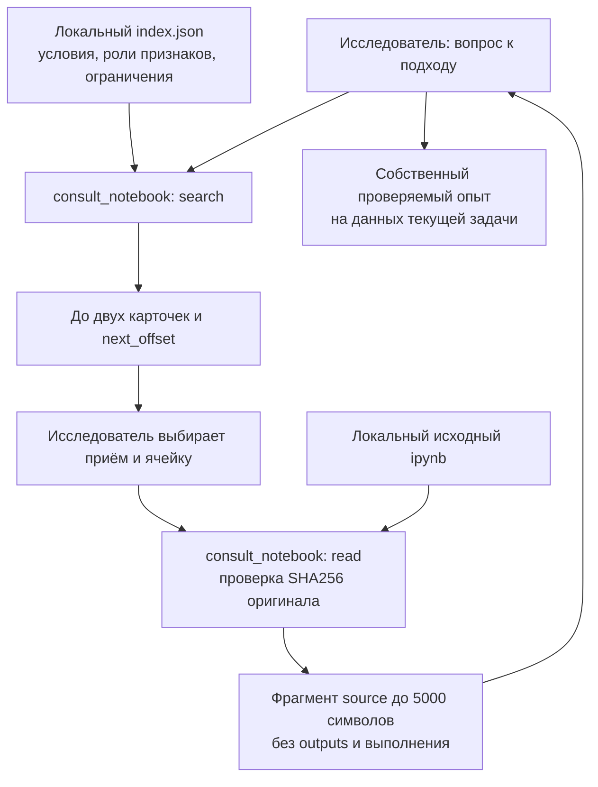

Стрелки поиска показывают выбор материала по разметке, а не автоматическое выполнение тетради. Из прочитанного фрагмента исследователь может сформулировать гипотезу, затем получить факты своей задачи и предложить отдельный опыт. Измеренную оценку по-прежнему вычисляет оценщик проекта.

Например, для повторных наблюдений одного объекта можно искать признаки относительно исходного значения:

```json
{"kind":"search","keywords":["исходный"],"offset":0,"limit":2}
```

Приём `osic-relative-baseline` относится ко второй тетради. В его разметке указаны исходные ячейки 25–27, контекст — 22–23; индексы начинаются с нуля в массиве `cells`. Для конкретного фрагмента допустим запрос:

```json
{"kind":"read","approach_id":"osic-relative-baseline","cell_index":25,"offset":0,"max_chars":5000}
```

Если ячейка длиннее ответа, продолжайте с возвращённого `next_offset`; произвольную ячейку вне разметки этого приёма прочитать нельзя. Поиск возвращает максимум две карточки за раз, следующие доступны через `offset`. Поиск ранжирует совпадения ключевых слов, типа задачи и подсказок названий столбцов. Совпавшее имя не подтверждает смысловую роль: `semantic_roles_confirmed` остаётся `false`, а несовпадение типа задачи не скрывается.

Для данного приёма необходимо, чтобы исходное значение целевой величины объекта было действительно выдано к моменту прогноза. Нельзя вычислить его по скрытым ответам проверки. Исходный автор объединял части данных при некоторых преобразованиях; ячейки надо изучать с этим ограничением, а не копировать проверку без изменений. Другие размеченные приёмы: `osic-linear-baseline`, `osic-quantile-loss`, `osic-keyed-blend`. Квантильная сеть использует библиотеки и ресурсы, которые нельзя считать автоматически допустимыми; произвольный ансамбль текущий граф не собирает.

У оригиналов лицензия `Unlicense`; происхождение, закреплённый коммит и точные SHA256 находятся в [provenance.json](research/notebooks/osic-artkulak/provenance.json). Индекс и разметка — в [index.json](research/notebooks/index.json), подробный разбор и пробелы — в [описании подборки](research/notebooks/README.md). Оригинальные байты сохранены; тетради здесь не запускались, авторские исторические оценки не воспроизводились, данные и веса не скачивались. Собственная адаптация за оригинал не выдаётся.

`read` возвращает только исходник выбранной ячейки: `outputs_included=false`, `execution_performed=false`. Сохранённый `research/references-*.json` объясняет, что именно прочитано. Его идентификатор не принимается в `evidence_ids` как измеренный факт задачи. Содержимое тетрадей — недоверенный изучаемый материал, а не инструкции системе. Во время соревнования инструмент работает с локальными файлами; обращения к внешним сайтам для него не нужны. Если необязательный индекс не удалось открыть при подготовке, пишется `research.references_unavailable`, и работа над первым проверенным ответом продолжается без этого инструмента.

### Что исследователь может предложить

`ResearchAction-v1` — структурированное решение о следующем действии:

- `catalog`: один опыт с проверенным конструктором семейства и выбранными параметрами;
- `pipeline`: собственный исходный код функции `make_pipeline(task_spec, params)`;
- `tune`: несколько связанных каталожных запусков с явно указанными осями изменения, пределом числа попыток и временем серии;
- `stop`: явный отказ продолжать исследование с кратким основанием.

Параметры действия проверяются вместе: каталожный опыт не должен тайно исполнять поле `code`, собственный конвейер требует явного исходника, а только `tune` разрешает связанную серию в адаптивном режиме. Схема и проверки находятся в [agent/research_actions.py](../agent/research_actions.py). Гипотеза, ожидаемый эффект, идентификаторы фактов и пределы настройки сохраняются отдельно в `research/intent-plan-*.json`.

Серия — несколько связанных опытов, а не новая система доказательства гипотез. Каждый запуск в ней остаётся отдельным измеренным опытом с собственными параметрами, временем, состоянием и оценкой.

Если явный `tune` начинается с уже измеренной конфигурации, её результат переиспользуется и занимает одно место в `max_trials`. Это не отменяет остальные разрешённые варианты серии. При продолжении меняются выбранные оси, а параметры за их пределами удерживаются; истёкшее или завершённое разрешение очищается.

### Текстовые разборы и память исследовательских решений

`search_knowledge` — отдельный инструмент чтения подготовленной библиотеки: 154 текстовых разбора из 43 соревнований, 17 карточек приёмов проекта и четыре собственных примера `make_pipeline`. Эти материалы дополняют два оригинальных `.ipynb`, описанных выше; текстовые публикации не считаются исходными тетрадями, а собственные примеры не выдаются за код автора соревнования. Начальная выдача попадает в контекст, последующие источники читаются по запросу или известному ID, без сети и дополнительных моделей. Детали происхождения и ограничений — в [KNOWLEDGE.md](KNOWLEDGE.md).

Теги помогают ранжировать материалы, но не требуют совпадения всех меток одновременно. Доступность типа задачи проверяется отдельно. Совпадения слов и текущий отложенный вопрос помогают выбрать чтение, а не доказывают пригодность метода. Ссылки на действительно прочитанные материалы передаются в необязательных `knowledge_ids`; их нельзя смешивать с измеренными `evidence_ids` своей задачи. Наличие старого ID в памяти не означает, что весь исходник уже присутствует в текущем сообщении.

Необязательное поле `research_notes` сохраняет вопрос, предполагаемый механизм, основание выбора перед доступной альтернативой, интерпретацию прежнего результата и конкретные отложенные варианты. Это явный текст исследователя. Его отсутствие помечается, вместо него не выдумывается недоступное рассуждение. `research/decision-*.json` сохраняется и для действия `stop`.

Диспетчер собирает `research_memory` из этих неизменяемых записей и проверенных оценок Store. В графе видны только принятые через G04 решения своей линии до соответствующего среза предка; измерения явных доноров не переносят чужую историю решений целиком. Метрика связывается с точным отпечатком конфигурации. Ошибка совместного конвейера не доказывает вред каждого его отдельного приёма, а продолжение местной настройки не приписывается идее по приблизительному сходству параметров.

Статус `open` означает, что вопрос остаётся неразрешённым. Он не обязывает потратить на него время и не подтверждает ценность идеи. Слова модели не закрывают семейство и не создают запрет на его будущие испытания. Это проекция памяти поверх имеющихся артефактов и оценок, без новой таблицы состояний или дополнительного координатора. Код и границы — [agent/research_memory.py](../agent/research_memory.py), [RESEARCH-DECISION-FIXES.md](RESEARCH-DECISION-FIXES.md).

## 6. Один исследовательский опыт

Предложение сначала привязывается к поручению. Поручение указывает исследователя, его базу, ветвь, версию состояния и допустимых доноров — ранее измеренные решения, чей приём можно переносить. Благодаря этой привязке поздний ответ не выдаёт себя за продолжение уже другой базы.

В диалоге до восьми попыток последняя запрашивает итоговое действие без доступных инструментов. Повторный раунд, в котором все одинаковые запросы уже получили ответы, раньше завершает инструментальную часть. Повторы определяются по имени операции и разобранным JSON-аргументам: порядок ключей и ID провайдера не делают запрос новым. Успехи и ошибки одинаковых запросов кэшируются в пределах одной операции. Новые исправленные запросы остаются допустимыми; система не считает семантически эквивалентные, но разные аргументы одним вызовом.

Полный неверный аргумент одного вызова получает ошибку и не уничтожает допустимые соседние вызовы той же партии. Неизвестная операция или сломанная оболочка партии отвергается до исполнения. Итоговый JSON проходит полную проверку схемы; допускается восстановление ровно одного явно ограждённого JSON-блока с поясняющим текстом вокруг. Дубли ключей, нечисловые константы, несколько блоков и текстовые команды инструментам не исполняются. Полный корректный ответ принимается и при отметке провайдера `finish_reason=length`; увеличение выходного предела предназначено для действительно незавершённого ответа. Реализация — [agent/llm/protocol.py](../agent/llm/protocol.py).

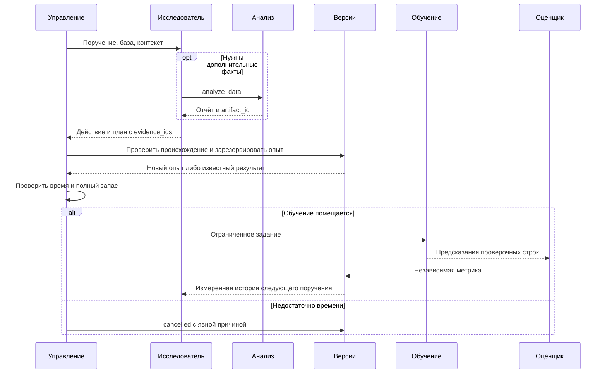

Стрелка «план» ещё не означает начало обучения. Дедупликация может найти тот же полный набор условий и использовать прежнюю запись, а проверка времени — отказать в новом запуске. При отказе нет вымышленного нуля метрики: сохраняется состояние и причина.

### От плана к процессу

План содержит рецепт, параметры, исходный код, преобразования, seed, данные, протокол проверки и ресурсы. Рецепт — доступный способ построения модели. В каталоге описаны допустимые параметры и их диапазоны; конструктор создаёт настоящий объект обучения. `seed` фиксирует начальное состояние случайных операций там, где библиотека его поддерживает.

Диспетчер — основной поток управления — единолично меняет SQLite. Исследовательские потоки могут ожидать API и создавать артефакты, но возвращают планы для принятия диспетчером. Это позволяет получать ответы двух исследователей параллельно и сохранять одну последовательность изменений состояния.

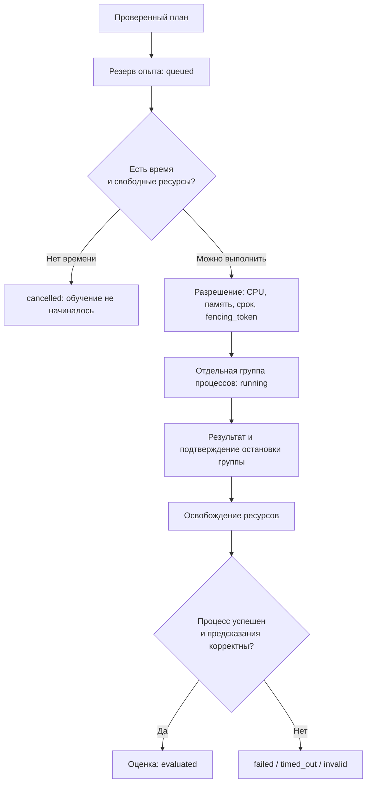

Стрелки показывают состояния, которые нельзя переставить произвольно. Ресурсное разрешение называется `lease`: оно связывает владельца, выделенные ресурсы, срок и номер исполнения. `fencing_token` помогает отвергнуть событие от устаревшего исполнения. Освобождение разрешения происходит после подтверждённой остановки группы, чтобы оставшийся дочерний процесс не работал вне учёта ресурсов.

[Runner](../agent/runner.py) запускает [worker](../agent/worker.py) отдельным процессом. Worker получает закреплённые входы, код и ограниченные параметры окружения. Ключи API ему не передаются. Он строит модель, обучает её только на fit-строках, предсказывает проверочные строки и сохраняет результат. Управление процессами наблюдает время, память и жизнеспособность, завершает потомков при необходимости, дренирует stdout/stderr даже после достижения предела сохраняемого текста.

### Почему собственный Python ограничен

Действие `pipeline` даёт свободу строить конвейер, но не менять оценщик, читать ответы проверки или писать окончательный CSV. Проверяются импорты и очевидные опасные вызовы; для пользовательского конвейера действует ограничение прямого доступа к исходным данным внутри worker. Функции передают разрешённые `X` и `y` через обучение. Ограничение действует и при преобразовании возвращённых предсказаний в обычный массив: пользовательский `__array__` не получает отдельного доступа к файлам после завершения `predict`. Такие объекты не сериализуются как доверенный снимок модели.

Эти проверки не являются полноценной изоляцией произвольного Python на уровне операционной системы. Они ограничивают поддержанный способ использования кода в проекте. Общие ограничения памяти и процессоров снаружи обеспечивает среда соревнования либо контейнер.

## 7. Проверка качества и сохранение результата

### Оценка принадлежит оценщику

Все сопоставимые опыты обучаются и проверяются на одинаковых индексах строк. При регрессии оценщик проверяет конечность чисел; при классификации — допустимость меток. Также проверяются точные колонки файла предсказаний и порядок проверочных индексов. Текст гипотезы не влияет на вычисленную метрику.

Сопоставимость — право сравнивать два результата как варианты одного опыта над задачей. Для него должны совпасть данные, протокол, метрика и полнота обучения `fidelity`. Сейчас обычные модели выполняют `full`; это не утверждение о наличии многоступенчатого отбора на подвыборках.

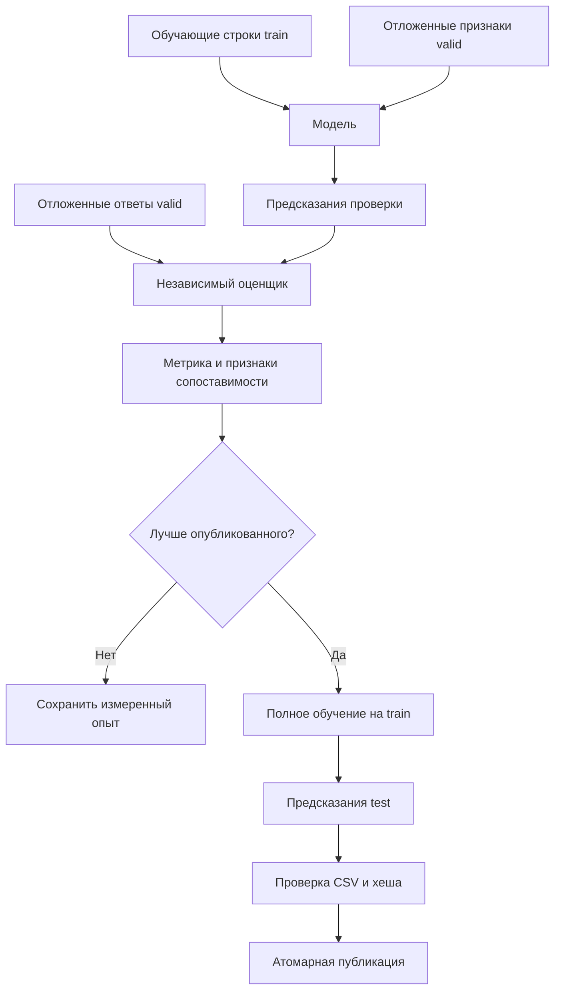

Отдельный путь истинных valid-ответов показывает независимость оценки. Окончательный `refit` — повторное обучение выбранной конфигурации на всём доступном train. Его test-предсказания проверяются по формату, а локальная оценка остаётся оценкой предыдущего опыта на holdout. Ответов test у системы нет.

Оценщик сохраняет и компактную диагностику: общие ошибки, ограниченные сведения по классам и группам признаков. По ним можно предложить следующий опыт, но многократное исследование одного holdout может подстроиться под него. Инфраструктура не доказывает качество переноса на скрытые данные соревнования.

### Лучший измеренный и лучший опубликованный — разные записи

`best_evaluated` — лучшая проверенная локальная оценка. `published_champion` — конфигурация, чей полный ответ уже прошёл проверку и доступен по выходному пути. Между ними может быть задержка: новый лучший вариант ещё обучается на всём train или не успевает поместиться в оставшееся время.

Подготовка ответа проходит `preparing → refitting → validating → published`. В любой момент до последнего шага старый проверенный CSV остаётся на месте. Проверяются число строк, точные колонки, порядок текстовых идентификаторов, допустимые классы либо конечные числовые значения. Ведущие нули идентификаторов сохраняются.

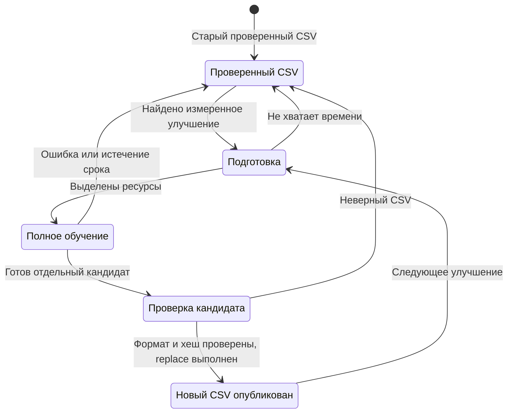

Возврат к `Old` означает сохранение файла, а не откат уже потраченного времени и вычислений. Публикация выполняется через временный файл в каталоге назначения, проверку хеша, запись намерения в журнал, `os.replace` и завершение записи в SQLite. Файловая система и база не объявляются одной транзакцией: журнал публикации позволяет согласовать состояние, если сбой случился после замены файла.

После неуспешного полного обучения или проверки кандидата система сохраняет опубликованный ответ и может попробовать следующий лучший сопоставимый оценённый вариант. Неудачный кандидат исключается из повторной финализации этого запуска, но его измерение не удаляется из научной истории. Такая ошибка фиксируется как `submission.refit_failed`, а не как ухудшение прежней локальной метрики.

## 8. Версии, родители, собственные базы и ветви

### Какие объекты различаются

**Решение** — определённый исходный код, конфигурация и набор компонентов. **Опыт** — выполнение решения на конкретных данных, протоколе и seed. Изменение seed может создать новый опыт того же решения. **Оценка** — результат независимой проверки предсказаний этого опыта. **Попытка исполнения** — технический запуск процесса; ошибка запуска не должна незаметно превратиться в ещё одну независимую оценку.

Отпечаток опыта включает данные, задачу, проверку, рецепт, фактические параметры с умолчаниями, код, преобразования, seed и полноту. Совпадение отпечатков позволяет не обучать одну конфигурацию заново. Словесная гипотеза и имя исследователя не делают одинаковое обучение новым.

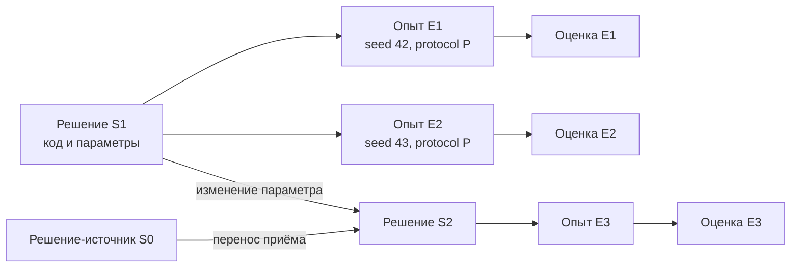

Обычная стрелка от S1 к S2 означает происхождение доработки. Стрелка от S0 отдельно показывает источник переносимого приёма. Обе связи полезны даже тогда, когда S2 не улучшило оценку: измеренный неуспех остаётся частью истории.

### Собственные базы исследователей

В активной ветви у каждого исследователя есть собственная текущая база, или `head`. Улучшение соседа не заменяет её незаметно. Контекст содержит свои результаты на линии происхождения и явно назначенных доноров. Работа фиксируется относительно собственной версии базы: результат от старого поручения может остаться полезным измерением, но не обязан передвигать уже обновлённую голову.

Глобальный выбор лучшего отделён от продвижения собственной базы. Поэтому результат закрытой ветви или законно завершившийся поздний опыт не теряется из финального сравнения только потому, что исследование уже переключилось.

### Исследовательские ветви

Ветвь — сохранённая линия исследования с собственными базами и ограничениями. Контролируемый перенос проверяет один приём сначала на исходной базе, затем на базе другого исследователя без посторонних изменений. При явно выбранном ветвлении появляются направления «принять» и «отклонить». Такие направления нужны, когда система действительно поддерживает и проверяет соответствующий компонент; произвольный текст модели не создаёт доказанный переносимый компонент.

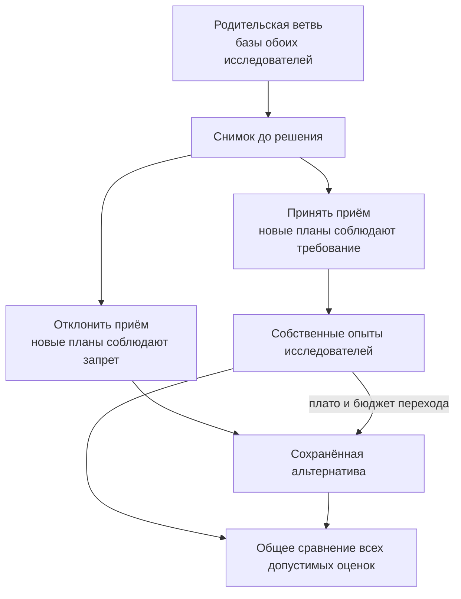

Стрелки от снимка показывают общий причинный старт. Переход к альтернативе не откатывает бюджет, процессы или опубликованный CSV. В `adaptive` успешное преобразование само по себе не создаёт обязательную ветвь: это исследовательское наблюдение, а не разрешение центральной политике сузить все будущие предложения.

При переходе к окончательной доводке измеренный глобальный лучший результат передаётся обоим исследователям явно. Это отдельное зарегистрированное действие, а не скрытое изменение обычных баз. Подробные форматы, транзакции и восстановление описаны в [GRAPH.md](GRAPH.md).

## 9. Время, ресурсы и причины остановки

### Поиск ограничен временем, а не числом обучений

Общий срок отсчитывается от входа в `solution.py`: подготовка, обращения к API, анализ, обучение, оценка и запись расходуют один бюджет. Новый опыт допускается, когда прогноз его длительности вместе с запасом на окончательное обучение и сохранение результата помещается в остаток.

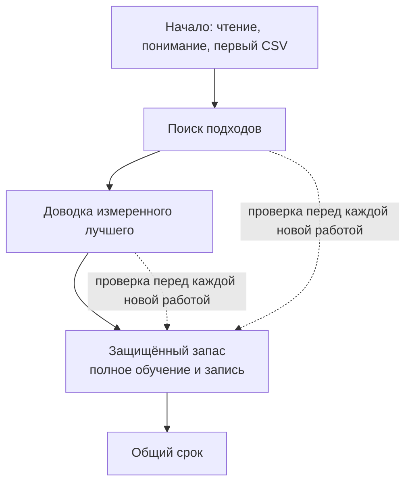

Последовательные стрелки обозначают этапы времени. Пунктирные — проверку резерва, который поиск не должен израсходовать. Обычно на исследование ветвей отводится 85% поискового времени после защиты публикации, затем начинается доводка. Переход возможен раньше, если прогноз следующей партии уже пересекает границу фаз. Это инженерная политика расходования времени, а не условие соревнования и не доказательство оптимальности доли 85/15.

[DurationModel](../agent/duration.py) учится на завершённых запусках соответствующего семейства. Учитываются размер данных, число признаков, потоки и параметры, влияющие на вычисления: например, число деревьев или итераций, глубина и число листьев. Время самого `fit`, если оно известно, отделяется от запуска процесса и других постоянных расходов. Полное обучение прогнозируется для полного train. Превышение срока учитывается как нижняя граница стоимости, а не как успешный быстрый опыт.

У собственных конвейеров одинаковая метка `custom` ещё не означает одинаковую стоимость. Их история разделяется также по закреплённому исходнику. В новом произвольном конвейере не удаётся заранее вывести точную сложность всех параметров: до первых измерений это особенно грубая оценка, защищённая сроком самого процесса.

У нового семейства ещё нет измерений: используется ограниченная первоначальная оценка. Это прогноз с запасом, не гарантия. Поэтому после допуска при выдаче ресурсов время проверяется повторно; процесс всё равно имеет жёсткий срок и наблюдение за ресурсами.

### Что продолжается при исчерпании API

Квота обращений и квота выходных токенов ограничивают новые ответы языковой модели. Они не означают, что обучение обязано завершиться в ту же секунду. Доступные связанные испытания каталога могут продолжаться без API в пределах разрешённой серии и общего времени. Такие планы обозначаются как местный выбор; их нельзя выдавать за новое предложение языковой модели.

В `adaptive` явное действие `tune` задаёт оси, число опытов и время серии. Пока API доступен, обычное действие `catalog` не разрешает автоматически разворачивать серию: следующий самостоятельный ход делает исследователь. При исчерпании API предусмотрен детерминированный местный поиск каталога, который явно отмечается в журнале. Его решения нельзя приписывать языковой модели. В совместимых режимах `catalog` и `code` сохранилась более ранняя политика автоматических местных замен. Явный `stop` адаптивного исследователя принимается; он не заменяется таким же образом, как некорректное предложение.

`stop` исследователя, повтор конфигурации, ошибка формы ответа, слишком дорогой план и общее завершение времени — разные причины. Сообщения и состояние должны позволять отличить их. Окончательное прекращение происходит, когда поиск закрыт временем, доступные допустимые действия не помещаются либо политика явно завершает текущую фазу; число уже выполненных обучений самостоятельной причиной не является.

### Ограничения ресурсов

По умолчанию одно обучение получает до трёх потоков и 10 GiB памяти. Общий `MAX_WORKERS` не разрешает запустить больше двух работ; графовый цикл обычно запускает одно обучение одновременно, пока второй исследователь может ожидать API. Потоки BLAS/OpenMP и параметры библиотек ограничиваются.

Память наблюдается по RSS группы процессов периодическими проверками. Это не отдельный жёсткий Linux cgroup на каждый опыт: общий внешний предел обеспечивает платформа или контейнер. Собственные ограничения не должны превышать условия соревнования: общий срок — не более 10800 секунд, CPU-only, разрешённые библиотеки, изоляция задач. Ресурсные разрешения, учёт API и защита публикации реализованы в [agent/budget.py](../agent/budget.py).

## 10. Что остаётся на диске

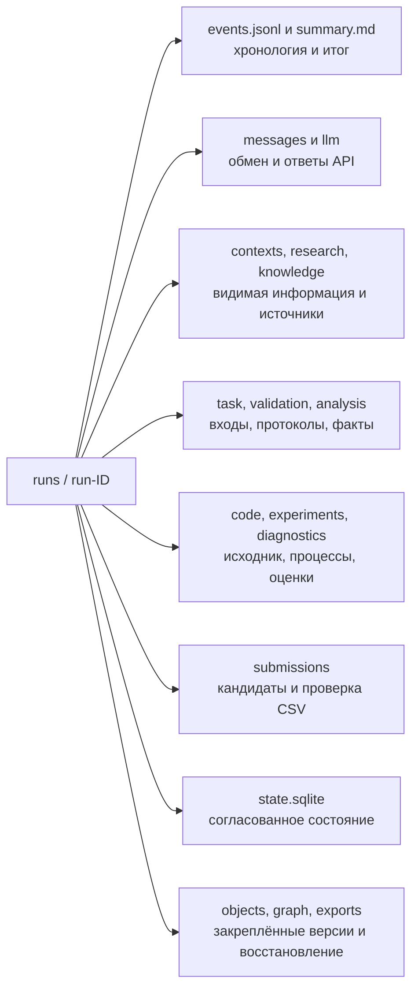

Здесь стрелки обозначают каталоги одного запуска, а подписи — вопрос, на который отвечает группа файлов. Фактический окончательный CSV лежит по пути задачи, а не обязан находиться внутри `runs`.

| Где искать | Что можно установить |
|---|---|
| `summary.md` | Итоговое состояние, опубликованный опыт, метрика, перечень опытов |
| `events.jsonl` | Порядок событий, идентификаторы вызовов, причины отказов и длительность |
| `messages/*.request.json`, `*.response.json` | Точные проверенные сообщения между компонентами |
| `llm/*.request.json`, `*.response.json` | Фактически отправленное модели и доступный ответ провайдера |
| `contexts/` | Снимок видимой исследователю базы, фактов, каталога и задания |
| `research/intent-plan-*.json` | Выбранное действие, evidence_ids, гипотеза и пределы серии |
| `research/decision-*.json` | Неизменяемое решение исследователя, включая stop; пояснения и альтернативы отделены от оценок |
| `research/schema-*.json` | Страницы полного технического профиля, запрошенные при подготовке |
| `research/references-*.json` | Выбранные карточки и фрагменты локальных тетрадей с происхождением; не измеренные факты задачи |
| `knowledge/query-*.json` | Выданные карточки и текстовые публикации библиотеки с knowledge IDs; не измеренные факты задачи |
| `task/` | Исходное условие, проверенная спецификация, полный технический профиль |
| `validation/` | Индексы обучающей и проверочной частей, хеш протокола |
| `analysis/` | Полные отчёты дополнительных запросов к данным |
| `code/` | Исходник, переданный процессу обучения |
| `experiments/` | Задание процесса, stdout/stderr, результат, предсказания, необязательные веса |
| `diagnostics/` | Независимо вычисленная оценка и ограниченные сводки ошибок |
| `submissions/` | Отдельные кандидаты CSV и результаты проверки формата |
| `state.sqlite` | Авторитетное состояние опытов, оценок, публикаций и графа |
| `objects/<sha256>/content` | Неизменяемые содержимые закреплённых артефактов |
| `exports/final-*/` | Читаемые `graph.json`, `ranking.json`, `graph-events.jsonl` |
| `graph/owned-runtime.zip` | Закреплённый код проекта для восстановления версии |

`artifact_id` — ссылка на сохранённый материал. Она не обязана быть обычным путём: разрешение идёт через учёт артефактов с проверками расположения, размера и хеша. Хеш — вычисленная подпись содержимого, позволяющая заметить изменение байтов. Не меняйте файлы `objects` вручную, иначе восстановление перестанет подтверждать происхождение.

SQLite меняет только диспетчер. Журнал `events.jsonl` удобен для наблюдения, но состояние графа определяется таблицами `g_*` и его типизированными событиями. Экспорт — зафиксированный срез состояния; он не обязан включать операции, произошедшие после границы этого среза.

Ключи маскируются, всё окружение и заголовки запросов не выгружаются. Каталоги запусков исключены из Git. При этом контексты, код и ответы могут содержать данные задачи; не следует публиковать `runs` вместе с исходниками.

Сжатые веса необязательны: один снимок ограничен 16 MiB, сумма на запуск — 64 MiB по умолчанию. Отказ сохранить слишком большой снимок не отменяет метрику и предсказания. Для восстановления используются закреплённые код, параметры, версии библиотек и данные, а не обязательная загрузка pickle. stdout/stderr сохраняются до 1 MiB на поток, после чего чтение продолжается во избежание блокировки процесса.

## 11. Сквозной пример на искусственной задаче

### Подготовка входов

Генератор создаёт числовые `x_numeric`, `z_numeric`, категорию `category`, текстовый `id` с ведущими нулями и целевой `label`. В признаках намеренно встречаются пустые ячейки. Категория `NA` остаётся строковым значением и не считается пропуском. При `--kind regression` цель — числовая, метрика — RMSE, меньшее значение лучше.

Для этого примера есть отдельная воспроизводимая команда [scripts/demo_research.py](../scripts/demo_research.py). Она заранее задаёт ответы имитатора так, чтобы пройти именно путь самостоятельного получения фактов и собственного конвейера:

```bash
python scripts/demo_research.py --directory /tmp/stepan-guide-example
```

После генерации:

```text
/tmp/stepan-guide-example/
  task/
    task.md
    train.csv
    test.csv
    sample_submission.csv
    submission.csv
  runs/run-ID/
  demo-result.json
```

Демонстрация создаёт 120 train-строк и 30 test-строк. На весь запуск задаётся 90 секунд, один исследователь, один процесс обучения, режим `adaptive` и отсутствие начальных каталожных испытаний. Это настройки короткой демонстрации, а не рекомендуемый предел настоящего соревнования. Папка назначения должна быть пустой.

Встроенный блок `agent-demo` читается только явно выбранным имитатором. В настоящем API задача интерпретируется по обычному условию, а не по скрытым эталонным ответам. В данном примере ответ имитатора запрограммирован; качество планирования настоящей языковой модели он не измеряет. Чтение фактов, построение модели, обучение, оценка и публикация выполняются настоящим кодом проекта.

### Что наблюдать

Команда выводит JSON с фактическим `run_id`, итоговой метрикой, числом отчётов анализа, публикациями и путём результата. Те же сведения сохраняются в `demo-result.json`. В указанном каталоге запуска откройте `summary.md`, затем посмотрите связанные события:

```bash
python scripts/show_run.py /tmp/stepan-guide-example/runs/run-ID --event validation.created
python scripts/show_run.py /tmp/stepan-guide-example/runs/run-ID --event experiment.evaluated
python scripts/show_run.py /tmp/stepan-guide-example/runs/run-ID --event submission.published
python scripts/show_graph.py /tmp/stepan-guide-example/runs/run-ID
```

`run-ID` здесь заменяется фактическим именем каталога. Для уже известного опыта:

```bash
python scripts/show_run.py /tmp/stepan-guide-example/runs/run-ID --experiment exp-ID
python scripts/show_run.py /tmp/stepan-guide-example/runs/run-ID --contract C16
```

Первые события покажут выбранный протокол и число fit/valid-строк. Далее появится оценка простой базы, полное обучение и первая публикация. Следующие опыты должны иметь тот же `validation_id`. Для любого предложения можно сопоставить `plan_id`, код, `experiment_id`, результат процесса, оценку и публикацию.

### Самостоятельный вопрос исследователя

Сначала имитатор интерпретатора вызывает `inspect_schema` для train, затем формирует спецификацию. Исследователь вызывает `analyze_data` со сводкой `x_numeric` и `z_numeric` без цели. На основании возвращённого `artifact_id` он предлагает `pipeline`: заполнение числовых пропусков, приведение масштаба и линейную Ridge с `alpha=1.0`. Категориальный признак в этой намеренно простой демонстрации не используется. Следующим самостоятельным действием исследователь выбирает `stop`.

Конкретный запрос дополнительных фактов в этом сценарии:

```json
{"kind":"summary","columns":["x_numeric","z_numeric"],"group_by":null,"include_target":false}
```

Полученный `artifact_id` включается в `evidence_ids` предложения. Существенные поля следующего действия:

```text
action = pipeline
recipe_id = python-pipeline-v1
hyperparameters = {"alpha": 1.0}
code = SOURCE из scripts/demo_research.py
tuning = null
evidence_ids = [идентификатор фактически полученного отчёта]
```

Последняя строка поясняет подстановку: идентификатор не задан заранее и не выдумывается. Сам исходник `SOURCE` создаёт `ColumnTransformer`, выбирающий два числовых столбца, затем `SimpleImputer`, `StandardScaler` и `Ridge`. Полный обмен остаётся в `llm/`, исходник — в `code/`, факт — в `analysis/`, задание и предсказания — в `experiments/`, проверки итогового файла — в `submissions/`.

Само наличие инструмента в списке не доказывает его использование. Связку подтверждают `research.analysis_completed`, запись отчёта в `analysis/`, `tool_calls` ответа и последующий `evidence_ids` действия. Содержимое `SOURCE` в демонстрационном сценарии — фактический исходник, передаваемый в `make_pipeline`; значения оценки ему не подставляются.

Проверено в Ubuntu 24.04, Python 3.12.3, 22 октября 2026 года. Команда выполнила запуск `run-20261022T195228Z-b37f0a2b` за 6,08 секунды и завершилась в состоянии `completed`. Сохранён один отчёт `analyze_data`. Ниже фактические локальные измерения этого запуска:

| Опыт | Что обучалось | RMSE на общей проверке | Итог |
|---|---|---:|---|
| `exp-9c09c990d896` | Простая постоянная база | `13.078247006718483` | Первый проверенный CSV опубликован |
| `exp-164f258ea648` | Собственный конвейер с Ridge | `2.8529165087536335` | Полное обучение и новая публикация |

Путь действительно созданного результата — `/tmp/stepan-architecture-guide-demo/task/submission.csv`. В команде выше можно выбрать другое пустое имя каталога; идентификатор и длительность следующего запуска изменятся. Меньший RMSE здесь подтверждает работу сравнения и замены ответа на искусственных данных. Он не является результатом соревнования и не доказывает качество настоящего исследователя: ответы языковой модели в примере заданы сценарием.

### Как восстановить полученную версию

Выберите реально измеренный `exp-ID` из итогового отчёта:

```bash
python scripts/reconstruct_solution.py /tmp/stepan-guide-example/runs/run-ID exp-ID \
  /tmp/stepan-rebuilt --task-root /tmp/stepan-guide-example/task
python /tmp/stepan-rebuilt/run_refit.py
```

Первый вызов проверяет хеши и готовит исходник кандидата, план, окружение, протокол, список входов и отдельное задание. Второй действительно обучает модель и записывает `/tmp/stepan-rebuilt/candidate.csv`. Он не заменяет опубликованный `submission.csv`, не устанавливает библиотеки и не обращается к языковой модели. Нужны исходные train/test и совместимые версии установленных пакетов.

Повторный запуск основного `solution.py` создаёт новый `run_id`. Автоматического продолжения старого исследовательского бюджета сейчас нет; восстановление версии и продолжение всего запуска — разные операции.

## 12. Как разбирать неудачный запуск

Начните с трёх вопросов: опубликован ли проверенный ответ, какой этап завершился последним, к какому опыту относится ошибка. Не удаляйте каталог запуска до разбора: причина часто находится в паре сообщений и журнале конкретного процесса.

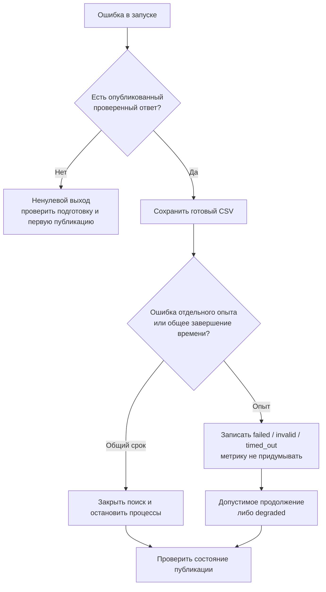

Стрелки показывают порядок действий после проблемы. Наличие ответа позволяет сохранить практический результат, но не скрывает ошибку исследования. Штатная остановка на общем бюджете отличается от отказа запуска процесса или неверных предсказаний.

| Признак | Где искать причину | Следующий шаг |
|---|---|---|
| Не найдены или неоднозначны входы | `C01`, код `AMBIGUOUS_PATH` | Передать `task.md` одной задачи, проверить соседние файлы |
| Неверная цель или метрика | `C02`, `C04`, сохранённый `task/` | Сопоставить предложение с условием и схемой таблицы |
| Ошибка разделения | `validation.created` либо `INVALID_SPLIT` | Проверить группы, время, число классов и размеры частей |
| Долго нет ответа API | `llm.call_started`, `llm.waiting` | Сравнить HTTP-срок и срок всей операции, проверить доступный бюджет |
| Ответ модели обрезан | `llm.output_truncated`, raw response | Проверить `finish_reason` и потолок выходных токенов |
| Предложение отвергнуто | `graph.proposal_rejected`, `research.action_proposed` | Проверить происхождение, допустимость параметров и текущую версию поручения |
| Обучение не началось | `search.admission`, состояние `queued/cancelled` | Проверить прогноз, запас и выдачу ресурсов |
| Процесс упал | `job.finished`, stdout/stderr опыта, `result.json` | Отличить ошибку конструктора, fit, памяти, времени и потомков |
| Нет метрики | `C16`, `experiment.rejected` | Проверить предсказания и сопоставимость; отсутствие оценки не равно нулю |
| Метрика лучше, CSV прежний | `best_evaluated`, `submission.refit_deferred`, `submissions/` | Проверить полное обучение и итоговую проверку формата |
| Каталог запуска слишком велик | `scripts/analyze_run.py`, снимки и API-артефакты | Проверить реальные категории размеров и заданные пределы |

Команды чтения:

```bash
python scripts/show_run.py runs/run-ID --event failed
python scripts/show_run.py runs/run-ID --event search.admission
python scripts/analyze_run.py runs/run-ID
```

### Что видно в обычном терминале

По умолчанию `CONSOLE_LOG_FORMAT=concise` выводит короткие русские сообщения в stderr: текущий этап, предложение и его явную гипотезу, модель с параметрами, прогноз длительности, остаток времени и запас, измеренную метрику и разницу с исходной базой. Отдельно видны причины замены предложения и переключения ветви, ошибки и путь уже проверенного ответа. Гипотеза помечена как предложение; она не выдаётся за измеренный результат или скрытые рассуждения модели.

Повторяющиеся обычные решения продолжать поиск подавляются. Сообщения ожидания обучения и API укрупняются до минутных интервалов. Отдельный успешный выход процесса не подменяет оценку: вслед за ним выводится независимая метрика. Ошибки и предупреждения остаются видимыми с краткой причиной; подробный traceback находится в `events.jsonl`.

Для подробностей конкретного запуска можно временно выбрать другой формат:

```bash
CONSOLE_LOG_FORMAT=human python solution.py /path/to/task.md --env-file .env
CONSOLE_LOG_FORMAT=json python solution.py /path/to/task.md --env-file .env
```

`human` показывает технические имена событий и поля; `json` — полные JSON-записи событий. Переменная процесса имеет приоритет перед `.env`. Выбор представления терминала не сокращает `events.jsonl`: туда записываются все события независимо от порога `LOG_LEVEL`. Маскирование ключей действует до обоих представлений. Формат реализован в [agent/observability/console.py](../agent/observability/console.py), запись — в [agent/observability/logging.py](../agent/observability/logging.py).

`request_id` связывает запрос и ответ в `messages/`. `span_id` и `parent_span_id` показывают вложенные операции. `experiment_id`, `job_id` и `submission_job_id` связывают опыт, процесс и подготовку окончательного ответа. Временные метки журналов записаны в UTC.

Отличайте `researchers_stopped` (исследователи явно завершили работу), `research_unavailable` (не удалось получить допустимое решение), `context_unavailable` (не удалось собрать ни одного поручения) и `no_affordable_candidates` (нет подходящего опыта по времени). Ошибка одного контекста не должна прерывать готовую работу другого исследователя. Ошибка предложения, потратившего API-попытки, возвращается в следующий контекст как `research_feedback`, пока хватает ресурсов; повторяемая ошибка до обращения к API не создаёт бесконечный цикл.

Проверяйте фактическую причину: полное истечение per-job срока, ошибка API, неверный CSV и нехватка остатка общего времени требуют разных исправлений. Не увеличивайте случайно все пределы сразу — так исчезнет возможность установить, что помогло.

## 13. Как расширять проект

### Новый способ анализа

Начните с вопроса, на который должен отвечать инструмент: например, нужна ли сводка частот пар категорий на обучающих строках. Опишите область разрешённых данных, ограничения размера и формат результата. Затем:

1. Добавьте допустимый запрос в `ANALYSIS_SCHEMA` и независимую проверку прямых вызовов в [tools/analysis.py](../tools/analysis.py).
2. Реализуйте ограниченное вычисление без произвольного присланного кода. Не передавайте инструменту метки valid-строк.
3. Сохраните полный отчёт и компактный ответ с `artifact_id`, областью и числом обработанных строк. Сообщите о выборке и сокращении.
4. Согласуйте описание инструмента, запросы Gateway, примеры и проверки. Исследователь должен иметь возможность получить факт в одном диалоге и сослаться на него в действии.
5. Проверьте граничные случаи: неизвестная колонка, запрос цели в сравнении с test, слишком большой ответ, закрытый бюджет, параллельные одинаковые запросы.

Не добавляйте обязательный вывод в общий профиль только ради нового приёма. Факт должен быть доступен, а решение применить приём — оставаться исследовательским, если оно не связано с условиями задачи или защитой оценки.

### Новое семейство моделей

Рецепты в [recipes/](../recipes/) описывают семейство, поддержанные задачи, параметры и значения по умолчанию. [Catalog](../agent/catalog.py) нормализует и проверяет их, а [agent/ml.py](../agent/ml.py) строит модели и преобразования.

Добавляйте семейство согласованно: рецепт, конструктор, проверку параметров, ограничение потоков, обработку пропусков и категорий, воспроизводимый seed. Для нового параметра длительности дополните [agent/duration.py](../agent/duration.py), чтобы дорогой вариант не оценивался как дешёвый. Не используйте библиотеку, отсутствующую в разрешённых зависимостях.

Если семейство поддерживает переносимый компонент, добавьте проверяемую реализацию и регистрацию в [agent/graph/constructor.py](../agent/graph/constructor.py). Параметр с таким же названием не является доказательством одинакового преобразования в двух семействах. Проверка переноса должна удерживать остальные параметры неизменными.

Минимальный полезный набор проверок: построение модели с допустимыми параметрами, отказ неизвестного параметра, настоящее fit/predict для поддержанного типа задачи, отсутствие обучения преобразования на valid, сохранение формата ответа, учёт ресурсов и платформенная упаковка.

### Новый исследовательский приём

Сначала определите, является ли он обычным запросом фактов, единичным опытом, связанной настройкой или новым действием. Приём, помещающийся в `catalog`, `pipeline` или `tune`, не требует дополнительного уровня сущностей. Полезнее добавить ясное описание условий применимости и проверку поведения, чем новый центральный выбор стратегии.

Если меняется формат сообщений, обновите производителя, потребителя, [contracts/contracts.schema.json](../contracts/contracts.schema.json), примеры и проверки одновременно. Не принимайте старое поле с новым смыслом молча. Для сохранённых форматов обозначьте версию и явный переход: старый граф должен либо корректно читаться, либо давать понятный отказ.

Изменение промпта само по себе не подтверждает, что исследователь получил новые полномочия. Проверьте фактический путь: инструмент присутствует в API-запросе, ответ выполняется, факт попадает в следующий шаг, план проходит допуск, настоящее обучение даёт независимую оценку, версия и публикация согласованы.

## 14. Проверки и платформенная поставка

Для локального изменения запускайте относящиеся к нему проверки. Для изменения поведения нескольких модулей требуется полный прогон:

```bash
python scripts/check.py
```

Ссылки действующих документов, заголовки, JSON-примеры запросов анализа и структуру блоков схем проверяет:

```bash
python scripts/check_docs.py
```

Это не полная проверка синтаксиса Mermaid. Для независимой полной отрисовки установите Mermaid CLI отдельно в среде разработки и передайте путь к `mmdc`: `python scripts/check_docs.py --mermaid-cli /path/to/mmdc`. Пакет не добавляется в зависимости агента и не устанавливается во время решения. При подготовке этого руководства все 15 его схем и схема отчёта ревизии действительно отрисованы Mermaid 11.12.2 в отдельной среде разработки; изображения выборочно просмотрены. GitHub распознаёт стандартные блоки `mermaid`, использованные в документе.

`--jobs 2` или `--jobs 3` разделяет независимые тесты на несколько процессов. Это режим разработки; он не меняет лимиты реального запуска. Проверки компилируют исходники и выполняют `unittest`. В наборе есть испытания управления состоянием с явно заданными тестовыми оценками и сквозные испытания с настоящим обучением на искусственных CSV. Эти виды доказательства различаются.

Платформа получает архив, собранный [scripts/package_solution.py](../scripts/package_solution.py):

```bash
python scripts/package_solution.py
```

Проверьте фактически напечатанный путь результата и следуйте [PLATFORM.md](PLATFORM.md). Обычный архив всего репозитория не является поставкой. Платформенный ZIP плоский: `solution.py`, точный `requirements.txt`, отдельные читаемые корневые `.py` с неизменёнными байтами исходников и открытые текстовые ресурсы `stepan_resources.py`. Точка входа восстанавливает структуру собственных пакетов во временном каталоге; закодированного исходника и исполняемого вложенного архива в ней нет.

Для чтения локальных тетрадей в текстовые ресурсы явно включены пять файлов: индекс, описание происхождения, лицензия и два оригинальных `.ipynb`. Это изучаемый JSON-текст; тетради не исполняются при распаковке или чтении. Их наличие в исходном репозитории без записи в списке упаковки само по себе не обеспечило бы доступ на платформе.

Отдельно в поставку включены шесть ресурсов `recipes/knowledge`: манифест, карточки, описания соревнований, тексты источников, журнал отбора и уведомление о лицензии исходного корпуса. На платформе они читаются локально; подготовительный `prepare_knowledge.py` и исходный архив корпуса для решения задачи не требуются. Пять файлов тетрадей и шесть ресурсов текста имеют разные происхождение и назначение.

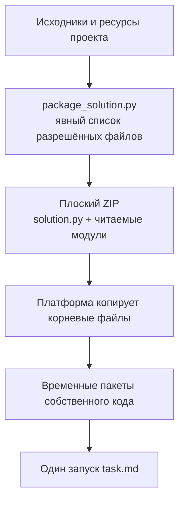

Стрелки показывают подготовку и выполнение поставки. Данные, `.env`, `runs`, ключи, окружения разработки и снимки весов не должны попасть в архив. Новому модулю или текстовому ресурсу требуется запись в правилах упаковки и проверка запуска после платформенного копирования; успешный запуск из исходной папки этого не заменяет.

Для каждого выпуска фиксируйте, какой код проверен, в какой среде и что именно выполнялось. Результаты этой ревизии находятся в [VALIDATION-ARCHITECTURE.md](VALIDATION-ARCHITECTURE.md). Полный искусственный прогон не доказывает поведение настоящего провайдера, качество на скрытых данных и соблюдение всех особенностей внешней платформы. Трёхчасовой запуск с настоящим API — отдельное измерение.

## 15. Границы возможностей и карта документации

В проекте есть рабочие ограничения: фиксированная проверка holdout вместо полной перекрёстной проверки, ограниченный набор метрик и форматов, описательные анализы с выборкой, эвристический прогноз длительности, наблюдение памяти вместо отдельного cgroup на опыт. Произвольные ансамбли, автоматическое продолжение прерванного исследования и перенос опыта между задачами не подразумеваются наличием соответствующих слов в исходной архитектурной схеме.

Адаптивный исследователь не означает неограниченное исполнение любого кода. Его свобода заключается в запросе дополнительных фактов, выборе подхода и явном предложении опыта в рамках проверяемых ресурсов и независимой оценки. Нарушение границ задачи не превращается в допустимый приём по просьбе модели или по тексту внешней тетради.

Для повседневной работы используйте это руководство и:

- [ARCHITECTURE_REVIEW.md](ARCHITECTURE_REVIEW.md) — подтверждённые причины архитектурных изменений и границы проверки;
- [PLATFORM.md](PLATFORM.md) — подготовка поставки;
- [LOGGING.md](LOGGING.md) — точные события и идентификаторы;
- [GRAPH.md](GRAPH.md) — форматы и гарантии графа;
- [OPEN-RESEARCH.md](OPEN-RESEARCH.md) — адаптивные исследовательские действия;
- [TIME-SEARCH.md](TIME-SEARCH.md) и [FINAL-REFINEMENT.md](FINAL-REFINEMENT.md) — управление временем и фазами;
- [CONTRIBUTING.md](../CONTRIBUTING.md) — порядок разработки.

Документы `RUN-REVIEW-*`, `VALIDATION-*` и исходные материалы `docs/architecture/` фиксируют исторические наблюдения, версии и замыслы. Их числа и описания не следует читать как действующие настройки текущей реализации. При расхождении поведение проверяется по фактическому коду и связанным тестам, затем действующее руководство обновляется.
