# AutoML: руководство участника команды

Это руководство описывает действующий адаптивный режим из ветки, основанной на `feat/final-data-research`, включая общий кеш входов из `7508799` и подключение разрешённых библиотек. Начните с общей картины, затем пройдите искусственный пример. Отдельный [разбор архитектуры и библиотек](LIBRARY_REVIEW.md) объясняет принятые решения и пределы проверки. Старые отчёты в `docs/` описывают свои состояния исходников; их цифры нельзя переносить на текущую версию.

## Оглавление

1. [Задача, входы и результат](#1-задача-входы-и-результат)
2. [Подготовка Ubuntu и настройки](#2-подготовка-ubuntu-и-настройки)
3. [Границы ответственности](#3-границы-ответственности)
4. [От запуска до первого ответа](#4-от-запуска-до-первого-ответа)
5. [Как исследователь получает факты](#5-как-исследователь-получает-факты)
6. [Как устроен один опыт](#6-как-устроен-один-опыт)
7. [Библиотеки и обработка данных](#7-библиотеки-и-обработка-данных)
8. [Проверка качества и сохранение ответа](#8-проверка-качества-и-сохранение-ответа)
9. [Версии и происхождение](#9-версии-и-происхождение)
10. [Время, очередь и остановка](#10-время-очередь-и-остановка)
11. [Файлы и восстановление](#11-файлы-и-восстановление)
12. [Сквозной искусственный пример](#12-сквозной-искусственный-пример)
13. [Разбор ошибок](#13-разбор-ошибок)
14. [Развитие и поставка](#14-развитие-и-поставка)

## 1. Задача, входы и результат

Один запуск решает одну табличную задачу. В `task.md` записаны условие, метрика качества и формат ответа. Метрика — численное правило сравнения предсказаний с известными ответами. Рядом находятся обучающая таблица с известными ответами, тестовая таблица без них, иногда шаблон ответа и словарь столбцов. Входной столбец называется признаком; предсказываемый — целью. Имена файлов, столбцов и меток берутся из условия и проверяются по данным.

Регрессия предсказывает числа, классификация — классы либо вероятности. Сейчас реализованы RMSE, MAE, R², accuracy, macro/weighted F1, log loss и бинарная ROC AUC. Поддержаны несколько числовых целей с последовательным обучением отдельных моделей. Конкретное сочетание типа задачи, метрики и выходных колонок должно пройти [проверку спецификации](../agent/task.py) и [проверку предсказаний](../agent/predictions.py).

Для измерения качества часть известных строк отделяется для проверки. Остальные строки, на которых модель учится, далее обозначаются `fit`. После выбора решения `refit` означает новое обучение на всей обучающей таблице для подготовки окончательного ответа. CSV — текстовый формат таблицы; JSON — формат небольших структурированных сообщений и настроек. API здесь означает программное обращение к языковой модели, CPU — обычный процессор.

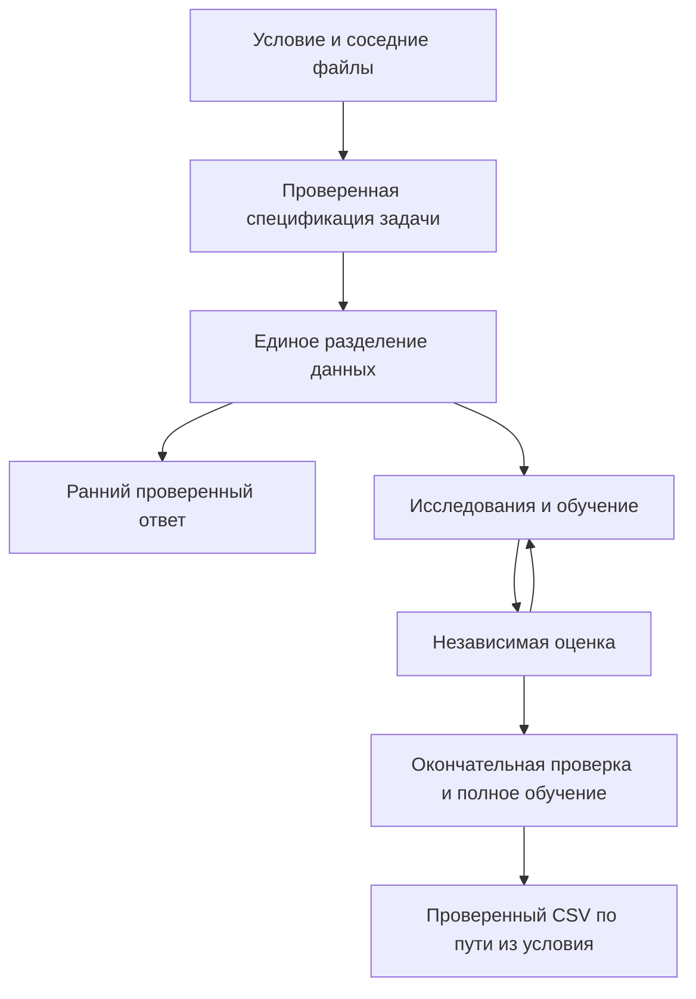

Стрелки показывают движение данных и результатов. Возврат от оценки означает следующий опыт, а не повторное определение метрики. Итоговый CSV — продукт работы; каталог `runs/run-…/` — свидетельства его происхождения.

## 2. Подготовка Ubuntu и настройки

Нужен Python 3.12. Зависимости устанавливаются **до** обработки задачи. На чистой Ubuntu 24.04 подготовьте Python, отдельное окружение и системную OpenMP для LightGBM:

```bash
sudo apt update
sudo apt install python3.12 python3.12-venv libgomp1
python3.12 -m venv .venv
source .venv/bin/activate
python -m pip install -r requirements.runtime.txt
python scripts/doctor.py
```

`requirements.runtime.txt` — разрешённое подмножество для разработки. Полный список организаторов находится в `requirements.organizers.txt`; платформенный `requirements.txt` должен совпадать с ним побайтно. Агент не устанавливает пакеты во время соревнования. `doctor.py` показывает версии и наличие переменных API, но не значения ключей; он не заменяет настоящее пробное обучение.

Для обращения к языковой модели скопируйте `.env.example` в `.env`, заполните предоставленные командой параметры и явно передайте файл:

```bash
python solution.py /absolute/path/task.md --env-file .env
```

Уже существующие переменные процесса имеют приоритет перед `.env`. Файл не исполняется как оболочка, подстановка команд не выполняется. Не добавляйте его в Git. Настройки читаются в [Config](../agent/config.py), запуск — в [runtime](../agent/runtime.py).

| Настройка | Смысл |
|---|---|
| `AUTOML_PROFILE` | Запуск командой по умолчанию выбирает `platform`; пример `.env` выбирает `development` с квотами разработки |
| `TIME_BUDGET_SECONDS` | Общий срок, максимум 10800 секунд, включая подготовку и сохранение |
| `RESEARCH_MODE` | `adaptive` по умолчанию; `catalog` и `code` — прежние режимы для сравнения |
| `GRAPH_ENABLED` | Постоянный граф версий, по умолчанию включён |
| `MAX_WORKERS`, `GRAPH_TRAIN_WORKERS` | Число одновременно исполняемых заданий и обучений |
| `TRAIN_CPU_THREADS`, `TRAIN_MEMORY_MB` | Ресурсы одного задания, сверху ограничены конфигурацией |
| `LLM_MAX_CALLS` | Фактические API-попытки; в `platform` по умолчанию числового ограничения нет |
| `LLM_RESEARCH_TOOL_SECONDS` | Временной бюджет дополнительных инструментов одного диалога |
| `FEATURE_RESEARCH_ENABLED` | Чередование внимания к признакам и фоновая подготовка небольших программ признаков |
| `MODEL_SNAPSHOT_MAX_BYTES` | Необязательные сжатые веса; воспроизведение не требует их наличия |

Не переносите все настройки старого `.env` без чтения: явный `RESEARCH_MODE=catalog` сохраняет прежние ограничения даже при новом коде. Все допустимые диапазоны и значения по умолчанию находятся в `Config.from_env`.

## 3. Границы ответственности

Оркестратор связывает части и ведёт выполнение. В адаптивном режиме он также организует начальные испытания, чередование поручений, фоновые программы признаков и переход к окончательной доводке. Поэтому утверждение, что он совсем не влияет на стратегию, было бы неверным. При этом он не назначает оценку и не ограничивает исследователя одним первоначальным описанием таблицы.

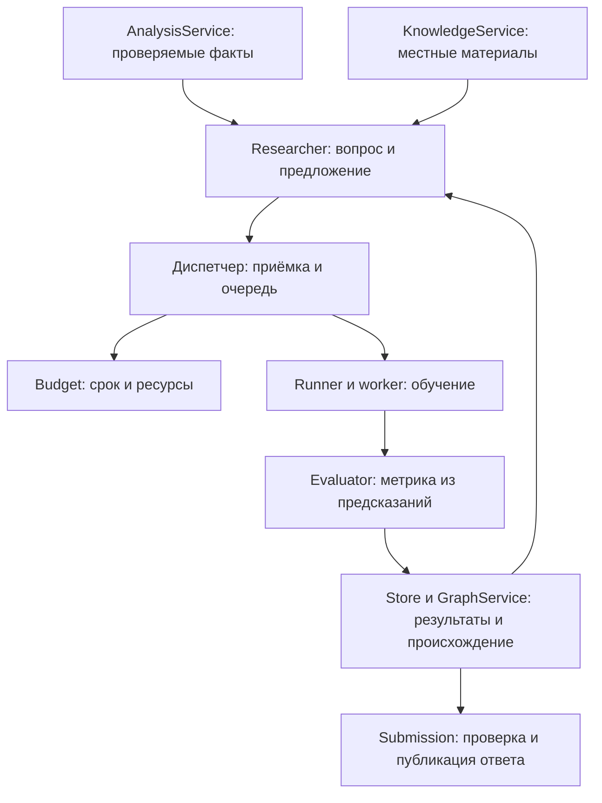

Стрелка от оценки к хранилищу означает фиксацию измеренного результата. Исследователь получает его в следующем контексте. Он не может заменить число своим заявлением об улучшении.

| Кто | Полномочия и ограничения |
|---|---|
| `TaskInterpreter` + `resolve_spec` | Предложить понимание условия, проверить его по таблицам и допустимым форматам |
| `Evaluator` | Принять допустимое разделение, вычислить метрики, ограниченные диагностические сводки |
| `Researcher` + `Gateway` | Запросить факты, предложить модель, признаки, код или ограниченную серию настройки |
| `Catalog`, `Constructor`, схемы | Проверить параметры, происхождение кода и соответствие предложения действительному исполнению |
| `Orchestrator`, графовый контроллер | Принять допустимую работу, упорядочить запуск, передать обратную связь, завершить поиск |
| `Budget`, `Runner`, `worker` | Разрешить ресурсы на срок, запустить процесс, остановить дерево процессов |
| `Store`, `GraphService` | Единственная согласованная запись состояний из потока диспетчера |
| `Submission` | Проверить полностью готовый CSV и заменить опубликованный результат |

Схемы сообщений проверяет `jsonschema`. Проверки смысла — например, совпадает ли разделение данных и доступен ли родитель — остаются у соответствующего владельца. Библиотека форматов не решает за исследователя, какую модель испытывать.

## 4. От запуска до первого ответа

[bootstrap](../agent/runtime.py) создаёт каталог запуска, журнал, хранилище артефактов, бюджет и локальную базу данных SQLite. Артефакт — сохранённый файл с зарегистрированными идентификатором и отпечатком содержимого. Затем система читает условие и техническое описание таблиц. Поиск соседних файлов не обходит чужие задачи; после обнаружения входы профилируются отдельно.

Интерпретатор предлагает тип задачи, цель, метрику и формат выхода. `resolve_spec` проверяет существование колонок, допустимые метки и согласованность ответа. Предложенный способ проверки становится фиксированным протоколом: обычное, групповое либо временное отделение проверочных строк.

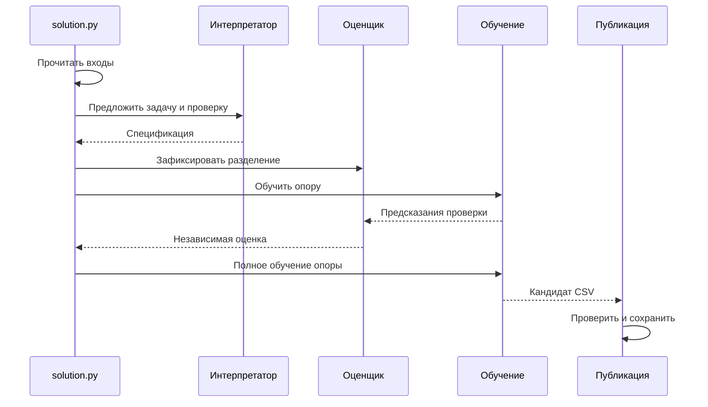

Первая модель `Dummy` даёт аварийный корректный ответ: среднее для регрессии или простую опору для классификации. Её не предлагают исследователям как содержательное направление настройки. После неё идут начальные обучаемые решения и исследования. Публикация первой опоры позволяет сохранить пригодный файл, если сложный опыт позже завершится ошибкой.

## 5. Как исследователь получает факты

Контекст содержит условие, краткие обязательные факты о схеме и пропусках, собственную базу исследователя, сильнейшие измеренные решения, ошибки прошлых предложений и доступные действия. База — опыт, от которого участник продолжает работу. Она может отличаться от лучшего общего решения; оба факта показываются явно.

Первоначальная сводка не является единственным доступным представлением. `analyze_data` в [AnalysisService](../tools/analysis.py) предоставляет дополнительные ограниченные запросы. `schema` позволяет просмотреть столбцы по страницам, `summary` — выбранные распределения, `groupby` — группы, другие операции — связи, пропуски и сравнения признаков. Точные поля запроса заданы `ANALYSIS_SCHEMA`; примеры — в [тестах доступа](../tests/test_analysis_access.py).

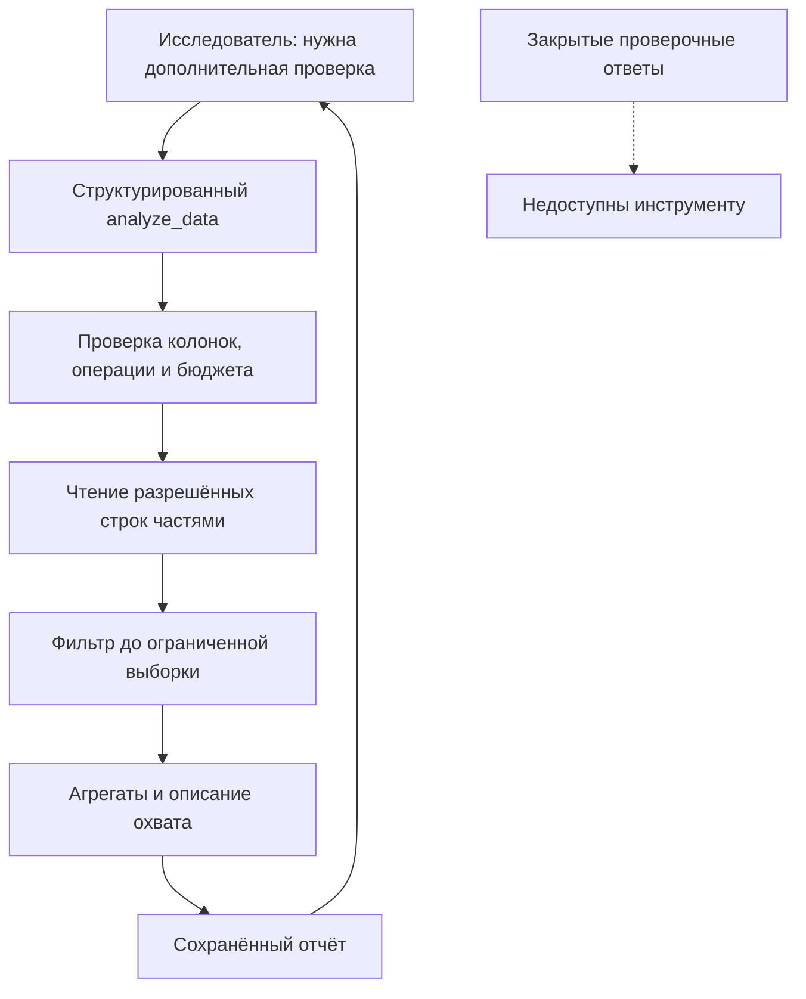

Сплошные стрелки — допустимый путь запроса. Пунктир показывает закрытый источник. Анализ использует обучающие строки текущего разделения; дополнительные сводки не открывают построчные ответы проверки. Исключённый идентификатор можно диагностировать как метаданные, но это не возвращает его в признаки модели автоматически. Все цели исключаются из входов и фильтров.

Потоковое чтение позволяет не потерять редкую группу только потому, что её не было в первой случайной выборке. При ограничении числа строк отчёт указывает фактический охват. Таблица целиком не отправляется в API. Собственный `make_pipeline` получает разрешённые обучающие признаки и ответы от Runner, а при предсказании — только признаки.

Чтобы не разбирать один CSV заново в каждом процессе, подготовка задачи теперь создаёт ограниченный общий кеш входных столбцов. Это способ передачи исходных значений, а не заранее обученная обработка признаков. Числа сохраняют типы; строковые значения восстанавливаются из словаря. Процессы получают ссылки с хешами, открывают массивы NumPy только для чтения и создают отдельные копии своих разрешённых строк до вызова модели. Закрытые ответы не остаются в её доступном буфере.

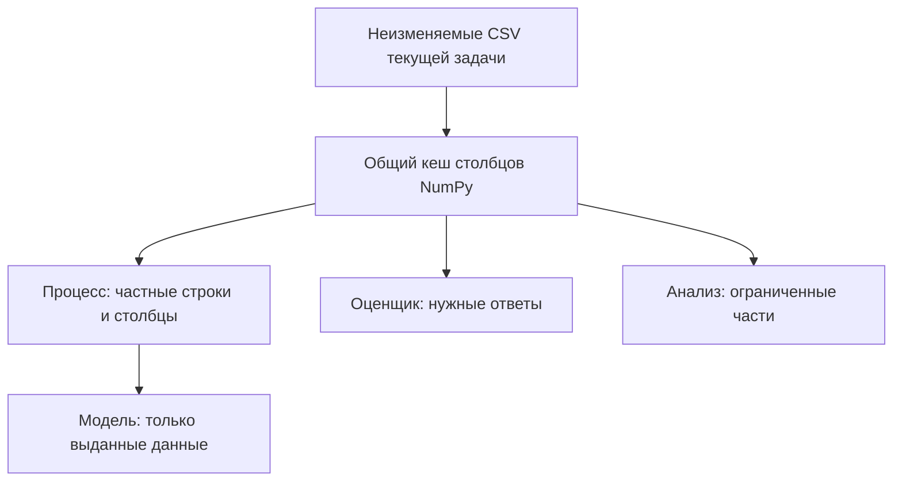

Стрелки из кеша означают проверенное чтение исходных значений. Медианы, частоты и статистики признаков всё равно обучаются отдельно на fit. Кеш ограничен 512 MiB на запуск и 128 столбцами на таблицу; при нехватке места/времени остаётся путь чтения CSV. Подробности и измерения команды — [DATA-TRANSPORT.md](DATA-TRANSPORT.md), код — [data_transport.py](../agent/data_transport.py).

`search_knowledge` обращается к местной подготовленной подборке без сети. Это сторонние разборы, карточки и авторские примеры проекта; наличие ссылки не означает наличия исходной тетради `.ipynb`. Происхождение и ограничения описаны в [KNOWLEDGE.md](KNOWLEDGE.md). Текст материала — изучаемые данные, а не дополнительные полномочия модели.

## 6. Как устроен один опыт

В адаптивном режиме предложение называется `ResearchAction-v1`. Доступны действия `catalog` — готовый рецепт, `pipeline` — собственный `make_pipeline`, `features` — проверяемая программа признаков, `tune` — ограниченная серия Optuna, `stop` — явное завершение. Точные варианты находятся в [research_actions.py](../agent/research_actions.py).

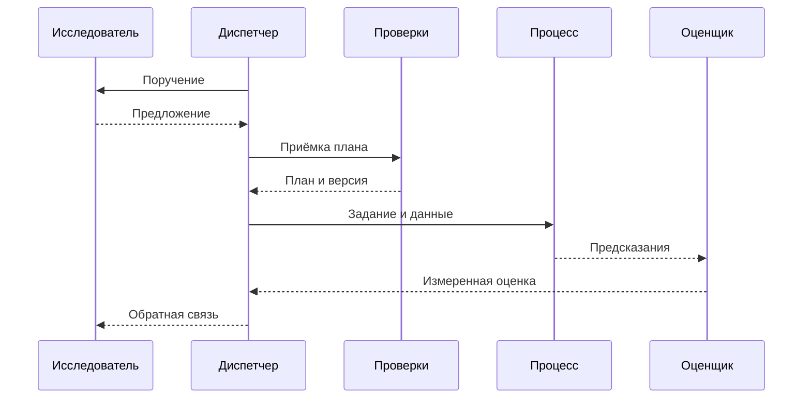

Опыт получает `experiment_id`; повтор той же исполняемой конфигурации распознаётся по отпечатку кода, параметров и условий. Неверный план не становится обучением. Причина отказа сохраняется и возвращается исследователю. Состояние «предложено» не означает «измерено».

`features` использует [FeatureProgram](../agent/feature_engineering.py): например, пропуски, произведения, частоты, групповые статистики. Сначала программа учится только на обучающих строках, затем неизменно применяется к проверке и тесту. Групповое среднее на тесте не пересчитывается по составу тестового пакета.

`tune` задаёт область изменения параметров, число попыток и время серии. Серия — несколько связанных запусков. Уже существующая [OptunaSearch](../agent/optuna_search.py) предлагает параметры через `ask`, а получает только подтверждённую оценку через `tell`. Она не запускает вторую очередь и не обучает модель в исследовательском потоке. Параметры вне объявленной области фиксированы.

## 7. Библиотеки и обработка данных

Каталог показывает только рецепты доступных пакетов. Теперь среди собственных рецептов есть LightGBM 4.6.0 и XGBoost 2.1.4 для классификации и регрессии. Они проходят тот же путь бюджета, версий, оценки и публикации, что остальные модели. Это расширение доступных опытов; улучшение соревновательной метрики ещё требуется измерить.

| Семейство | Обработка в готовом рецепте | Существенные ограничения |
|---|---|---|
| Линейное | Медианы, разреженное кодирование категорий, масштабирование чисел | Высокая размерность зависит от категорий |
| HistGradientBoosting, леса | Медианы и порядковые номера категорий | Порядковый код не означает осмысленный порядок категорий |
| CatBoost | Числовые NaN, строковые категории с обозначением пропуска | Работа только на CPU в готовом рецепте |
| LightGBM | Медианы и порядковые номера категорий | Здесь не используется его отдельный режим нативных категорий |
| XGBoost | Та же подготовка; метки классов кодируются по обучающим ответам и возвращаются обратно | CPU, `tree_method=hist`; порядок вероятностей согласуется с исходными метками |

Подготовка реализована в [ml.py](../agent/ml.py), её описание для исследователя — в [preprocessing.py](../agent/preprocessing.py). Данные проверки не участвуют в подборе медиан, кодов категорий или преобразования цели. Готовые новые рецепты не передают проверочную выборку в раннюю остановку библиотеки и не создают внутреннее разделение.

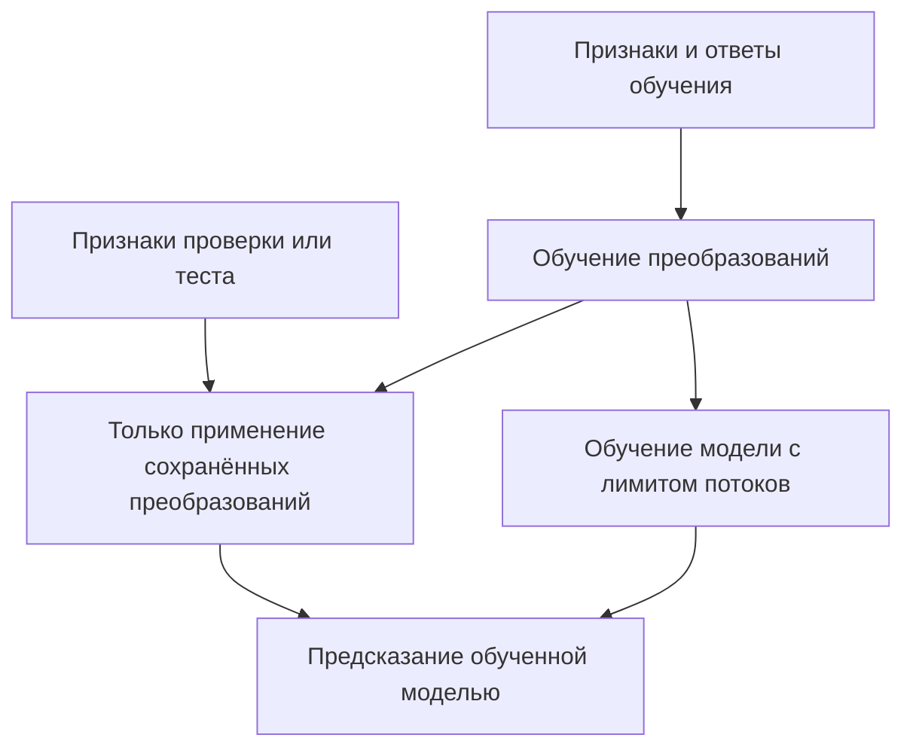

Стрелка от обучения преобразований к применению означает использование уже найденных параметров. Она не означает дополнительное обучение на проверке. Собственный Python может выбирать иную допустимую подготовку; тогда описания готового рецепта недостаточно — нужен его сохранённый исходник.

## 8. Проверка качества и сохранение ответа

Оценщик читает предсказания процесса и сам вычисляет метрику. Он проверяет номера строк, размерность, конечность чисел, метки и вероятности. Для сравнения важны не только значения: должны совпадать задача, данные, разделение, метрика и полнота проверки.

| Метрика | Что сравнивается | Лучше |
|---|---|---|
| RMSE | Корень из средней квадратичной ошибки; сильнее штрафует большие промахи | Меньше |
| MAE | Средняя абсолютная ошибка в единицах цели | Меньше |
| R² | Насколько предсказание объясняет изменчивость относительно среднего; возможно отрицательное значение | Больше |
| Accuracy | Доля верных меток | Больше |
| Macro/weighted F1 | Согласованность точности и полноты по классам; равные веса классов либо веса по числу ответов | Больше |
| Log loss | Ошибка вероятностей с сильным штрафом за уверенный неверный ответ | Меньше |
| ROC AUC | Порядок положительных и отрицательных примеров по вероятности заданного положительного класса | Больше |

Выбор определяется условием, а не тем, какая метрика дала красивое число.

В адаптивной работе оценки идут по строкам `selection_indices` из сохранённого протокола. Если размер и структура позволяют, отдельные `confirmation_indices` остаются закрытыми до завершения исследований. В событии `validation.confirmation_reserved` их количества названы `selection_rows` и `confirmation_rows`. После закрытия API кандидаты сравниваются на закрытой части по уже сохранённым предсказаниям. При слишком малой проверочной части подтверждение явно недоступно; причина сохраняется. Это не отдельная внешняя тестовая выборка и не гарантия от любого переобучения на проверке. Механизм — в [confirmation.py](../agent/confirmation.py).

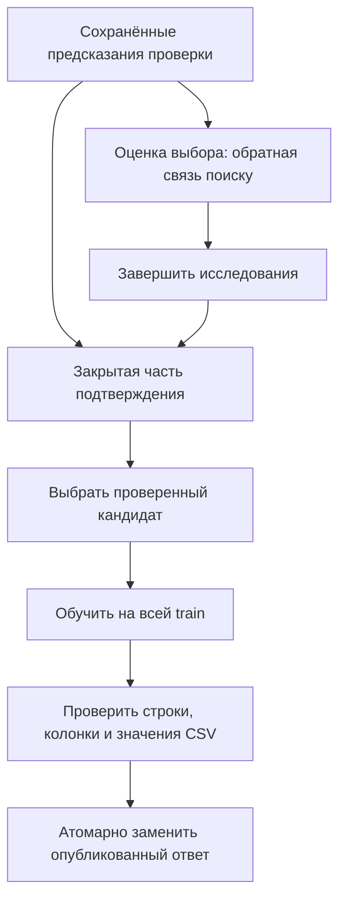

Исследования не возобновляются по результатам закрытого подтверждения. Лучший проверочный опыт и уже опубликованный ответ — разные состояния: полное обучение ещё может не закончиться. [Submission](../agent/submission.py) сохраняет последний проверенный CSV до полной готовности замены; ошибка нового кандидата не стирает старый.

Если закрытое подтверждение возвращает ранее испытанную модель после другого чемпиона, создаётся новое задание подготовки ответа. Его идентичность включает опыт, текущую версию чемпиона и основание окончательного выбора. Повтор запроса в той же ситуации использует прежний результат, а новая ситуация не получает старое завершённое задание по совпавшему имени модели.

## 9. Версии и происхождение

Версия решения описывает код, нормализованные параметры, преобразования, среду и родителей. Опыт добавляет измеренный результат конкретного запуска. У двух исследователей могут быть свои собственные базы при одном лучшем общем результате. Общая таблица измерений не означает, что происхождение их решений смешалось.

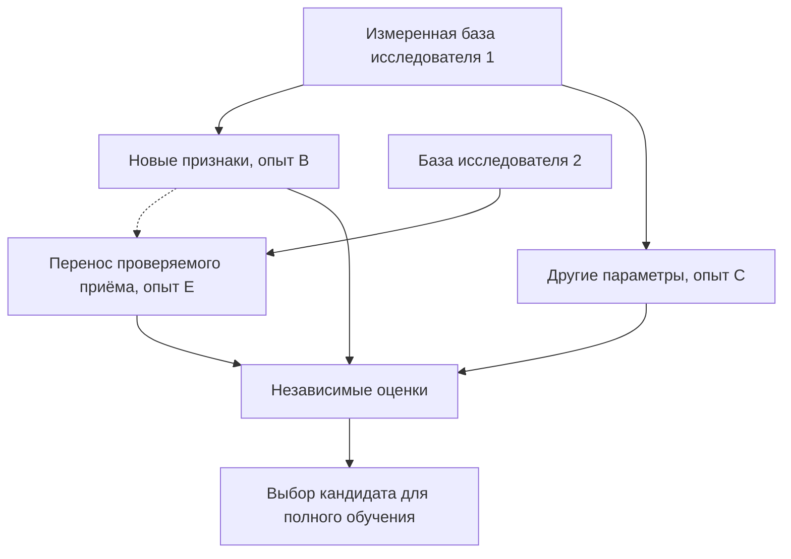

Сплошные стрелки обозначают происхождение или передачу оценки. Пунктир — донорский приём; он не доказывает улучшение нового опыта. Принятие/отклонение идеи в графе не удаляет измерения проигравших решений. В этой работе структура графа сохранена: для подключения моделей достаточно существующих идентичностей и компонентов.

[Constructor](../agent/graph/constructor.py) фиксирует исходники собственной среды исполнения, хеши и версии библиотек. `catalog_verified` означает точное совпадение с собственной фабрикой рецепта; `declared_only` — заявленный смысл произвольного кода. Анализ синтаксиса не доказывает семантику собственного алгоритма. Подробнее о переходах и восстановлении — [GRAPH.md](GRAPH.md).

## 10. Время, очередь и остановка

Разрешение на ресурсы называется `lease`: оно ограничивает владельца, процессоры, память и срок. Только после его получения запускается процесс. По завершении диспетчер сначала останавливает оставшихся потомков и фиксирует событие, затем освобождает ресурсы. Завершение родителя при живом помощнике не считается освобождением машины.

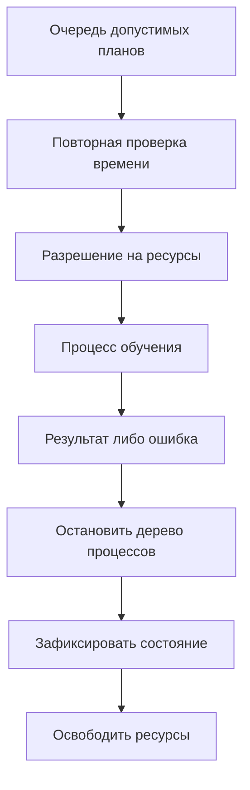

[DurationModel](../agent/duration.py) использует историю соответствующего семейства: длительность обучения, постоянные расходы процесса, число строк/признаков/целей и число потоков. Для деревьев учитываются влияющие на стоимость параметры: например, число деревьев и листья LightGBM, глубина и доли выборки XGBoost. Это осторожная эвристика, не точный прогноз. Тайм-аут — нижняя граница стоимости, а не быстрое успешное обучение.

У собственного кода история дополнительно разделена по `code_artifact_id`: две произвольные программы могут иметь совершенно разную стоимость. Поэтому ссылка на исходник сохраняется даже в краткой записи базы для расчёта срока API-ответа. Старый сохранённый контекст без ссылки получает холодную оценку неизвестного источника и не смешивается с чужими измерениями.

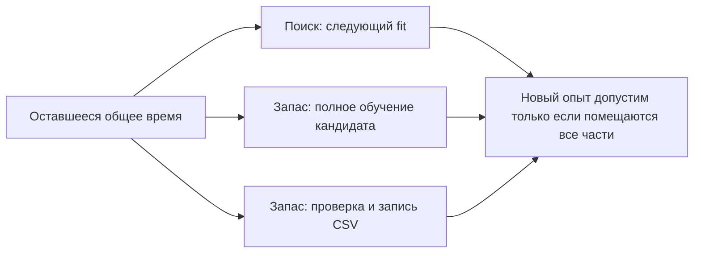

Фазы поиска и доводки по умолчанию разделены долей 85/15; это не отменяет обязательного запаса на окончательное обучение. Нельзя израсходовать его ради ещё одного опыта. Число 12 в старом `MAX_RESEARCH_EXPERIMENTS` не является причиной завершения. После исчерпания API уже разрешённые серии могут продолжаться, пока есть допустимые разные опыты и время. Явный `stop`, отсутствие допустимого продолжения, срок, ресурсная ошибка и плато имеют разные причины в журнале.

Плато означает отсутствие достаточного прогресса по завершённым разным попыткам, а не число повторных API-ответов. В адаптивной фазе доводки собственные признаки и смена семейства не запрещены прежним ограничением рецепта; явно заданные ограничения конкретной ветки всё равно проверяются.

## 11. Файлы и восстановление

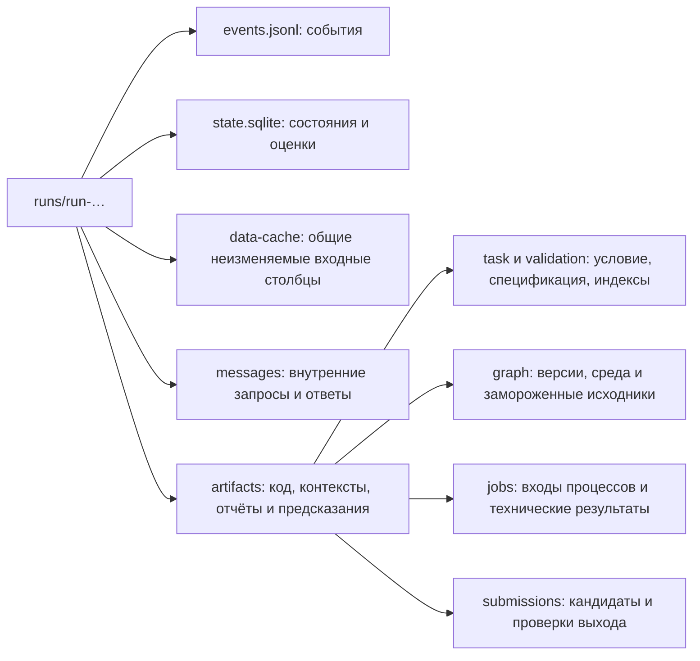

Это карта назначения, а не обещание одинакового физического пути каждого файла: [Artifacts](../agent/artifacts.py) регистрирует `artifact_id` и путь. Начинайте с идентификатора в событии/плане и записи артефакта. `events.jsonl` позволяет связать поручение, API-ответ, `experiment_id`, процесс и оценку; `state.sqlite` хранит согласованные текущие состояния и граф.

Для воспроизведения измеренного решения используйте:

```bash
python scripts/reconstruct_solution.py /path/to/run-… experiment-… /tmp/reproduced
```

Подставьте действительный `experiment_id` из состояния запуска. Если данные перемещены, прочитайте справку `--help` и укажите `--task-root`. Скрипт восстанавливает замороженный код и параметры; наличие произвольных весов joblib не является обязательным условием. Повтор требует совместимой среды и исходных данных. Восстановление решения не означает возобновление всех незавершённых API-диалогов.

## 12. Сквозной искусственный пример

Создайте новую папку: генератор отказывается перезаписывать существующие входы.

```bash
python scripts/make_demo.py /tmp/automl-guide-demo --kind regression --rows 360
AUTOML_PROFILE=development TIME_BUDGET_SECONDS=90 LLM_MAX_CALLS=6 \
  TRAIN_CPU_THREADS=1 GRAPH_MIN_FREE_DISK_BYTES=0 \
  python solution.py /tmp/automl-guide-demo/task.md --llm-mode mock --work-dir /tmp/automl-guide-runs
```

`mock` — явная местная имитация ответов API, понимающая блок `agent-demo` генератора. Настоящие модели при этом обучаются. Она не является запасным поставщиком для реальной задачи и не доказывает качество живой языковой модели.

Здесь генератор создаёт `id`, `x_numeric`, `z_numeric`, `category`, числовую цель `label` и 90 тестовых строк. Условие требует `submission.csv` с колонками `id,label` и RMSE как меру качества. Сначала фиксируется разделение, затем измеряется и публикуется простая опора, после неё выполняются разрешённые опыты. Точное число опытов и лучшая модель зависят от времени и среды.

Пример каталожного предложения для той же задачи:

```json
{
  "action": "catalog",
  "recipe_id": "lightgbm-regressor-v1",
  "hyperparameters": {"n_estimators": 20, "num_leaves": 7, "min_child_samples": 2},
  "hypothesis": "Проверить небольшие деревья на смешанных признаках",
  "expected_effect": "Сравнить с измеренной базой на том же разделении",
  "feature_steps": [], "code": null, "tuning": null, "evidence_ids": []
}
```

Это иллюстрация действительного формата, а не обещание, что местный имитатор выберет именно его. Пропущенные параметры нормализует Catalog. Для классификации используется `lightgbm-classifier-v1`; у XGBoost аналогичные идентификаторы с префиксом `xgboost`.

После запуска проверьте файлы:

```bash
head /tmp/automl-guide-demo/submission.csv
find /tmp/automl-guide-runs -name state.sqlite
```

В CSV должны быть `id,label` и 90 строк данных. В событиях ищите `job.started`, `job.finished`, события оценки/публикации и `run.finished`. Не считайте наличие только `job.started` успешным опытом.

Для воспроизводимой проверки обеих новых библиотек выполните:

```bash
python -m unittest tests.test_library_integration -v
```

Этот сценарий действительно обучает классификаторы и регрессоры с пропусками/категориями, проверяет возврат строковых меток и вероятностей. Затем оба семейства проходят `train` и `refit` в защищённых процессах с программой признаков на 90 обучающих строках: 60 для обучения, 30 для предсказаний проверки и 12 тестовых. Временные файлы теста удаляются после проверки. Результаты выполненной проверки и её границы записаны в [LIBRARY_REVIEW.md](LIBRARY_REVIEW.md); выдуманных соревновательных оценок здесь нет.

## 13. Разбор ошибок

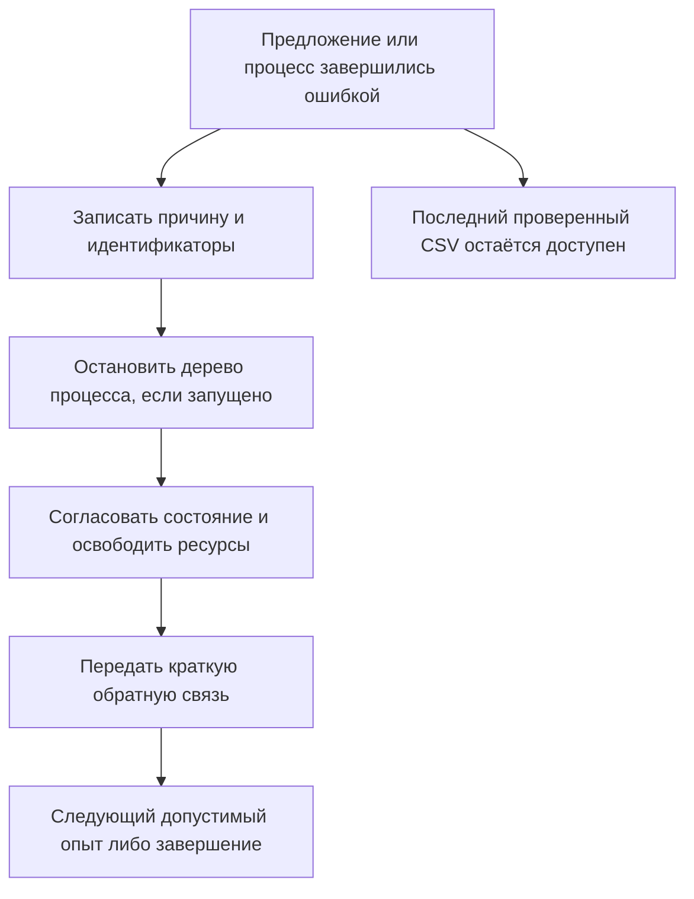

Стрелка к сохранённому CSV означает гарантию сохранности, а не публикацию неудачного кандидата. Причина ошибки должна быть конкретной: недопустимые параметры, несовместимое происхождение, отсутствие пакета, ошибка обучения, срок или память.

| Симптом | Где смотреть и что проверять |
|---|---|
| Нет первого ответа | События начальной подготовки, ошибки спецификации и разделения, журнал процесса Dummy |
| Предложение отклонено до обучения | Ответ контракта, `research_feedback`, доступность рецепта, ресурсы и ссылки на версии |
| LightGBM не импортируется | `libgomp.so.1`, установленная версия и подготовка Ubuntu; не запускать установку из опыта |
| Собственный код не читает файл | Данные передаются Runner; произвольный доступ к диску закрыт намеренно |
| Оценка есть, новый CSV отсутствует | Состояние полного обучения и проверки вывода, сохранённый чемпион |
| Поиск закончился рано | Явный `stop_reason`, остаток времени, прогноз следующего fit/refit, доступность API и разрешённой серии |
| Много похожих опытов | Область Optuna, отпечатки, замены дубликатов и фактические разные параметры |
| Зависший процесс | События отмены, дерево процессов и активные разрешения; не освобождать их вручную до остановки |

Обычный вывод содержит наблюдаемые этапы и основания решений. Подробности остаются в [журнале](LOGGING.md). Гипотеза языковой модели — явное предложение; скрытые рассуждения не придумываются и не считаются измерением.

## 14. Развитие и поставка

**Новый анализ.** Добавьте операцию в `ANALYSIS_SCHEMA` и AnalysisService, сохраните ограничение обучающими строками и объёмом ответа. Проверьте фильтр до выборки, закрытые цели, охват и повторное использование отчёта. Обновите контекст/документацию инструмента. Не добавляйте модельный выбор в сервис фактов.

**Новое семейство.** Сначала проверьте разрешённую версию. Добавьте домены параметров в `recipes/catalog.json`, фабрику в `build_pipeline`, точное описание подготовки, стоимость в DurationModel и происхождение пакета в Constructor. Если семейство участвует в программах признаков, подготовьте импорт до включения защиты и лимитов потоков. Проверьте метки/вероятности, ресурсы, train/refit, независимую оценку и восстановление. Один `import` в контроллере не является завершённой интеграцией.

**Новый исследовательский приём.** Предпочитайте существующие `features`, `pipeline` и ограниченный `tune`. Если формат действия действительно меняется, согласованно меняйте схему, производителя, обработчик, примеры и проверки. Знание о возможном приёме не становится обязательным ограничением ветки без проверяемого основания.

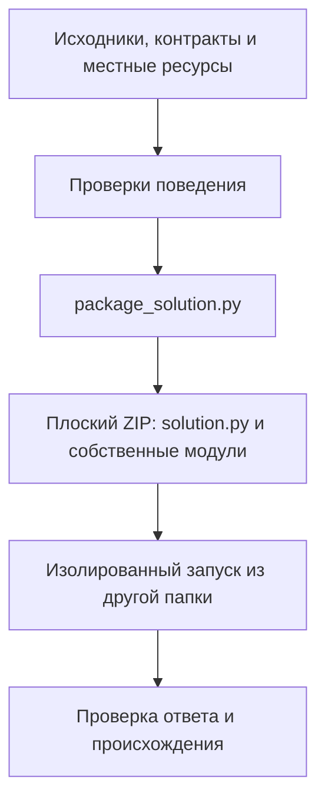

Платформа копирует только корневые `.py` и `requirements.txt`. [Сборщик](../scripts/package_solution.py) экспортирует каждый собственный модуль читаемым и побайтно совпадающим с исходником; текстовые ресурсы находятся в `stepan_resources.py`. При запуске они восстанавливаются во временное дерево пакетов. Архив всего репозитория не является платформенной поставкой.

```bash
python scripts/check.py --jobs 3
python scripts/package_solution.py --help
```

Первая команда проверяет межмодульное поведение. Linux необходим для полной проверки групп процессов. Перед публикацией сопоставляйте результат с точной проверенной версией исходников; успех на искусственной задаче не устанавливает преимущество на Kaggle/MLE-bench. Пределы этого прохода перечислены в [отчёте](LIBRARY_REVIEW.md).
